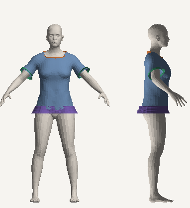
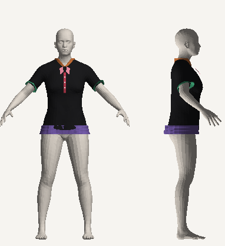
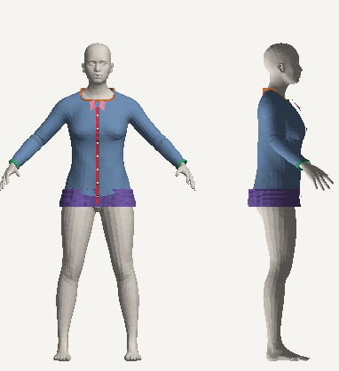
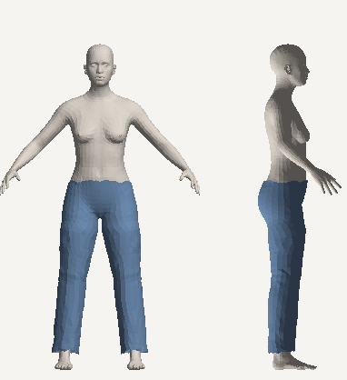

<!-- gerado por lib/avatar3d/matriz3d/matriz3d.test.ts (MATRIZ3D_WRITE=1) — não editar à mão -->
# MATRIZ-3D — relatório gerado

Versões: taxonomia 1.0.0 · molde `fai-mould-skinwrap-v2` · contrato 1.0.0 · corpo `fai-body-v1`.

Legenda: ✔ implementado e validado · ◐ implementado, sem validação · ◑ parcial · ✖ ausente · — não aplicável.

## Cobertura

| Estado | Células |
|---|---:|
| ✔ Implementado e validado | 683 |
| ◐ Implementado, sem validação | 392 |
| ◑ Parcial | 162 |
| ✖ Ausente | 339 |
| — Não aplicável | 723 |

## Subcategoria × grupo (pior estado entre os componentes que se aplicam)

| Subcategoria | Molde | Assets padrão | Mangas | Gola e decote | Botões | Casas e fechamento | Costuras | Corpo da peça | Cintura e acabamento | Detalhes | Aparência | Vestibilidade | Calçados | Acessórios |
|---|---|:-:|:-:|:-:|:-:|:-:|:-:|:-:|:-:|:-:|:-:|:-:|:-:|:-:|
| `t_shirt` | tee | ✔ 4/4 | ✖ 2/5 | ◐ 3/4 | — | — | ✖ 0/2 | ✖ 4/6 | — | ◐ | ✖ 2/7 | ✖ 5/6 | — | — |
| `shirt` | shirt | ◐ 2/3 | ✖ 2/5 | ✖ 3/6 | ◑ 2/3 | ✖ 1/2 | ✖ 1/3 | ✖ 4/6 | — | ✖ 0/2 | ✖ 2/7 | ✖ 2/6 | — | — |
| `blouse` | shirt | ◐ 2/3 | ✖ 2/5 | ◐ 3/4 | — | ✖ | ✖ 0/2 | ✖ 4/6 | — | ◐ | ✖ 2/7 | ✖ 2/6 | — | — |
| `tank_top` | tank | ◐ 2/3 | ◐ | ◐ 2/4 | — | — | ✖ 0/2 | ✖ 2/6 | — | ◑ 0/2 | ✖ 1/7 | ✖ 2/6 | — | — |
| `top` | tank | ◐ 2/3 | ✖ 1/5 | ◐ 2/4 | — | ✖ | ✖ 0/2 | ✖ 2/6 | — | ◐ | ✖ 1/7 | ✖ 2/6 | — | — |
| `crop_top` (legado) | crop | ◐ 2/3 | ✖ 1/5 | ◐ 2/4 | — | — | ✖ 0/2 | ✖ 2/5 | — | ◐ | ✖ 1/7 | ✖ 2/6 | — | — |
| `polo_shirt` | shirt | ◐ 2/3 | ✖ 2/5 | ✖ 3/6 | ✔ | ✖ 1/2 | ✖ 0/2 | ✖ 4/6 | — | ◐ | ✖ 2/7 | ✖ 2/6 | — | — |
| `bodysuit` | tank | ◐ 2/3 | ✖ 1/6 | ◐ 2/4 | — | ✖ | ✖ 0/2 | ✖ 2/6 | — | ◑ 0/2 | ✖ 1/7 | ✖ 2/6 | — | — |
| `sweater` | sweater | ✔ 3/3 | ✖ 2/5 | ◐ 2/4 | — | — | ✖ 0/2 | ✖ 4/6 | — | ◐ | ✖ 2/7 | ✖ 3/6 | — | — |
| `sweatshirt` | sweater | ✔ 3/3 | ✖ 2/5 | ◐ 2/4 | — | — | ✖ 0/2 | ✖ 4/6 | — | ◐ | ✖ 2/7 | ✖ 3/6 | — | — |
| `hoodie` | hoodie | ◐ 2/3 | ✖ 1/5 | ◐ 2/4 | — | — | ✖ 0/2 | ✖ 3/6 | — | ✖ 0/3 | ✖ 1/7 | ✖ 2/6 | — | — |
| `cardigan` | jacket | ✔ 3/3 | ✖ 2/5 | ✔ 2/2 | ✖ | ✖ 0/4 | ✖ 0/2 | ✖ 5/6 | — | ◐ | ✖ 1/7 | ✖ 4/6 | — | — |
| `vest` | vest | ◐ 2/3 | ◐ | ✔ 2/2 | — | ◑ | ✖ 0/2 | ✖ 2/6 | — | ◐ | ✖ 1/7 | ✖ 2/6 | — | — |
| `blazer` | jacket | ✔ 3/3 | ✖ 2/5 | ✖ 2/3 | ✖ | ✖ 0/3 | ✖ 0/2 | ✖ 5/6 | ✖ | ✖ 0/2 | ✖ 1/7 | ✖ 4/6 | — | — |
| `jacket` | jacket | ✔ 3/3 | ✖ 2/5 | ✔ 2/2 | — | ✖ 0/2 | ✖ 0/2 | ✖ 5/6 | — | ✖ 0/2 | ✖ 1/7 | ✖ 4/6 | — | — |
| `coat` | coat | ✔ 3/3 | ✖ 2/5 | ✖ 2/3 | ✖ | ✖ 0/4 | ✖ 0/2 | ✖ 4/6 | ✖ | ✖ 0/2 | ✖ 1/7 | ✖ 4/6 | — | — |
| `parka` | coat | ✔ 3/3 | ✖ 2/5 | ✔ 2/2 | — | ✖ 0/2 | ✖ 0/2 | ✖ 4/6 | ✖ | ✖ 0/4 | ✖ 1/7 | ✖ 4/6 | — | — |
| `windbreaker` | jacket | ✔ 3/3 | ✖ 2/5 | ✔ 2/2 | — | ✖ 0/2 | ✖ 0/2 | ✖ 5/6 | — | ✖ 0/2 | ✖ 1/7 | ✖ 4/6 | — | — |
| `kimono` | jacket | ✔ 3/3 | ✖ 2/5 | ✔ 2/2 | — | ◑ | ✖ 0/2 | ✖ 5/6 | — | ◐ | ✖ 1/7 | ✖ 4/6 | — | — |
| `jeans` | pants | ✔ 4/4 | — | — | — | ✖ | ✖ 0/2 | ✖ 3/4 | ✖ 1/4 | ✖ 0/2 | ✖ 3/7 | ✖ 5/6 | — | — |
| `tailored_pants` | pants | ✔ 3/3 | — | — | — | ✖ | ✖ 0/2 | ✖ 3/4 | ✖ 1/4 | ✖ 0/3 | ✖ 3/7 | ✖ 5/6 | — | — |
| `casual_pants` | pants | ✔ 3/3 | — | — | — | ✖ | ✖ 0/2 | ✖ 3/4 | ✖ 1/4 | ✖ 0/2 | ✖ 3/7 | ✖ 5/6 | — | — |
| `chino_pants` | pants | ✔ 3/3 | — | — | — | ✖ | ✖ 0/2 | ✖ 3/4 | ✖ 1/4 | ✖ 0/2 | ✖ 3/7 | ✖ 5/6 | — | — |
| `cargo_pants` | pants | ✔ 3/3 | — | — | — | ✖ | ✖ 0/2 | ✖ 3/4 | ✖ 1/4 | ✖ 0/2 | ✖ 3/7 | ✖ 5/6 | — | — |
| `jogger_pants` | pants | ✔ 3/3 | — | — | — | — | ✖ 0/2 | ✖ 3/4 | ✖ 1/5 | ✖ 0/2 | ✖ 3/7 | ✖ 5/6 | — | — |
| `sweatpants` | pants | ✔ 3/3 | — | — | — | — | ✖ 0/2 | ✖ 3/4 | ✖ 1/5 | ✖ 0/2 | ✖ 3/7 | ✖ 5/6 | — | — |
| `leggings` | leggings | ◐ 2/3 | — | — | — | — | ✖ 0/2 | ✖ 2/4 | ✖ 0/3 | ◐ | ✖ 1/7 | ✖ 2/6 | — | — |
| `culottes` | culottes | ◐ 2/3 | — | — | — | ✖ | ✖ 0/2 | ✖ 2/4 | ◑ 0/3 | ✖ 0/2 | ✖ 1/7 | ✖ 2/6 | — | — |
| `shorts` | shorts | ◐ 2/3 | — | — | — | — | ✖ 0/2 | ✖ 2/4 | ◑ 0/2 | ✖ 0/2 | ✖ 1/7 | ✖ 2/6 | — | — |
| `bermuda_shorts` (legado) | bermuda | ◐ 2/3 | — | — | — | ✖ | ✖ 0/2 | ✖ 2/4 | ✖ 0/4 | ✖ 0/2 | ✖ 1/7 | ✖ 2/6 | — | — |
| `denim_shorts` (legado) | shorts | ◐ 2/3 | — | — | — | ✖ | ✖ 0/2 | ✖ 2/4 | ✖ 0/3 | ✖ 0/2 | ✖ 1/7 | ✖ 2/6 | — | — |
| `skirt` | skirt | ✔ 3/3 | — | — | — | ✖ | ✖ 0/2 | ✖ 4/5 | ◑ | ✖ 0/3 | ✖ 2/7 | ✖ 3/6 | — | — |
| `skort` | skirt | ✔ 3/3 | — | — | — | ✖ | ✖ 0/2 | ✖ 4/5 | ◑ | ◐ | ✖ 2/7 | ✖ 3/6 | — | — |
| `dress` | dress | ✔ 3/3 | ✖ 1/6 | ◐ 2/4 | — | ✖ | ✖ 0/2 | ✖ 5/6 | — | ✖ 0/4 | ✖ 2/7 | ✖ 4/6 | — | — |
| `jumpsuit` | jumpsuit | ◐ 2/3 | ✖ 1/6 | ◐ 2/4 | — | ✖ | ✖ 0/2 | ✖ 2/5 | ◑ 0/3 | ◑ 0/2 | ✖ 1/7 | ✖ 2/6 | — | — |
| `romper` | romper | ◐ 2/3 | ✖ 1/6 | ◐ 2/4 | — | ✖ | ✖ 0/2 | ✖ 2/5 | ◑ 0/2 | ◑ 0/2 | ✖ 1/7 | ✖ 2/6 | — | — |
| `matching_set` | jumpsuit | ◐ 2/3 | ✖ 1/5 | ◐ 2/4 | — | — | ✖ 0/2 | ✖ 2/5 | ◑ 0/2 | ◐ | ✖ 1/7 | ✖ 2/6 | — | — |
| `overalls` | jumpsuit | ◐ 2/3 | ◐ | ✔ 2/2 | — | — | ✖ 0/2 | ✖ 2/5 | ◑ 0/3 | ✖ 0/3 | ✖ 1/7 | ✖ 2/6 | — | — |
| `casual_sneakers` | shoes | ◑ 3/4 | — | — | — | ◐ | — | — | — | — | ✔ | ◐ 2/3 | ✖ 1/4 | — |
| `running_shoes` | shoes | ✔ 3/3 | — | — | — | ◐ | — | — | — | — | ✔ | ◐ 2/3 | ✖ 1/4 | — |
| `training_shoes` | shoes | ✔ 3/3 | — | — | — | ◐ | — | — | — | — | ✔ | ◐ 2/3 | ✖ 1/4 | — |
| `basketball_shoes` | shoes | ✔ 3/3 | — | — | — | ◐ | — | — | — | — | ✔ | ◐ 2/3 | ✖ 1/4 | — |
| `skate_shoes` | shoes | ✔ 3/3 | — | — | — | ◐ | — | — | — | — | ✔ | ◐ 2/3 | ✖ 1/4 | — |
| `high_top_sneakers` (legado) | shoes | ✔ 3/3 | — | — | — | ◐ | — | — | — | — | ✔ | ◐ 2/3 | ✖ 1/5 | — |
| `loafers` | shoes | ✔ 3/3 | — | — | — | — | — | — | — | — | ✔ | ◐ 2/3 | ✖ 1/4 | — |
| `moccasins` | shoes | ✔ 3/3 | — | — | — | — | — | — | — | — | ✔ | ◐ 2/3 | ✖ 1/4 | — |
| `oxford_shoes` | shoes | ✔ 3/3 | — | — | — | ◐ | — | — | — | — | ✔ | ◐ 2/3 | ✖ 1/4 | — |
| `derby_shoes` | shoes | ✔ 3/3 | — | — | — | ◐ | — | — | — | — | ✔ | ◐ 2/3 | ✖ 1/4 | — |
| `boots` | boots | ✔ 4/4 | — | — | — | — | — | — | — | — | ✔ | ◐ 2/3 | ◐ 2/4 | — |
| `ankle_boots` (legado) | boots | ✔ 4/4 | — | — | — | — | — | — | — | — | ✔ | ◐ 2/3 | ◐ 2/4 | — |
| `long_boots` (legado) | boots | ✔ 4/4 | — | — | — | — | — | — | — | — | ✔ | ◐ 2/3 | ◐ 2/4 | — |
| `combat_boots` (legado) | boots | ✔ 4/4 | — | — | — | ✖ | — | — | — | — | ✔ | ◐ 2/3 | ✖ 2/5 | — |
| `sandals` | shoes | ◑ 2/3 | — | — | — | — | — | — | — | — | ✔ | ◐ 2/3 | ✖ 1/4 | — |
| `flip_flops` | shoes | ◑ 2/3 | — | — | — | — | — | — | — | — | ✔ | ◐ 2/3 | ✖ 1/4 | — |
| `heels` | shoes | ◑ 2/3 | — | — | — | — | — | — | — | — | ✔ | ◐ 2/3 | ✖ 1/5 | — |
| `flats` | shoes | ✔ 3/3 | — | — | — | — | — | — | — | — | ✔ | ◐ 2/3 | ✖ 1/4 | — |
| `espadrilles` | shoes | ◑ 2/3 | — | — | — | — | — | — | — | — | ✔ | ◐ 2/3 | ✖ 1/4 | — |
| `handbag` | — | ✔ | — | — | — | — | — | — | — | — | — | — | — | ✖ 1/4 |
| `crossbody_bag` (legado) | — | ✔ | — | — | — | — | — | — | — | — | — | — | — | ✖ 1/4 |
| `tote_bag` | — | ✔ | — | — | — | — | — | — | — | — | — | — | — | ✖ 1/4 |
| `clutch` | — | ✔ | — | — | — | — | — | — | — | — | — | — | — | ✖ 1/4 |
| `backpack` | — | ✔ | — | — | — | — | — | — | — | — | — | — | — | ✖ 1/4 |
| `belt` | — | ✔ | — | — | — | — | — | — | — | — | — | — | — | ✖ 1/4 |
| `cap` | — | ✔ | — | — | — | — | — | — | — | — | — | — | — | ✖ 1/2 |
| `hat` | — | ✔ | — | — | — | — | — | — | — | — | — | — | — | ✖ 1/2 |
| `beanie` | — | ✔ | — | — | — | — | — | — | — | — | — | — | — | ✖ 1/2 |
| `scarf` | — | ✔ | — | — | — | — | — | — | — | — | — | — | — | ✖ 1/2 |
| `tie` | — | ✔ | — | — | — | — | — | — | — | — | — | — | — | ✖ 1/2 |
| `bow_tie` | — | ✔ | — | — | — | — | — | — | — | — | — | — | — | ✖ 1/2 |
| `sunglasses` | — | ✔ | — | — | — | — | — | — | — | — | — | — | — | ✖ 1/3 |
| `eyeglasses` | — | ✔ | — | — | — | — | — | — | — | — | — | — | — | ✖ 1/3 |
| `necklace` | — | ✔ | — | — | — | — | — | — | — | — | — | — | — | ✖ 1/4 |
| `bracelet` | — | ✔ | — | — | — | — | — | — | — | — | — | — | — | ✖ 1/4 |
| `earrings` | — | ✔ | — | — | — | — | — | — | — | — | — | — | — | ✖ 1/3 |
| `ring` | — | ✔ | — | — | — | — | — | — | — | — | — | — | — | ✖ 1/3 |
| `watch` | — | ✔ | — | — | — | — | — | — | — | — | — | — | — | ✖ 1/5 |
| `wallet` | — | ✔ | — | — | — | — | — | — | — | — | — | — | — | ✖ 1/2 |
| `gloves` | — | ✔ | — | — | — | — | — | — | — | — | — | — | — | ✖ 1/2 |
| `socks` | — | ✔ | — | — | — | — | — | — | — | — | — | — | — | ✖ 1/2 |
| `hair_accessory` | — | ✔ | — | — | — | — | — | — | — | — | — | — | — | ✖ 1/3 |

## Lacuna principal por subcategoria

| Subcategoria | Estado de suporte | Principal lacuna |
|---|---|---|
| `t_shirt` | molde estimado (ESTIMADA) · ✔20 ◐7 ◑2 ✖6 | Tipo de inserção (raglan, ombro caído, dolman, bufante): SLEEVE_STYLE não é lido: toda manga nasce da pele do braço, sem costura de inserção nem volume |
| `shirt` | molde estimado (ESTIMADA) · ✔19 ◐11 ◑4 ✖9 | Tipo de inserção (raglan, ombro caído, dolman, bufante): SLEEVE_STYLE não é lido: toda manga nasce da pele do braço, sem costura de inserção nem volume |
| `blouse` | molde estimado (ESTIMADA) · ✔15 ◐11 ◑2 ✖7 | Tipo de inserção (raglan, ombro caído, dolman, bufante): SLEEVE_STYLE não é lido: toda manga nasce da pele do braço, sem costura de inserção nem volume |
| `tank_top` | molde estimado (ESTIMADA) · ✔9 ◐14 ◑3 ✖5 | Alças: a alça é o que sobra entre decote e cava: largura não é parâmetro |
| `top` | molde estimado (ESTIMADA) · ✔10 ◐16 ◑2 ✖7 | Tipo de inserção (raglan, ombro caído, dolman, bufante): SLEEVE_STYLE não é lido: toda manga nasce da pele do braço, sem costura de inserção nem volume |
| `crop_top` | molde estimado (ESTIMADA) · ✔10 ◐16 ◑2 ✖5 | Tipo de inserção (raglan, ombro caído, dolman, bufante): SLEEVE_STYLE não é lido: toda manga nasce da pele do braço, sem costura de inserção nem volume |
| `polo_shirt` | molde estimado (ESTIMADA) · ✔17 ◐11 ◑3 ✖8 | Tipo de inserção (raglan, ombro caído, dolman, bufante): SLEEVE_STYLE não é lido: toda manga nasce da pele do braço, sem costura de inserção nem volume |
| `bodysuit` | molde estimado (ESTIMADA) · ✔10 ◐17 ◑3 ✖7 | Alças: a alça é o que sobra entre decote e cava: largura não é parâmetro |
| `sweater` | molde estimado (ESTIMADA) · ✔16 ◐10 ◑2 ✖6 | Tipo de inserção (raglan, ombro caído, dolman, bufante): SLEEVE_STYLE não é lido: toda manga nasce da pele do braço, sem costura de inserção nem volume |
| `sweatshirt` | molde estimado (ESTIMADA) · ✔16 ◐10 ◑2 ✖6 | Tipo de inserção (raglan, ombro caído, dolman, bufante): SLEEVE_STYLE não é lido: toda manga nasce da pele do braço, sem costura de inserção nem volume |
| `hoodie` | molde estimado (ESTIMADA) · ✔11 ◐15 ◑2 ✖8 | Capuz: moletom com capuz sai sem capuz |
| `cardigan` | molde estimado (ESTIMADA) · ✔17 ◐7 ◑3 ✖10 | Abertura frontal (peça aberta na frente): declarada aberta, mas a casca da frente é fechada (sem as duas bordas nem sobreposição) |
| `vest` | molde estimado (ESTIMADA) · ✔9 ◐12 ◑3 ✖5 | Abertura frontal (peça aberta na frente): declarada aberta, mas a casca da frente é fechada (sem as duas bordas nem sobreposição) |
| `blazer` | molde estimado (ESTIMADA) · ✔17 ◐7 ◑3 ✖12 | Lapela: blazer e casaco sem lapela (a frente é a casca fechada) |
| `jacket` | molde estimado (ESTIMADA) · ✔17 ◐7 ◑3 ✖8 | Abertura frontal (peça aberta na frente): declarada aberta, mas a casca da frente é fechada (sem as duas bordas nem sobreposição) |
| `coat` | molde estimado (ESTIMADA) · ✔16 ◐8 ◑3 ✖13 | Lapela: blazer e casaco sem lapela (a frente é a casca fechada) |
| `parka` | molde estimado (ESTIMADA) · ✔16 ◐8 ◑3 ✖11 | Abertura frontal (peça aberta na frente): declarada aberta, mas a casca da frente é fechada (sem as duas bordas nem sobreposição) |
| `windbreaker` | molde estimado (ESTIMADA) · ✔17 ◐7 ◑3 ✖8 | Abertura frontal (peça aberta na frente): declarada aberta, mas a casca da frente é fechada (sem as duas bordas nem sobreposição) |
| `kimono` | molde estimado (ESTIMADA) · ✔17 ◐7 ◑3 ✖6 | Abertura frontal (peça aberta na frente): declarada aberta, mas a casca da frente é fechada (sem as duas bordas nem sobreposição) |
| `jeans` | molde estimado (ESTIMADA) · ✔16 ◐2 ◑5 ✖7 | Braguilha e botão do cós: jeans e calças sem braguilha nem botão do cós |
| `tailored_pants` | molde estimado (ESTIMADA) · ✔15 ◐2 ◑5 ✖8 | Braguilha e botão do cós: jeans e calças sem braguilha nem botão do cós |
| `casual_pants` | molde estimado (ESTIMADA) · ✔15 ◐2 ◑5 ✖7 | Braguilha e botão do cós: jeans e calças sem braguilha nem botão do cós |
| `chino_pants` | molde estimado (ESTIMADA) · ✔15 ◐2 ◑5 ✖7 | Braguilha e botão do cós: jeans e calças sem braguilha nem botão do cós |
| `cargo_pants` | molde estimado (ESTIMADA) · ✔15 ◐2 ◑5 ✖7 | Braguilha e botão do cós: jeans e calças sem braguilha nem botão do cós |
| `jogger_pants` | molde estimado (ESTIMADA) · ✔15 ◐2 ◑5 ✖7 | Costura que une painéis (ombro, lateral, manga, entrepernas): a peça é uma malha contínua sem painéis: nenhuma costura estrutural nem simulação de costura |
| `sweatpants` | molde estimado (ESTIMADA) · ✔15 ◐2 ◑5 ✖7 | Costura que une painéis (ombro, lateral, manga, entrepernas): a peça é uma malha contínua sem painéis: nenhuma costura estrutural nem simulação de costura |
| `leggings` | molde estimado (ESTIMADA) · ✔7 ◐9 ◑5 ✖5 | Costura que une painéis (ombro, lateral, manga, entrepernas): a peça é uma malha contínua sem painéis: nenhuma costura estrutural nem simulação de costura |
| `culottes` | molde estimado (ESTIMADA) · ✔7 ◐10 ◑5 ✖6 | Costura que une painéis (ombro, lateral, manga, entrepernas): a peça é uma malha contínua sem painéis: nenhuma costura estrutural nem simulação de costura |
| `shorts` | molde estimado (ESTIMADA) · ✔7 ◐9 ◑5 ✖5 | Costura que une painéis (ombro, lateral, manga, entrepernas): a peça é uma malha contínua sem painéis: nenhuma costura estrutural nem simulação de costura |
| `bermuda_shorts` | molde estimado (ESTIMADA) · ✔7 ◐10 ◑5 ✖7 | Braguilha e botão do cós: jeans e calças sem braguilha nem botão do cós |
| `denim_shorts` | molde estimado (ESTIMADA) · ✔7 ◐9 ◑5 ✖7 | Braguilha e botão do cós: jeans e calças sem braguilha nem botão do cós |
| `skirt` | molde estimado (ESTIMADA) · ✔12 ◐5 ◑4 ✖7 | Costura que une painéis (ombro, lateral, manga, entrepernas): a peça é uma malha contínua sem painéis: nenhuma costura estrutural nem simulação de costura |
| `skort` | molde estimado (ESTIMADA) · ✔12 ◐5 ◑4 ✖5 | Costura que une painéis (ombro, lateral, manga, entrepernas): a peça é uma malha contínua sem painéis: nenhuma costura estrutural nem simulação de costura |
| `dress` | molde estimado (ESTIMADA) · ✔17 ◐10 ◑4 ✖8 | Alças: a alça é o que sobra entre decote e cava: largura não é parâmetro |
| `jumpsuit` | molde estimado (ESTIMADA) · ✔10 ◐17 ◑6 ✖6 | Alças: a alça é o que sobra entre decote e cava: largura não é parâmetro |
| `romper` | molde estimado (ESTIMADA) · ✔10 ◐16 ◑6 ✖6 | Alças: a alça é o que sobra entre decote e cava: largura não é parâmetro |
| `matching_set` | molde estimado (ESTIMADA) · ✔10 ◐15 ◑5 ✖5 | Tipo de inserção (raglan, ombro caído, dolman, bufante): SLEEVE_STYLE não é lido: toda manga nasce da pele do braço, sem costura de inserção nem volume |
| `overalls` | molde estimado (ESTIMADA) · ✔9 ◐12 ◑6 ✖5 | Alças: a alça é o que sobra entre decote e cava: largura não é parâmetro |
| `casual_sneakers` | molde estimado (ESTIMADA) · ✔7 ◐3 ◑2 ✖1 | Peça padrão da zona (avatar nunca sem roupa): a peça padrão dos pés usa a subcategoria "sneakers", que não existe na taxonomia (o molde sai certo por kindOf) |
| `running_shoes` | molde estimado (ESTIMADA) · ✔7 ◐3 ◑1 ✖1 | Colarinho (abertura do tornozelo): tênis/sapato: a abertura é a borda do cabedal, sem acolchoado |
| `training_shoes` | molde estimado (ESTIMADA) · ✔7 ◐3 ◑1 ✖1 | Colarinho (abertura do tornozelo): tênis/sapato: a abertura é a borda do cabedal, sem acolchoado |
| `basketball_shoes` | molde estimado (ESTIMADA) · ✔7 ◐3 ◑1 ✖1 | Colarinho (abertura do tornozelo): tênis/sapato: a abertura é a borda do cabedal, sem acolchoado |
| `skate_shoes` | molde estimado (ESTIMADA) · ✔7 ◐3 ◑1 ✖1 | Colarinho (abertura do tornozelo): tênis/sapato: a abertura é a borda do cabedal, sem acolchoado |
| `high_top_sneakers` | molde estimado (ESTIMADA) · ✔7 ◐3 ◑1 ✖2 | Colarinho (abertura do tornozelo): tênis/sapato: a abertura é a borda do cabedal, sem acolchoado |
| `loafers` | molde estimado (ESTIMADA) · ✔7 ◐2 ◑1 ✖1 | Colarinho (abertura do tornozelo): tênis/sapato: a abertura é a borda do cabedal, sem acolchoado |
| `moccasins` | molde estimado (ESTIMADA) · ✔7 ◐2 ◑1 ✖1 | Colarinho (abertura do tornozelo): tênis/sapato: a abertura é a borda do cabedal, sem acolchoado |
| `oxford_shoes` | molde estimado (ESTIMADA) · ✔7 ◐3 ◑1 ✖1 | Colarinho (abertura do tornozelo): tênis/sapato: a abertura é a borda do cabedal, sem acolchoado |
| `derby_shoes` | molde estimado (ESTIMADA) · ✔7 ◐3 ◑1 ✖1 | Colarinho (abertura do tornozelo): tênis/sapato: a abertura é a borda do cabedal, sem acolchoado |
| `boots` | molde estimado (ESTIMADA) · ✔9 ◐3 ◑0 ✖0 | — |
| `ankle_boots` | molde estimado (ESTIMADA) · ✔9 ◐3 ◑0 ✖0 | — |
| `long_boots` | molde estimado (ESTIMADA) · ✔9 ◐3 ◑0 ✖0 | — |
| `combat_boots` | molde estimado (ESTIMADA) · ✔9 ◐3 ◑0 ✖2 | Amarração (cadarço): existe na biblioteca (shoes.ts#cadarco), mas o molde boots não o recebe |
| `sandals` | molde estimado (ESTIMADA) · ✔6 ◐2 ◑1 ✖2 | Tiras abertas (sandália, chinelo): sandália e chinelo viram sapato fechado (KNOWN_LIMITS) |
| `flip_flops` | molde estimado (ESTIMADA) · ✔6 ◐2 ◑1 ✖2 | Tiras abertas (sandália, chinelo): sandália e chinelo viram sapato fechado (KNOWN_LIMITS) |
| `heels` | molde estimado (ESTIMADA) · ✔6 ◐2 ◑1 ✖3 | Salto: salto alto vira sapato baixo (KNOWN_LIMITS) |
| `flats` | molde estimado (ESTIMADA) · ✔7 ◐2 ◑1 ✖1 | Colarinho (abertura do tornozelo): tênis/sapato: a abertura é a borda do cabedal, sem acolchoado |
| `espadrilles` | molde estimado (ESTIMADA) · ✔6 ◐2 ◑1 ✖2 | Tiras abertas (sandália, chinelo): sandália e chinelo viram sapato fechado (KNOWN_LIMITS) |
| `handbag` | SEM_3D (só prévia 2D) | Fixação no corpo (osso âncora): estratégia "fixo-no-osso" declarada em STRATEGIES, sem implementação |
| `crossbody_bag` | SEM_3D (só prévia 2D) | Fixação no corpo (osso âncora): estratégia "fixo-no-osso" declarada em STRATEGIES, sem implementação |
| `tote_bag` | SEM_3D (só prévia 2D) | Fixação no corpo (osso âncora): estratégia "fixo-no-osso" declarada em STRATEGIES, sem implementação |
| `clutch` | SEM_3D (só prévia 2D) | Fixação no corpo (osso âncora): estratégia "fixo-no-osso" declarada em STRATEGIES, sem implementação |
| `backpack` | SEM_3D (só prévia 2D) | Fixação no corpo (osso âncora): estratégia "fixo-no-osso" declarada em STRATEGIES, sem implementação |
| `belt` | SEM_3D (só prévia 2D) | Fixação no corpo (osso âncora): estratégia "fixo-no-osso" declarada em STRATEGIES, sem implementação |
| `cap` | SEM_3D (só prévia 2D) | Fixação no corpo (osso âncora): estratégia "fixo-no-osso" declarada em STRATEGIES, sem implementação |
| `hat` | SEM_3D (só prévia 2D) | Fixação no corpo (osso âncora): estratégia "fixo-no-osso" declarada em STRATEGIES, sem implementação |
| `beanie` | SEM_3D (só prévia 2D) | Fixação no corpo (osso âncora): estratégia "fixo-no-osso" declarada em STRATEGIES, sem implementação |
| `scarf` | SEM_3D (só prévia 2D) | Fixação no corpo (osso âncora): estratégia "fixo-no-osso" declarada em STRATEGIES, sem implementação |
| `tie` | SEM_3D (só prévia 2D) | Fixação no corpo (osso âncora): estratégia "fixo-no-osso" declarada em STRATEGIES, sem implementação |
| `bow_tie` | SEM_3D (só prévia 2D) | Fixação no corpo (osso âncora): estratégia "fixo-no-osso" declarada em STRATEGIES, sem implementação |
| `sunglasses` | SEM_3D (só prévia 2D) | Fixação no corpo (osso âncora): estratégia "fixo-no-osso" declarada em STRATEGIES, sem implementação |
| `eyeglasses` | SEM_3D (só prévia 2D) | Fixação no corpo (osso âncora): estratégia "fixo-no-osso" declarada em STRATEGIES, sem implementação |
| `necklace` | SEM_3D (só prévia 2D) | Fixação no corpo (osso âncora): estratégia "fixo-no-osso" declarada em STRATEGIES, sem implementação |
| `bracelet` | SEM_3D (só prévia 2D) | Fixação no corpo (osso âncora): estratégia "fixo-no-osso" declarada em STRATEGIES, sem implementação |
| `earrings` | SEM_3D (só prévia 2D) | Fixação no corpo (osso âncora): estratégia "fixo-no-osso" declarada em STRATEGIES, sem implementação |
| `ring` | SEM_3D (só prévia 2D) | Fixação no corpo (osso âncora): estratégia "fixo-no-osso" declarada em STRATEGIES, sem implementação |
| `watch` | SEM_3D (só prévia 2D) | Fixação no corpo (osso âncora): estratégia "fixo-no-osso" declarada em STRATEGIES, sem implementação |
| `wallet` | SEM_3D (só prévia 2D) | Fixação no corpo (osso âncora): estratégia "fixo-no-osso" declarada em STRATEGIES, sem implementação |
| `gloves` | SEM_3D (só prévia 2D) | Fixação no corpo (osso âncora): estratégia "fixo-no-osso" declarada em STRATEGIES, sem implementação |
| `socks` | SEM_3D (só prévia 2D) | Meia (dentro do calçado): meia não aparece (cano pela SHAFT_HEIGHT não é usado) |
| `hair_accessory` | SEM_3D (só prévia 2D) | Fixação no corpo (osso âncora): estratégia "fixo-no-osso" declarada em STRATEGIES, sem implementação |

## Biblioteca de componentes

| Componente | Grupo | Implementação | Moldes validados | Usado em | Ausente em | Lacuna |
|---|---|---|---|---:|---:|---|
| `asset.molde` Molde paramétrico da família (casca do corpo) | Assets padrão | `lib/avatar3d/human/garments.ts` `lib/avatar3d/human/dress.ts` | tee, pants, shoes, dress, jacket, coat, sweater, skirt, boots | 42 | 0 | malha de vestimenta própria (APPROVED_ASSET) com painéis e UV — hoje todo molde é aproximação (casca do corpo) |
| `asset.forma-calcado` Fôrma do calçado (substitui o molde no pé) | Assets padrão | `lib/avatar3d/human/shoes.ts` | shoes, boots | 19 | 0 |  |
| `asset.corpo` Corpo de referência e esqueleto (fai-body-v1) | Assets padrão | `lib/avatar3d/garment-contract.ts` `lib/avatar3d/human/asset.ts` `public/avatar3d/body/fai-body-v1.json` | todos (caminho único) | 57 | 0 |  |
| `asset.contrato` Contrato da vestimenta e estado no provador | Assets padrão | `lib/avatar3d/garment-contract.ts` `lib/tryon/garment-asset.ts` | todos (caminho único) | 80 | 0 |  |
| `asset.peca-padrao` Peça padrão da zona (avatar nunca sem roupa) | Assets padrão | `lib/avatar3d/human/default-outfit.ts` | tee, pants, shoes | 3 | 0 |  |
| `manga.molde` Manga (comprimento no braço) | Mangas | `lib/avatar3d/human/garments.ts` | tee, shirt, jacket, coat, sweater | 21 | 0 | manga em vestido/macacão só por atributo SLEEVE_LENGTH |
| `manga.comprimento-atributo` Comprimento pela dimensão SLEEVE_LENGTH | Mangas | `lib/avatar3d/human/garment-fit.ts` | todos (caminho único) | 21 | 0 |  |
| `manga.boca` Abertura da boca da manga (flare) | Mangas | `lib/avatar3d/human/garments.ts` | — | 21 | 0 | sem teste que meça a abertura da boca da manga |
| `manga.punho` Barra/punho da manga (faixa 3D) | Mangas | `lib/avatar3d/human/garment-trims.ts` | longsleeve | 21 | 0 |  |
| `manga.cava` Cava sem manga | Mangas | `lib/avatar3d/human/garments.ts` | — | 7 | 0 | formato da cava não é parâmetro (vem do decote/tronco); sem teste próprio |
| `manga.insercao` Tipo de inserção (raglan, ombro caído, dolman, bufante) | Mangas | — | — | 0 | 21 | SLEEVE_STYLE não é lido: toda manga nasce da pele do braço, sem costura de inserção nem volume |
| `decote.forma` Forma do decote (redondo, V, quadrado, canoa) | Gola e decote | `lib/avatar3d/human/garments.ts` | todos (caminho único) | 24 | 0 |  |
| `decote.atributo` Decote pela dimensão NECKLINE ou pelo nome | Gola e decote | `lib/avatar3d/human/garment-fit.ts` | todos (caminho único) | 24 | 0 |  |
| `decote.foto` Profundidade do decote medida na foto | Gola e decote | `components/three/human-outfit.tsx` `lib/avatar3d/human/garments.ts` | — | 15 | 0 | sem teste do aprofundamento pela foto |
| `gola.faixa` Gola em faixa 3D (ribana) em volta do decote | Gola e decote | `lib/avatar3d/human/garments.ts` | tee, shirt | 15 | 0 |  |
| `gola.pontas` Pontas da gola de camisa | Gola e decote | `lib/avatar3d/human/garment-trims.ts` | shirt | 1 | 0 | gola de camisa com pé e volume |
| `gola.pe` Pé de gola | Gola e decote | — | — | 0 | 2 | camisa e polo sem pé de gola (a gola é faixa de ribana ou ponta plana) |
| `gola.polo` Gola polo (com vista de 2–3 botões) | Gola e decote | `lib/avatar3d/human/garments.ts` `lib/avatar3d/human/garment-trims.ts` | shirt | 1 | 0 | a polo precisa de refinamento do volume da gola |
| `gola.lapela` Lapela | Gola e decote | — | — | 0 | 2 | blazer e casaco sem lapela (a frente é a casca fechada) |
| `botoes.disco` Botões da vista (posição, quantidade, espaçamento) | Botões | `lib/avatar3d/human/garment-trims.ts` | shirt | 2 | 3 | cardigã, blazer e casaco não têm botões |
| `botoes.aro` Aro do botão | Botões | `lib/avatar3d/human/garment-trims.ts` | shirt | 1 | 0 |  |
| `botoes.fixacao` Fixação do botão no tecido | Botões | `lib/avatar3d/human/garment-trims.ts` | shirt | 1 | 0 | linha de fixação (cruz/paralela) visível |
| `fechamento.vista` Vista/carcela frontal | Casas e fechamento | `lib/avatar3d/human/garment-trims.ts` | shirt | 2 | 3 | cardigã, blazer e casaco sem vista |
| `fechamento.casas` Casas de botão | Casas e fechamento | — | — | 0 | 5 | nenhuma casa de botão modelada (nem textura) |
| `fechamento.abertura` Abertura frontal (peça aberta na frente) | Casas e fechamento | `lib/avatar3d/garment-contract.ts` | jacket | 8 | 0 | frente aberta com bordas e sobreposição |
| `fechamento.ziper` Zíper frontal | Casas e fechamento | — | — | 0 | 3 | zíper (fita + cursor) ausente |
| `fechamento.braguilha` Braguilha e botão do cós | Casas e fechamento | — | — | 0 | 7 | jeans e calças sem braguilha nem botão do cós |
| `fechamento.amarracao` Amarração (cadarço) | Casas e fechamento | `lib/avatar3d/human/shoes.ts` | — | 8 | 1 | cadarço só no estilo tênis e na peça "shoes": bota de cano curto/coturno e sapato social ficam sem; sem teste |
| `fechamento.outros` Colchetes, velcro, fivelas e amarrações de roupa | Casas e fechamento | — | — | 0 | 11 | variações transpassadas (WRAP), amarradas (TIE_FRONT) e corset sem fechamento modelado |
| `costura.uniao` Costura que une painéis (ombro, lateral, manga, entrepernas) | Costuras | — | — | 0 | 38 | a peça é uma malha contínua sem painéis: nenhuma costura estrutural nem simulação de costura |
| `costura.pesponto` Pesponto visual (linha decorativa) | Costuras | `lib/avatar3d/human/garment-trims.ts` | shirt | 1 | 0 |  |
| `costura.barra-tronco` Barra do tronco (faixa 3D) | Costuras | `lib/avatar3d/human/garment-trims.ts` | longsleeve | 2 | 17 | jaqueta, casaco, colete e blazer sem barra 3D (TORSO_HEM não os inclui) |
| `costura.barra-perna` Barra da perna | Costuras | `lib/avatar3d/human/garments.ts` | — | 16 | 0 | barra 3D da calça/shorts (como a do tronco) |
| `costura.barra-saia` Barra da saia/vestido (fim do tubo) | Costuras | `lib/avatar3d/human/garments.ts` | — | 3 | 0 | bainha da saia |
| `corpo.folga` Largura/folga do corpo e sobreposição | Corpo da peça | `lib/avatar3d/human/garments.ts` | tee, pants, shoes, dress, jacket, coat, sweater, skirt, boots | 38 | 0 |  |
| `corpo.caimento` Caimento do busto e peito (cai reto, não desenha o corpo) | Corpo da peça | `lib/avatar3d/human/garments.ts` | tee, shirt, sweater, hoodie, jacket, dress | 24 | 0 |  |
| `corpo.comprimento` Comprimento (barra) pela dimensão LENGTH | Corpo da peça | `lib/avatar3d/human/garment-fit.ts` | todos (caminho único) | 38 | 0 |  |
| `corpo.silhueta` Silhueta por classe de caimento (justa/regular/oversized/estruturada/fluida) | Corpo da peça | `lib/avatar3d/human/garment-fit.ts` | todos (caminho único) | 38 | 0 |  |
| `corpo.tubo` Tubo da saia/vestido/casaco longo | Corpo da peça | `lib/avatar3d/human/garments.ts` | skirt, dress, coat | 5 | 0 |  |
| `corpo.envelope-barra` Envelope contínuo abaixo do quadril (barra longa de camisa/jaqueta) | Corpo da peça | `lib/avatar3d/human/garments.ts` | shirt, jacket | 15 | 1 |  |
| `corpo.recortes` Painéis frente/costas e recortes | Corpo da peça | — | — | 0 | 38 | frente e costas são regiões da mesma casca (a foto vai na frente, as costas na cor do tecido); sem recortes/painéis |
| `cintura.cos` Altura do cós | Cintura e acabamento | `lib/avatar3d/human/garments.ts` | pants | 18 | 0 | cós como faixa 3D |
| `cintura.elastico` Cós elástico/franzido | Cintura e acabamento | — | — | 0 | 3 | jogger, moletom e legging sem cós elástico |
| `cintura.passantes` Passantes | Cintura e acabamento | — | — | 0 | 7 | passantes ausentes |
| `cintura.gancho` Gancho e entrepernas | Cintura e acabamento | `lib/avatar3d/human/garments.ts` | pants | 16 | 0 | gancho com profundidade (RISE) |
| `cintura.perna-coluna` Perna em coluna (cai reta do joelho) | Cintura e acabamento | `lib/avatar3d/human/garment-relax.ts` `lib/avatar3d/human/garments.ts` | pants | 11 | 0 |  |
| `cintura.forro` Forro | Cintura e acabamento | — | — | 0 | 3 | sem forro (interior da peça é a mesma face, DoubleSide) |
| `cintura.punho-perna` Punho na barra da perna | Cintura e acabamento | — | — | 0 | 2 | jogger e calça de moletom sem punho de ribana no tornozelo |
| `detalhe.bolsos` Bolsos | Detalhes | — | — | 0 | 18 | nenhum bolso modelado (cargo muda folga e cós, não bolsos) |
| `detalhe.capuz` Capuz | Detalhes | — | — | 0 | 2 | moletom com capuz sai sem capuz |
| `detalhe.alcas` Alças | Detalhes | `lib/avatar3d/human/garments.ts` | tank, dress, jumpsuit | 6 | 0 | sem alça: a casca termina abaixo dos ombros (gola h=0,9) e a peça sai tomara-que-caia — regata, body, vestido, macacão e jardineira |
| `detalhe.pregas` Pregas, pences, franzidos e babados | Detalhes | — | — | 0 | 4 | volume só pelo flare do tubo; sem pregas/franzidos |
| `detalhe.fenda` Fendas | Detalhes | — | — | 0 | 2 | HEM=SLIT não é lido |
| `detalhe.dobras` Dobras do tecido | Detalhes | `lib/avatar3d/human/garment-relax.ts` | — | 38 | 0 | sem teste próprio das dobras |
| `detalhe.enchimento` Enchimento/estrutura (puffer, ombreira) | Detalhes | — | — | 0 | 1 | parka e puffer com a mesma casca da jaqueta |
| `aparencia.uv-frente` UV da frente (foto projetada) | Aparência | `lib/avatar3d/human/garments.ts` | tee, sweater, dress, pants, skirt | 38 | 0 |  |
| `aparencia.uv-tecido` UV de tecido (costas, laterais e mangas) | Aparência | `lib/avatar3d/human/garments.ts` `lib/avatar3d/human/garment-photo.ts` | shirt | 38 | 0 |  |
| `aparencia.material` Material físico (rugosidade, brilho) | Aparência | `lib/avatar3d/human/garments.ts` | pants | 38 | 0 | MATERIAL do cadastro (jeans, couro, seda) não muda o material |
| `aparencia.cor` Cor do tecido e dos acabamentos | Aparência | `lib/avatar3d/human/garments.ts` | todos (caminho único) | 57 | 0 |  |
| `aparencia.estampa` Estampa e logo | Aparência | `lib/avatar3d/human/garments.ts` | tee, sweater, dress, pants, skirt | 38 | 0 | foto das costas para estampa traseira |
| `aparencia.relevo` Bordado, relevo e trama (mapa normal) | Aparência | — | — | 0 | 38 | maps.normal = null no contrato |
| `aparencia.transparencia` Transparência | Aparência | `lib/avatar3d/human/garments.ts` | — | 38 | 0 |  |
| `vest.rig` Rig e pesos (cópia da pele) | Vestibilidade | `lib/avatar3d/human/garments.ts` | todos (caminho único) | 57 | 0 |  |
| `vest.relaxamento` Relaxamento do tecido | Vestibilidade | `lib/avatar3d/human/garment-relax.ts` | tee, pants, dress | 57 | 0 |  |
| `vest.camadas` Camadas e oclusão da peça de baixo | Vestibilidade | `lib/avatar3d/human/garment-layers.ts` | tee, longsleeve, jacket, coat, pants | 38 | 0 |  |
| `vest.colisao` Colisão corpo–roupa (penetração) | Vestibilidade | `lib/avatar3d/garment-contract.ts` `lib/avatar3d/human/fit-metrics.ts` | tee, pants, shoes, dress, jacket, coat, sweater, skirt, boots | 57 | 0 |  |
| `vest.pose` Braços abertos por camada/saia | Vestibilidade | `lib/avatar3d/human/garments.ts` | todos (caminho único) | 38 | 0 |  |
| `vest.simulacao` Simulação física do tecido | Vestibilidade | — | — | 0 | 38 | sem simulação: a roupa segue o esqueleto (skinning) |
| `calcado.cabedal` Cabedal com bico e contraforte | Calçados | `lib/avatar3d/human/shoes.ts` | shoes | 19 | 0 |  |
| `calcado.sola` Sola (entressola e solado) | Calçados | `lib/avatar3d/human/shoes.ts` | boots | 19 | 0 |  |
| `calcado.colarinho` Colarinho (abertura do tornozelo) | Calçados | `lib/avatar3d/human/shoes.ts` | — | 15 | 0 | colarinho acolchoado do tênis; sem teste |
| `calcado.cano` Cano da bota | Calçados | `lib/avatar3d/human/garment-fit.ts` `lib/avatar3d/human/garments.ts` | boots | 4 | 1 |  |
| `calcado.lingueta` Lingueta e ilhoses | Calçados | — | — | 0 | 9 | cadarço passa por cima do cabedal liso |
| `calcado.salto` Salto | Calçados | — | — | 0 | 1 | salto alto vira sapato baixo (KNOWN_LIMITS) |
| `calcado.tiras` Tiras abertas (sandália, chinelo) | Calçados | — | — | 0 | 4 | sandália e chinelo viram sapato fechado (KNOWN_LIMITS) |
| `calcado.palmilha` Palmilha visível | Calçados | — | — | 0 | 7 | sem palmilha (só importa em calçado aberto/baixo) |
| `acc.previa` Prévia 2D (o avatar não veste) | Acessórios | `lib/avatar3d/garment-contract.ts` `lib/tryon/garment-asset.ts` | todos (caminho único) | 23 | 0 |  |
| `acc.fixacao` Fixação no corpo (osso âncora) | Acessórios | — | — | 0 | 22 | estratégia "fixo-no-osso" declarada em STRATEGIES, sem implementação |
| `acc.alcas` Alças e tiras | Acessórios | — | — | 0 | 7 | alças ausentes |
| `acc.fechos` Fivelas e fechos | Acessórios | — | — | 0 | 9 | fivelas e fechos ausentes |
| `acc.rigido` Partes rígidas (armação, caixa, metal) | Acessórios | — | — | 0 | 8 | óculos 3D só os da foto de perfil (glasses-3d.ts, identidade do avatar), não a peça do catálogo |
| `acc.meia` Meia (dentro do calçado) | Acessórios | — | — | 0 | 1 | meia não aparece (cano pela SHAFT_HEIGHT não é usado) |

## Achados (inconsistências, código legado, componentes sem teste)

| Tipo | Onde | Detalhe | Impacto |
|---|---|---|:-:|
| aplicado onde não se aplica | `top` | Cava sem manga (manga.cava) sai do molde tank | 2 |
| aplicado onde não se aplica | `top` | Alças (detalhe.alcas) sai do molde tank | 2 |
| aplicado onde não se aplica | `polo_shirt` | Pontas da gola de camisa (gola.pontas) sai do molde shirt | 2 |
| aplicado onde não se aplica | `polo_shirt` | Aro do botão (botoes.aro) sai do molde shirt | 2 |
| aplicado onde não se aplica | `polo_shirt` | Fixação do botão no tecido (botoes.fixacao) sai do molde shirt | 2 |
| aplicado onde não se aplica | `polo_shirt` | Pesponto visual (linha decorativa) (costura.pesponto) sai do molde shirt | 2 |
| aplicado onde não se aplica | `matching_set` | Cava sem manga (manga.cava) sai do molde jumpsuit | 2 |
| aplicado onde não se aplica | `matching_set` | Perna em coluna (cai reta do joelho) (cintura.perna-coluna) sai do molde jumpsuit | 2 |
| aplicado onde não se aplica | `matching_set` | Alças (detalhe.alcas) sai do molde jumpsuit | 2 |
| aplicado onde não se aplica | `overalls` | Profundidade do decote medida na foto (decote.foto) sai do molde jumpsuit | 2 |
| aplicado onde não se aplica | `overalls` | Gola em faixa 3D (ribana) em volta do decote (gola.faixa) sai do molde jumpsuit | 2 |
| aplicado onde não se aplica | `sandals` | Colarinho (abertura do tornozelo) (calcado.colarinho) sai do molde shoes | 2 |
| aplicado onde não se aplica | `flip_flops` | Colarinho (abertura do tornozelo) (calcado.colarinho) sai do molde shoes | 2 |
| aplicado onde não se aplica | `heels` | Colarinho (abertura do tornozelo) (calcado.colarinho) sai do molde shoes | 2 |
| aplicado onde não se aplica | `espadrilles` | Colarinho (abertura do tornozelo) (calcado.colarinho) sai do molde shoes | 2 |
| código legado muda o molde | `crop_top → top` | o código antigo vira crop, o novo vira tank: a mesma peça muda de molde ao migrar | 2 |
| código legado muda o molde | `bermuda_shorts → shorts` | o código antigo vira bermuda, o novo vira shorts: a mesma peça muda de molde ao migrar | 2 |
| componente sem teste | `costura.barra-perna` | Barra da perna — lib/avatar3d/human/garments.ts#sp.leg - dl | 2 |
| eficiência | `dress.ts › buildGarment (kind shoes)` | o molde do pé é construído e relaxado (16 iterações) e descartado em human-outfit.tsx: 15 subcategorias de tênis/sapato pagam a construção sem usar | 1 |
| acervo com código legado | `acervo.ts › 01_parte_superior_05_crop_top_cropped` | usa "crop_top" (LEGACY) | 1 |
| acervo com código legado | `acervo.ts › 02_parte_inferior_10_bermuda` | usa "bermuda_shorts" (LEGACY) | 1 |
| acervo com código legado | `acervo.ts › 02_parte_inferior_11_shorts_jeans` | usa "denim_shorts" (LEGACY) | 1 |
| acervo com código legado | `acervo.ts › 03_calcados_06_tenis_cano_alto` | usa "high_top_sneakers" (LEGACY) | 1 |
| acervo com código legado | `acervo.ts › 03_calcados_11_bota_cano_curto` | usa "ankle_boots" (LEGACY) | 1 |
| acervo com código legado | `acervo.ts › 03_calcados_12_bota_cano_longo` | usa "long_boots" (LEGACY) | 1 |
| acervo com código legado | `acervo.ts › 03_calcados_14_coturno` | usa "combat_boots" (LEGACY) | 1 |
| componente sem teste | `manga.boca` | Abertura da boca da manga (flare) — lib/avatar3d/human/garments.ts#sp.flare * smooth(sp.sleeve * 0.3, sp.sleeve, P.arm[v]) | 1 |
| componente sem teste | `manga.cava` | Cava sem manga — lib/avatar3d/human/garments.ts#if (g === 2 && sp.sleeve === 0) c *= inTorso | 1 |
| componente sem teste | `decote.foto` | Profundidade do decote medida na foto — components/three/human-outfit.tsx#withPhotoNeckline; lib/avatar3d/human/garments.ts#neckDrop | 1 |
| componente sem teste | `fechamento.amarracao` | Amarração (cadarço) — lib/avatar3d/human/shoes.ts#cadarco | 1 |
| componente sem teste | `costura.barra-saia` | Barra da saia/vestido (fim do tubo) — lib/avatar3d/human/garments.ts#skirtTube | 1 |
| componente sem teste | `detalhe.dobras` | Dobras do tecido — lib/avatar3d/human/garment-relax.ts#foldGarment | 1 |
| componente sem teste | `aparencia.transparencia` | Transparência — lib/avatar3d/human/garments.ts#alpha | 1 |
| componente sem teste | `calcado.colarinho` | Colarinho (abertura do tornozelo) — lib/avatar3d/human/shoes.ts#colarinho; lib/avatar3d/human/shoes.ts#upperOf | 1 |

## Rastreio de peças reais do acervo

### camiseta — Abercrombie & Fitch · Detroit Lions Graphic Tee

Registro: `t_shirt` · cor — · [página oficial](https://www.abercrombie.com/shop/us/p/detroit-lions-graphic-tee-63314008) · fonte `data/catalog/acervo/acervo-oficial-2026-10-05.jsonl.gz`.

Atributos → molde: `{"molde":"tee","classe_caimento":"regular","decote":null,"folga_mm":7,"manga":0.33,"barra_h":-0.06,"cos_h":null,"perna":0,"perna_coluna":0}`

| Componente | Estado | Implementação | Parâmetros |
|---|---|---|---|
| `asset.molde` | ✔ Implementado e validado | garments.ts#SPECS; garments.ts#garmentGeometry; dress.ts#buildGarment | molde tee · folga 7 mm · barra h=-0.06 · cós h=— · manga 0.33 · perna 0 · saia 0 m · camada 3 · 2281 vért. |
| `asset.corpo` | ✔ Implementado e validado | garment-contract.ts#BODY_RIG; asset.ts#parseBodyAsset; fai-body-v1.json#bones | MakeHuman CC0 + esqueleto Mixamo; 2 formas (F/M) por fitBody |
| `asset.contrato` | ✔ Implementado e validado | garment-contract.ts#garmentContractOf; garment-contract.ts#MOULD_VERSION; garment-asset.ts#garmentContract; garment-asset.ts#KNOWN_LIMITS | origem de cada atributo (CONFIRMED/ESTIMATED/MISSING) + estado APROVADA/ESTIMADA/PROCESSANDO/SEM_3D/ERRO |
| `asset.peca-padrao` | ✔ Implementado e validado | default-outfit.ts#DEFAULT_PIECES; default-outfit.ts#withDefaultOutfit | zona upper |
| `manga.molde` | ✔ Implementado e validado | garments.ts#coverage; garments.ts#sleeve: | manga 0.33 (0 ombro → 1 punho) · 460 vért. |
| `manga.comprimento-atributo` | ✔ Implementado e validado | garment-fit.ts#SLEEVE_LEN; garment-fit.ts#specFor | LONG_SLEEVE → 0.96 |
| `manga.boca` | ◐ Implementado, sem validação | garments.ts#sp.flare * smooth(sp.sleeve * 0.3, sp.sleeve, P.arm[v]) | flare 0.02 m/unid. (manga curta abre mais: ×1; longa ×0,3) |
| `manga.punho` | ◐ Implementado, sem validação | garment-trims.ts#garmentTrims; garment-trims.ts#trimWidth | barra dobrada 14 mm · 576 vért. (2 lados) |
| `decote.forma` | ✔ Implementado e validado | garments.ts#necklineH | round · gola h=0.98 · profundidade 0.09 |
| `decote.atributo` | ✔ Implementado e validado | garment-fit.ts#necklineOf; garment-fit.ts#NECK_WORDS | NECKLINE=V_NECK → v 0.22 |
| `decote.foto` | ◐ Implementado, sem validação | human-outfit.tsx#withPhotoNeckline; garments.ts#neckDrop | neckDrop × (gola − barra); só aprofunda |
| `gola.faixa` | ✔ Implementado e validado | garments.ts#collarBand; garments.ts#HAS_COLLAR_BAND; garments.ts#ribColor | 288 vért. · cor ribColor() |
| `corpo.folga` | ✔ Implementado e validado | garments.ts#underLayer; garments.ts#ease: | folga 7 mm + camadas de baixo · camada 3 |
| `corpo.caimento` | ✔ Implementado e validado | garments.ts#hullRing; garments.ts#bustFall | drape 0.85 · queda até 0.985× o anel do busto |
| `corpo.comprimento` | ✔ Implementado e validado | garment-fit.ts#SKIRT_LEN; garment-fit.ts#LEG_LEN | barra h=-0.06 · perna 0 · saia 0 m |
| `corpo.silhueta` | ✔ Implementado e validado | garment-fit.ts#fitClassOf; garment-fit.ts#VARIATION_FIT | classe regular |
| `corpo.envelope-barra` | ◐ Implementado, sem validação | garments.ts#shortHem | barra h=-0.06 < 0 → tubo até h=0,07 |
| `detalhe.dobras` | ◐ Implementado, sem validação | garment-relax.ts#foldGarment | dobras procedurais após o relaxamento |
| `aparencia.uv-frente` | ✔ Implementado e validado | garments.ts#texturedGeometry; garments.ts#photoInfo | projeção frontal na pose de exibição: gola↔topo, barra↔pé, largura do tronco↔largura da foto |
| `aparencia.uv-tecido` | ◐ Implementado, sem validação | garments.ts#fabricMapping; garment-photo.ts#fabricTile | amostra de tecido da própria foto repetida nas costas e mangas |
| `aparencia.material` | ◐ Implementado, sem validação | garments.ts#garmentMaterial | MeshPhysicalMaterial por tipo (cargo fosco) |
| `aparencia.cor` | ✔ Implementado e validado | garments.ts#fabricColor; garments.ts#trimColors; garments.ts#shoeColors | mediana da foto dentro da peça (nunca do fundo); sem foto, a cor do cadastro |
| `aparencia.estampa` | ◑ Parcial | garments.ts#garmentTexture | só pela foto da frente |
| `aparencia.transparencia` | ◑ Parcial | garments.ts#alpha | alfa só nas bordas (barra, gola, punho) |
| `vest.rig` | ✔ Implementado e validado | garments.ts#skinWeight[v * 4 + k] | 4 ossos por vértice, soma 1; tubo: quadril + coxas |
| `vest.relaxamento` | ✔ Implementado e validado | garment-relax.ts#relaxGarment; garment-relax.ts#RELAX | 7 iterações |
| `vest.camadas` | ✔ Implementado e validado | garment-layers.ts#occludeInnerGarment; garment-layers.ts#visibleGarmentFinishes | camada 3 |
| `vest.colisao` | ✔ Implementado e validado | garment-contract.ts#COLLISION_MARGIN_MM; fit-metrics.ts#fitReport | margem 2 mm; tolerância por pose (exibição 3%, agachamento 6%) |
| `vest.pose` | ✔ Implementado e validado | garments.ts#armOutFor | 10° a 22° conforme espessura na axila; saia rodada 15° |

Asset final no provador: `peca-<peça>`, `punho-<peça>`, `gola-<peça>`.

Prova no avatar (corpo de referência F e M, pose de repouso): `{"FEMININO":{"vertices":2281,"triangulos":4280,"penetracao_repouso":"0%","acabamentos":{"punho":576},"gola_vertices":288},"MASCULINO":{"vertices":2412,"triangulos":4553,"penetracao_repouso":"0%","acabamentos":{"punho":576},"gola_vertices":288}}`

### polo — AllSaints · Sonny Long Sleeve Polo

Registro: `polo_shirt` · cor black · [página oficial](https://www.allsaints.com/us/menswear/sonny-long-sleeve-polo/USM014KC-5.html) · fonte `data/catalog/acervo/acervo-oficial-2026-10-05.jsonl.gz`.

Atributos → molde: `{"molde":"shirt","classe_caimento":"regular","decote":"POLO_COLLAR","folga_mm":8,"manga":0.33,"barra_h":-0.06,"cos_h":null,"perna":0,"perna_coluna":0}`

**Divergências entre o registro e o molde:**

- o nome diz manga longa, o molde sai com manga 0.33 (SLEEVE_LENGTH não é lido do nome)

| Componente | Estado | Implementação | Parâmetros |
|---|---|---|---|
| `asset.molde` | ◐ Implementado, sem validação | garments.ts#SPECS; garments.ts#garmentGeometry; dress.ts#buildGarment | molde shirt · folga 8 mm · barra h=-0.06 · cós h=— · manga 0.33 · perna 0 · saia 0 m · camada 3 · 2332 vért. |
| `asset.corpo` | ✔ Implementado e validado | garment-contract.ts#BODY_RIG; asset.ts#parseBodyAsset; fai-body-v1.json#bones | MakeHuman CC0 + esqueleto Mixamo; 2 formas (F/M) por fitBody |
| `asset.contrato` | ✔ Implementado e validado | garment-contract.ts#garmentContractOf; garment-contract.ts#MOULD_VERSION; garment-asset.ts#garmentContract; garment-asset.ts#KNOWN_LIMITS | origem de cada atributo (CONFIRMED/ESTIMATED/MISSING) + estado APROVADA/ESTIMADA/PROCESSANDO/SEM_3D/ERRO |
| `manga.molde` | ✔ Implementado e validado | garments.ts#coverage; garments.ts#sleeve: | manga 0.33 (0 ombro → 1 punho) · 460 vért. |
| `manga.comprimento-atributo` | ✔ Implementado e validado | garment-fit.ts#SLEEVE_LEN; garment-fit.ts#specFor | LONG_SLEEVE → 0.96 |
| `manga.boca` | ◐ Implementado, sem validação | garments.ts#sp.flare * smooth(sp.sleeve * 0.3, sp.sleeve, P.arm[v]) | flare 0 m/unid. (manga curta abre mais: ×1; longa ×0,3) |
| `manga.punho` | ◐ Implementado, sem validação | garment-trims.ts#garmentTrims; garment-trims.ts#trimWidth | barra dobrada 14 mm · 576 vért. (2 lados) |
| `decote.forma` | ✔ Implementado e validado | garments.ts#necklineH | round · gola h=1.02 · profundidade 0.11 |
| `decote.atributo` | ✔ Implementado e validado | garment-fit.ts#necklineOf; garment-fit.ts#NECK_WORDS | NECKLINE=V_NECK → v 0.22 |
| `decote.foto` | ◐ Implementado, sem validação | human-outfit.tsx#withPhotoNeckline; garments.ts#neckDrop | neckDrop × (gola − barra); só aprofunda |
| `gola.faixa` | ✔ Implementado e validado | garments.ts#collarBand; garments.ts#HAS_COLLAR_BAND; garments.ts#ribColor | 288 vért. · cor ribColor() |
| `gola.polo` | ◑ Parcial | garments.ts#placketLength: .16; garment-trims.ts#shirtPlacket |  |
| `botoes.disco` | ✔ Implementado e validado | garment-trims.ts#shirtPlacket; garment-trims.ts#const count = gg.spec.placketLength ? 3 : 7 | 3 discos de 5 mm · espaçamento uniforme do decote−4 cm à barra+4 cm · face +z |
| `fechamento.vista` | ✔ Implementado e validado | garment-trims.ts#carcela | tira de 18 mm do decote à barra, centrada em x=0 |
| `corpo.folga` | ◐ Implementado, sem validação | garments.ts#underLayer; garments.ts#ease: | folga 8 mm + camadas de baixo · camada 3 |
| `corpo.caimento` | ✔ Implementado e validado | garments.ts#hullRing; garments.ts#bustFall | drape 0.85 · queda até 0.985× o anel do busto |
| `corpo.comprimento` | ✔ Implementado e validado | garment-fit.ts#SKIRT_LEN; garment-fit.ts#LEG_LEN | barra h=-0.06 · perna 0 · saia 0 m |
| `corpo.silhueta` | ✔ Implementado e validado | garment-fit.ts#fitClassOf; garment-fit.ts#VARIATION_FIT | classe regular |
| `corpo.envelope-barra` | ✔ Implementado e validado | garments.ts#shortHem | barra h=-0.06 < 0 → tubo até h=0,07 |
| `detalhe.dobras` | ◐ Implementado, sem validação | garment-relax.ts#foldGarment | dobras procedurais após o relaxamento |
| `aparencia.uv-frente` | ◐ Implementado, sem validação | garments.ts#texturedGeometry; garments.ts#photoInfo | projeção frontal na pose de exibição: gola↔topo, barra↔pé, largura do tronco↔largura da foto |
| `aparencia.uv-tecido` | ✔ Implementado e validado | garments.ts#fabricMapping; garment-photo.ts#fabricTile | amostra de tecido da própria foto repetida nas costas e mangas |
| `aparencia.material` | ◐ Implementado, sem validação | garments.ts#garmentMaterial | MeshPhysicalMaterial por tipo (cargo fosco) |
| `aparencia.cor` | ✔ Implementado e validado | garments.ts#fabricColor; garments.ts#trimColors; garments.ts#shoeColors | mediana da foto dentro da peça (nunca do fundo); sem foto, a cor do cadastro |
| `aparencia.estampa` | ◑ Parcial | garments.ts#garmentTexture | só pela foto da frente |
| `aparencia.transparencia` | ◑ Parcial | garments.ts#alpha | alfa só nas bordas (barra, gola, punho) |
| `vest.rig` | ✔ Implementado e validado | garments.ts#skinWeight[v * 4 + k] | 4 ossos por vértice, soma 1; tubo: quadril + coxas |
| `vest.relaxamento` | ◐ Implementado, sem validação | garment-relax.ts#relaxGarment; garment-relax.ts#RELAX | 8 iterações |
| `vest.camadas` | ◐ Implementado, sem validação | garment-layers.ts#occludeInnerGarment; garment-layers.ts#visibleGarmentFinishes | camada 3 |
| `vest.colisao` | ◐ Implementado, sem validação | garment-contract.ts#COLLISION_MARGIN_MM; fit-metrics.ts#fitReport | margem 2 mm; tolerância por pose (exibição 3%, agachamento 6%) |
| `vest.pose` | ✔ Implementado e validado | garments.ts#armOutFor | 10° a 22° conforme espessura na axila; saia rodada 15° |

Asset final no provador: `peca-<peça>`, `punho-<peça>`, `gola-<peça>`, `botoes-<peça>`, `carcela-<peça>`.

Prova no avatar (corpo de referência F e M, pose de repouso): `{"FEMININO":{"vertices":2394,"triangulos":4510,"penetracao_repouso":"0%","acabamentos":{"punho":576,"carcela":82,"costura":164,"botoes":39,"botoes-borda":72,"gola-ponta":8},"gola_vertices":288},"MASCULINO":{"vertices":2527,"triangulos":4787,"penetracao_repouso":"0%","acabamentos":{"punho":576,"carcela":82,"costura":164,"botoes":39,"botoes-borda":72,"gola-ponta":8},"gola_vertices":288}}`

### camisa com botões — Aramis · Camisa Social Manga Longa Slim Branco

Registro: `shirt` · cor — · [página oficial](https://www.aramis.com.br/camisa-social-manga-longa-slim-branco-ml-18-0315-001/p) · fonte `data/catalog/acervo/acervo-oficial-2026-10-05.jsonl.gz`.

Atributos → molde: `{"molde":"shirt","classe_caimento":"regular","decote":null,"folga_mm":8,"manga":0.96,"barra_h":-0.1,"cos_h":null,"perna":0,"perna_coluna":0}`

**Divergências entre o registro e o molde:**

- o nome diz SLIM: lida como variação seria "justa", o molde usa "regular" (variação não é lida do nome)

| Componente | Estado | Implementação | Parâmetros |
|---|---|---|---|
| `asset.molde` | ◐ Implementado, sem validação | garments.ts#SPECS; garments.ts#garmentGeometry; dress.ts#buildGarment | molde shirt · folga 8 mm · barra h=-0.1 · cós h=— · manga 0.96 · perna 0 · saia 0 m · camada 3 · 3078 vért. |
| `asset.corpo` | ✔ Implementado e validado | garment-contract.ts#BODY_RIG; asset.ts#parseBodyAsset; fai-body-v1.json#bones | MakeHuman CC0 + esqueleto Mixamo; 2 formas (F/M) por fitBody |
| `asset.contrato` | ✔ Implementado e validado | garment-contract.ts#garmentContractOf; garment-contract.ts#MOULD_VERSION; garment-asset.ts#garmentContract; garment-asset.ts#KNOWN_LIMITS | origem de cada atributo (CONFIRMED/ESTIMATED/MISSING) + estado APROVADA/ESTIMADA/PROCESSANDO/SEM_3D/ERRO |
| `manga.molde` | ✔ Implementado e validado | garments.ts#coverage; garments.ts#sleeve: | manga 0.33 (0 ombro → 1 punho) · 460 vért. |
| `manga.comprimento-atributo` | ✔ Implementado e validado | garment-fit.ts#SLEEVE_LEN; garment-fit.ts#specFor | LONG_SLEEVE → 0.96 |
| `manga.boca` | ◐ Implementado, sem validação | garments.ts#sp.flare * smooth(sp.sleeve * 0.3, sp.sleeve, P.arm[v]) | flare 0 m/unid. (manga curta abre mais: ×1; longa ×0,3) |
| `manga.punho` | ◐ Implementado, sem validação | garment-trims.ts#garmentTrims; garment-trims.ts#trimWidth | barra dobrada 14 mm · 576 vért. (2 lados) |
| `decote.forma` | ✔ Implementado e validado | garments.ts#necklineH | round · gola h=1.02 · profundidade 0.11 |
| `decote.atributo` | ✔ Implementado e validado | garment-fit.ts#necklineOf; garment-fit.ts#NECK_WORDS | NECKLINE=V_NECK → v 0.22 |
| `decote.foto` | ◐ Implementado, sem validação | human-outfit.tsx#withPhotoNeckline; garments.ts#neckDrop | neckDrop × (gola − barra); só aprofunda |
| `gola.faixa` | ✔ Implementado e validado | garments.ts#collarBand; garments.ts#HAS_COLLAR_BAND; garments.ts#ribColor | 288 vért. · cor ribColor() |
| `gola.pontas` | ◑ Parcial | garment-trims.ts#shirtPlacket; garment-trims.ts#gola-ponta | 2 quadriláteros ~5 × 3 cm deitados no peito |
| `botoes.disco` | ✔ Implementado e validado | garment-trims.ts#shirtPlacket; garment-trims.ts#const count = gg.spec.placketLength ? 3 : 7 | 7 discos de 5 mm · espaçamento uniforme do decote−4 cm à barra+4 cm · face +z |
| `botoes.aro` | ✔ Implementado e validado | garment-trims.ts#botoes-borda | anel 4,8–6,3 mm, escuro |
| `botoes.fixacao` | ◑ Parcial | garment-trims.ts#weightsNear | pesos do vértice de tronco mais próximo (4 ossos, soma 1) |
| `fechamento.vista` | ✔ Implementado e validado | garment-trims.ts#carcela | tira de 18 mm do decote à barra, centrada em x=0 |
| `costura.pesponto` | ✔ Implementado e validado | garment-trims.ts#costura | 2 fios de 1,2 mm nas bordas da carcela; cor da linha contrastando com o tecido |
| `corpo.folga` | ◐ Implementado, sem validação | garments.ts#underLayer; garments.ts#ease: | folga 8 mm + camadas de baixo · camada 3 |
| `corpo.caimento` | ✔ Implementado e validado | garments.ts#hullRing; garments.ts#bustFall | drape 0.85 · queda até 0.985× o anel do busto |
| `corpo.comprimento` | ✔ Implementado e validado | garment-fit.ts#SKIRT_LEN; garment-fit.ts#LEG_LEN | barra h=-0.1 · perna 0 · saia 0 m |
| `corpo.silhueta` | ✔ Implementado e validado | garment-fit.ts#fitClassOf; garment-fit.ts#VARIATION_FIT | classe regular |
| `corpo.envelope-barra` | ✔ Implementado e validado | garments.ts#shortHem | barra h=-0.1 < 0 → tubo até h=0,07 |
| `detalhe.dobras` | ◐ Implementado, sem validação | garment-relax.ts#foldGarment | dobras procedurais após o relaxamento |
| `aparencia.uv-frente` | ◐ Implementado, sem validação | garments.ts#texturedGeometry; garments.ts#photoInfo | projeção frontal na pose de exibição: gola↔topo, barra↔pé, largura do tronco↔largura da foto |
| `aparencia.uv-tecido` | ✔ Implementado e validado | garments.ts#fabricMapping; garment-photo.ts#fabricTile | amostra de tecido da própria foto repetida nas costas e mangas |
| `aparencia.material` | ◐ Implementado, sem validação | garments.ts#garmentMaterial | MeshPhysicalMaterial por tipo (cargo fosco) |
| `aparencia.cor` | ✔ Implementado e validado | garments.ts#fabricColor; garments.ts#trimColors; garments.ts#shoeColors | mediana da foto dentro da peça (nunca do fundo); sem foto, a cor do cadastro |
| `aparencia.estampa` | ◑ Parcial | garments.ts#garmentTexture | só pela foto da frente |
| `aparencia.transparencia` | ◑ Parcial | garments.ts#alpha | alfa só nas bordas (barra, gola, punho) |
| `vest.rig` | ✔ Implementado e validado | garments.ts#skinWeight[v * 4 + k] | 4 ossos por vértice, soma 1; tubo: quadril + coxas |
| `vest.relaxamento` | ◐ Implementado, sem validação | garment-relax.ts#relaxGarment; garment-relax.ts#RELAX | 8 iterações |
| `vest.camadas` | ◐ Implementado, sem validação | garment-layers.ts#occludeInnerGarment; garment-layers.ts#visibleGarmentFinishes | camada 3 |
| `vest.colisao` | ◐ Implementado, sem validação | garment-contract.ts#COLLISION_MARGIN_MM; fit-metrics.ts#fitReport | margem 2 mm; tolerância por pose (exibição 3%, agachamento 6%) |
| `vest.pose` | ✔ Implementado e validado | garments.ts#armOutFor | 10° a 22° conforme espessura na axila; saia rodada 15° |

Asset final no provador: `peca-<peça>`, `punho-<peça>`, `gola-<peça>`, `gola-ponta-<peça>`, `botoes-<peça>`, `botoes-borda-<peça>`, `carcela-<peça>`, `costura-<peça>`.

Prova no avatar (corpo de referência F e M, pose de repouso): `{"FEMININO":{"vertices":3078,"triangulos":5884,"penetracao_repouso":"0%","acabamentos":{"punho":576,"carcela":82,"costura":164,"botoes":91,"botoes-borda":168,"gola-ponta":8},"gola_vertices":288},"MASCULINO":{"vertices":3191,"triangulos":6121,"penetracao_repouso":"0%","acabamentos":{"punho":576,"carcela":82,"costura":164,"botoes":91,"botoes-borda":168,"gola-ponta":8},"gola_vertices":288}}`

### calça jeans — Abercrombie & Fitch · High Rise Bootcut Jean

Registro: `jeans` · cor — · [página oficial](https://www.abercrombie.com/shop/us/p/high-rise-bootcut-jean-61265349) · fonte `data/catalog/acervo/acervo-oficial-2026-10-05.jsonl.gz`.

Atributos → molde: `{"molde":"pants","classe_caimento":"regular","decote":null,"folga_mm":11,"manga":0,"barra_h":null,"cos_h":0.18,"perna":0.985,"perna_coluna":1}`

**Divergências entre o registro e o molde:**

- o nome diz cintura alta: RISE não é lido (o cós fica na altura padrão do molde)

| Componente | Estado | Implementação | Parâmetros |
|---|---|---|---|
| `asset.molde` | ✔ Implementado e validado | garments.ts#SPECS; garments.ts#garmentGeometry; dress.ts#buildGarment | molde pants · folga 11 mm · barra h=— · cós h=0.18 · manga 0 · perna 0.99 · saia 0 m · camada 2 · 1517 vért. |
| `asset.corpo` | ✔ Implementado e validado | garment-contract.ts#BODY_RIG; asset.ts#parseBodyAsset; fai-body-v1.json#bones | MakeHuman CC0 + esqueleto Mixamo; 2 formas (F/M) por fitBody |
| `asset.contrato` | ✔ Implementado e validado | garment-contract.ts#garmentContractOf; garment-contract.ts#MOULD_VERSION; garment-asset.ts#garmentContract; garment-asset.ts#KNOWN_LIMITS | origem de cada atributo (CONFIRMED/ESTIMATED/MISSING) + estado APROVADA/ESTIMADA/PROCESSANDO/SEM_3D/ERRO |
| `asset.peca-padrao` | ✔ Implementado e validado | default-outfit.ts#DEFAULT_PIECES; default-outfit.ts#withDefaultOutfit | zona lower |
| `costura.barra-perna` | ◑ Parcial | garments.ts#sp.leg - dl | perna até 0.99 (0 quadril → 1 tornozelo); borda por alfa (2% da perna) |
| `corpo.folga` | ✔ Implementado e validado | garments.ts#underLayer; garments.ts#ease: | folga 11 mm + camadas de baixo · camada 2 |
| `corpo.comprimento` | ✔ Implementado e validado | garment-fit.ts#SKIRT_LEN; garment-fit.ts#LEG_LEN | barra h=— · perna 0.99 · saia 0 m |
| `corpo.silhueta` | ✔ Implementado e validado | garment-fit.ts#fitClassOf; garment-fit.ts#VARIATION_FIT | classe regular |
| `cintura.cos` | ◑ Parcial | garments.ts#waist: | cós em h=0.18 |
| `cintura.gancho` | ◑ Parcial | garments.ts#if (g === 3 && sp.leg > 0) | segue a pele do quadril e das coxas |
| `cintura.perna-coluna` | ✔ Implementado e validado | garment-relax.ts#columnLegs; garments.ts#legColumn | legColumn 1 (0 acompanha, 1 reta, >1 ampla) |
| `detalhe.dobras` | ◐ Implementado, sem validação | garment-relax.ts#foldGarment | dobras procedurais após o relaxamento |
| `aparencia.uv-frente` | ✔ Implementado e validado | garments.ts#texturedGeometry; garments.ts#photoInfo | projeção frontal na pose de exibição: gola↔topo, barra↔pé, largura do tronco↔largura da foto |
| `aparencia.uv-tecido` | ◐ Implementado, sem validação | garments.ts#fabricMapping; garment-photo.ts#fabricTile | amostra de tecido da própria foto repetida nas costas e mangas |
| `aparencia.material` | ✔ Implementado e validado | garments.ts#garmentMaterial | MeshPhysicalMaterial por tipo (cargo fosco) |
| `aparencia.cor` | ✔ Implementado e validado | garments.ts#fabricColor; garments.ts#trimColors; garments.ts#shoeColors | mediana da foto dentro da peça (nunca do fundo); sem foto, a cor do cadastro |
| `aparencia.estampa` | ◑ Parcial | garments.ts#garmentTexture | só pela foto da frente |
| `aparencia.transparencia` | ◑ Parcial | garments.ts#alpha | alfa só nas bordas (barra, gola, punho) |
| `vest.rig` | ✔ Implementado e validado | garments.ts#skinWeight[v * 4 + k] | 4 ossos por vértice, soma 1; tubo: quadril + coxas |
| `vest.relaxamento` | ✔ Implementado e validado | garment-relax.ts#relaxGarment; garment-relax.ts#RELAX | 6 iterações |
| `vest.camadas` | ✔ Implementado e validado | garment-layers.ts#occludeInnerGarment; garment-layers.ts#visibleGarmentFinishes | camada 2 |
| `vest.colisao` | ✔ Implementado e validado | garment-contract.ts#COLLISION_MARGIN_MM; fit-metrics.ts#fitReport | margem 2 mm; tolerância por pose (exibição 3%, agachamento 6%) |
| `vest.pose` | ✔ Implementado e validado | garments.ts#armOutFor | 10° a 22° conforme espessura na axila; saia rodada 15° |

Asset final no provador: `peca-<peça>`.

Prova no avatar (corpo de referência F e M, pose de repouso): `{"FEMININO":{"vertices":1517,"triangulos":2941,"penetracao_repouso":"0%","acabamentos":{},"gola_vertices":0},"MASCULINO":{"vertices":1539,"triangulos":2987,"penetracao_repouso":"0%","acabamentos":{},"gola_vertices":0}}`

