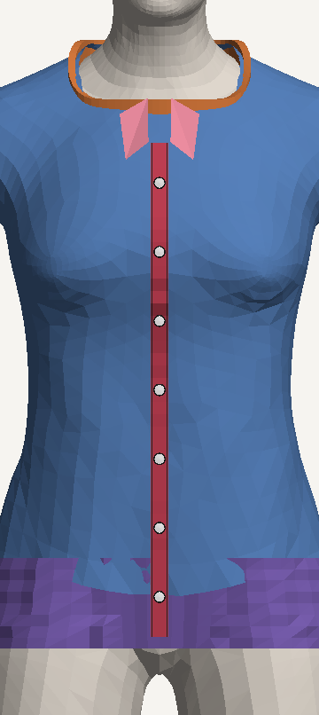
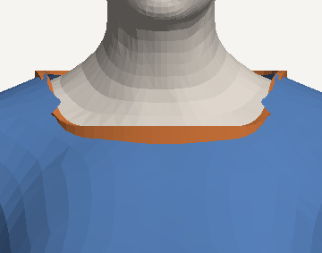
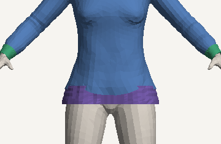
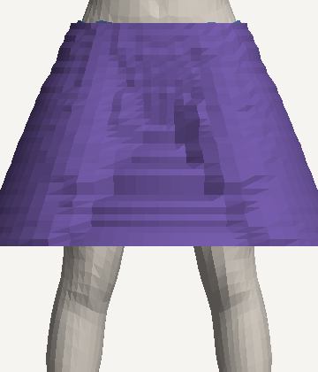
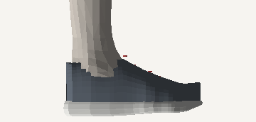
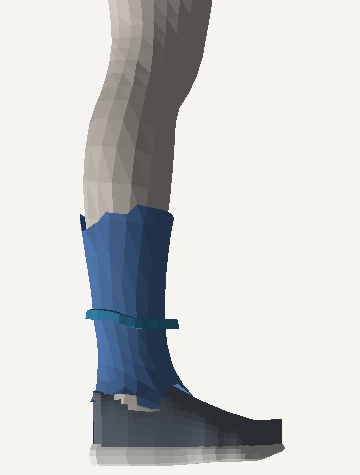

# MATRIZ-3D — rastreabilidade da vestimenta 3D (#237)

Esta matriz serve para localizar e explicar cada elemento de uma peça no provador 3D, ver o que cada variante reaproveita
e saber o que já existe, o que foi validado e o que ainda falta construir. Ela é **gerada pela execução real** dos
construtores (molde → caimento → acabamentos → calçado), não pela leitura do código. Se a implementação muda, o teste
avisa e a matriz é regravada.

| Arquivo | O que é |
|---|---|
| [`matriz-principal.csv`](matriz-principal.csv) | **Tabela principal**: uma linha por subcategoria da taxonomia (80, inclusive as legadas), com identificação, assets padrão e uma coluna por grupo (mangas, gola e decote, botões, casas e fechamento, costuras, corpo, cintura e acabamento, detalhes, aparência, vestibilidade, calçados, acessórios) e qualidade (testes, evidências, estado de suporte, principal lacuna). Cada célula traz `ícone nome — arquivo#símbolo (parâmetros)` |
| [`componentes.csv`](componentes.csv) | **Tabela detalhada** (normalizada): categoria → subcategoria → componente → variação → aplicabilidade → asset → arquivo → símbolo → parâmetros/unidades → dependências → teste → estado → observação (2 299 linhas) |
| [`biblioteca.csv`](biblioteca.csv) | **Biblioteca de componentes** (82): contrato de conexão, dependências, testes, moldes validados, em quantas subcategorias é usado e em quantas falta |
| [`achados.csv`](achados.csv) | Inconsistências encontradas na execução: componente aplicado onde não se aplica, código legado que muda o molde, parâmetro fora da taxonomia, componente sem teste, eficiência |
| [`matriz-3d.json`](matriz-3d.json) | Versões, **assinatura** (subcategoria · componente · estado, o que o teste compara), biblioteca, achados e rastreio de peças reais |
| [`GERADO.md`](GERADO.md) | Relatório gerado: cobertura, subcategoria × grupo, lacuna principal por subcategoria, biblioteca, achados e rastreio completo |
| [`catalogo/`](catalogo/) | **Catálogo visual**: cada molde de frente e de lado, desenhado a partir da geometria que os construtores produzem, e closes dos componentes |
| [`matriz-3d.xlsx`](matriz-3d.xlsx) | Exportação para planilha (abas Matriz principal, Componentes, Biblioteca, Achados, Legenda), com filtro e cor por estado |

Código: [`lib/avatar3d/matriz3d/`](../../../lib/avatar3d/matriz3d/). `registry.ts` é a biblioteca de componentes com
as referências, `probe.ts` monta a peça pelo mesmo caminho do provador, `matrix.ts` gera as tabelas, `raster.ts` desenha
o catálogo e `matriz3d.test.ts` verifica e grava tudo. A exportação para planilha fica em
[`scripts/avatar3d/matriz3d_xlsx.py`](../../../scripts/avatar3d/matriz3d_xlsx.py).

## Como ler

| Estado | Quando |
|---|---|
| ✔ **Implementado e validado** | o construtor produziu o componente para esta subcategoria **e** um teste automatizado o exercita **neste molde** (o teste está na coluna `teste`) |
| ◐ **Implementado, sem validação** | produzido, mas nenhum teste exercita este molde (ou o componente não tem teste) |
| ◑ **Parcial** | produzido, mas incompleto. A observação diz o que falta (ex.: cós sem faixa dobrada, frente declarada aberta com malha fechada) |
| ✖ **Ausente** | aplica-se à subcategoria e não existe. Também quando o componente existe na biblioteca mas não está ligado a ela (ex.: a carcela existe, mas a polo não a recebe) |
| — **Não aplicável** | não faz sentido para a peça (manga de regata, cadarço de sandália). **Nunca** aparece como ausente |

Componente produzido onde não se aplica (ex.: a blusa recebendo os 7 botões da camisa) continua "Não aplicável" na
tabela e vira **achado**. A coluna `variacao` diz com que atributo a peça foi montada para aquele componente: a manga do
vestido é observada com `SLEEVE_LENGTH=SHORT_SLEEVE`, o decote por atributo com `NECKLINE=V_NECK`.

**O que separa elementos parecidos:**

- **Fixação do botão** (`botoes.fixacao`, preso por pesos de pele, sem linha), **casa de botão** (`fechamento.casas`, ausente) e **costura da vista** (`costura.pesponto`, os dois fios de 1,2 mm nas bordas da carcela) são linhas separadas.
- **Costura que une painéis** (`costura.uniao`, ausente: a peça é uma casca contínua, sem painéis nem simulação) é diferente do **pesponto visual** (`costura.pesponto`, só desenho sobre a carcela).

## Resultado (11/10/2026)

| Estado | Células |
|---|---:|
| ✔ Implementado e validado | 694 |
| ◐ Implementado, sem validação | 379 |
| ◑ Parcial | 158 |
| ✖ Ausente | 345 |
| — Não aplicável | 723 |

- **Cobertura**: as 80 subcategorias da taxonomia (72 ativas e 8 legadas) têm linha. As 23 de acessório (22 ativas e `crossbody_bag`, legada) ficam em prévia 2D (SEM_3D) e as 57 demais têm molde.
- **Referências quebradas**: nenhuma. O teste confere que cada arquivo, símbolo, teste e dependência citado existe.
- **Componentes**: 82 na biblioteca, 30 deles ainda sem implementação (as lacunas declaradas) e 10 implementados sem teste: abertura da boca da manga, cava, decote pela foto, cadarço, barra da perna, barra da saia, alças, dobras, transparência e colarinho.
- **Código duplicado**:
  - Há dois contratos de vestimenta com vocabulários de família diferentes: `lib/avatar3d/garment-contract.ts` (`FAMILY`: TOPS, BOTTOMS, SKIRTS…) e `lib/tryon/garment-asset.ts` (`FAMILY_OF`: superior, inferior…). A saia é `SKIRTS` num e `inferior` no outro.
  - O tênis constrói o molde do pé (casca + 16 iterações de relaxamento) e o provador o descarta, porque a fôrma de `shoes.ts` o substitui. São 15 subcategorias pagando essa construção sem usar.
- **Parâmetros inconsistentes**:
  - A peça padrão dos pés usa a subcategoria `sneakers`, que não existe na taxonomia.
  - Seis peças do acervo usam códigos legados.
  - Dois códigos legados mudam o molde ao migrar: `crop_top` vira crop, mas o substituto `top` vira camiseta; `bermuda_shorts` vira bermuda, mas `shorts` vira short curto.

## Rastreio de peças reais do acervo

O rastreio segue cada peça do registro do catálogo até a prova no avatar: registro → atributos → componentes →
implementação → asset final → prova no avatar. São quatro peças do acervo
`data/catalog/acervo/acervo-oficial-2026-10-05.jsonl.gz`; o detalhe completo, com cada componente, está em
[GERADO.md](GERADO.md#rastreio-de-peças-reais-do-acervo).

| Peça | Registro | Molde e atributos | Asset final no provador | Prova (F e M, repouso) | Divergência encontrada |
|---|---|---|---|---|---|
| camiseta | Abercrombie & Fitch · Detroit Lions Graphic Tee | `tee`, regular, manga 0,33, folga 7 mm | `peca-*`, `punho-*`, `gola-*` | 2 281 / 2 412 vértices, penetração 0% | — |
| polo | AllSaints · Sonny Long Sleeve Polo | `tee`, decote POLO_COLLAR, manga 0,33 | `peca-*`, `punho-*`, `gola-*` | penetração 0% | **o nome diz manga longa e o molde sai com manga curta**; polo vira camiseta, sem gola dobrada nem vista |
| camisa com botões | Aramis · Camisa Social Manga Longa Slim | `shirt`, manga 0,96, folga 8 mm | `peca-*`, `punho-*`, `gola-*`, `gola-ponta-*`, `botoes-*`, `botoes-borda-*`, `carcela-*`, `costura-*` | penetração 0% | "Slim" não é lido: o molde usa `regular` |
| calça jeans | Abercrombie & Fitch · High Rise Bootcut Jean | `pants`, regular, cós h=0,18, perna em coluna 1 | `peca-*` | penetração 0% | "High Rise" não é lido: o cós fica na altura padrão |

 

## Catálogo visual

Cada imagem mostra o molde de frente e de lado no corpo de referência F, com uma cor por componente: corpo bege, casca
azul (ou a cor da peça no rastreio), tubo da saia ou da barra lilás, gola laranja, punho verde, barra amarela, carcela
vermelha, botões brancos com aro preto, pontas da gola rosa, sola clara e cadarço vermelho.

| | | |
|---|---|---|
| <br>carcela, 7 botões, pesponto e pontas da gola | <br>gola em faixa 3D (ribana) | <br>punho e barra de ribana (suéter) |
| <br>tubo da saia | <br>fôrma, sola e cadarço | <br>bota: molde no cano + fôrma no pé |

Um arquivo por molde: [tee](catalogo/tee.png) · [shirt](catalogo/shirt.png) · [tank](catalogo/tank.png) ·
[crop](catalogo/crop.png) · [sweater](catalogo/sweater.png) · [hoodie](catalogo/hoodie.png) ·
[jacket](catalogo/jacket.png) · [coat](catalogo/coat.png) · [vest](catalogo/vest.png) · [dress](catalogo/dress.png) ·
[jumpsuit](catalogo/jumpsuit.png) · [romper](catalogo/romper.png) · [skirt](catalogo/skirt.png) ·
[pants](catalogo/pants.png) · [culottes](catalogo/culottes.png) · [shorts](catalogo/shorts.png) ·
[bermuda](catalogo/bermuda.png) · [leggings](catalogo/leggings.png) · [shoes](catalogo/shoes.png) ·
[boots](catalogo/boots.png).

O catálogo mostrou um defeito que a leitura do código não mostrava: **a regata e o vestido saem tomara-que-caia**
([tank.png](catalogo/tank.png), [dress.png](catalogo/dress.png)). A casca para abaixo dos ombros (gola h=0,9) e não há
alça. A união corpete–saia do vestido, que parecia aberta, está fechada quando o alfa é testado por pixel, como faz o
material da peça.

## Lacunas priorizadas (impacto no acabamento e no caimento)

**P1 — mudam a leitura da peça (impacto 3)**

1. **Alças**: regata, body, vestido, macacão, macaquinho e jardineira saem sem alça. A alça pode nascer da própria casca: subir a cobertura do tronco numa faixa de largura parametrizada sobre o ombro, em `coverage`/`necklineH`, sem asset novo.
2. **Atributos lidos do nome**: o catálogo não traz atributos e só o decote é lido do nome (`necklineOf`). Por isso manga ("Long Sleeve" sai curta), altura do cós (`RISE`) e modelagem ("Slim", "Wide Leg") ficam no padrão. Ler `SLEEVE_LENGTH`, `RISE` e a variação pelo mesmo mecanismo custa pouco e acerta o comprimento e a silhueta de milhares de peças.
3. **Frente aberta e lapela**: cardigã, blazer, jaqueta, casaco, parka, quimono, colete e corta-vento são declarados abertos, mas a casca da frente é fechada. Abrir a casca em x≈0 com sobreposição e uma faixa de borda resolve a abertura; a lapela de blazer e casaco precisa de peça própria.
4. **Polo**: sai como camiseta, com gola redonda de ribana. A vista de 2 a 3 botões pode reaproveitar `shirtPlacket` parametrizado (quantidade e comprimento). A gola dobrada precisa de malha própria.
5. **Capuz** (moletom com capuz, parka), **salto** e **tiras** (salto alto, sandália, chinelo, alpargata viram sapato fechado): precisam de asset específico.

**P2 — acabamento visível de perto (impacto 2)**

6. **Blusa**: herda carcela, 7 botões, pesponto e pontas da gola do molde de camisa (6 componentes aplicados sem se aplicar). Basta ligar a carcela por subcategoria, e não pelo molde.
7. **Cós e barra da perna**: 18 e 16 subcategorias de baixo terminam no recorte do alfa, sem faixa nem espessura. A `tube()` de `garment-trims.ts` já faz a faixa: basta usar o eixo da cintura e o de cada perna.
8. **Gancho**: a casca segue a pele, sem profundidade (16 subcategorias). Depende de ler `RISE`.
9. **Botões, vista e braguilha**: faltam em polo, cardigã, blazer e casaco, e a braguilha com botão do cós falta em 7 calças.
10. **Estrutura da peça**: não há costura de união, painéis, recortes nem simulação (38 subcategorias), e a inserção da manga é sempre a mesma (21). Exigem malha própria (caminho APPROVED_ASSET do contrato).
11. **Detalhes e materiais**: bolsos (18), punho de perna em jogger e moletom, material do cadastro ignorado (jeans e couro com o mesmo material), conjunto que vira macacão, jardineira com gola de ribana e códigos legados que mudam o molde.

**P3 — detalhe fino ou eficiência (impacto 1)**

- **Aparência**: estampa só na frente, sem relevo nem transparência.
- **Barras e fechamentos**: barra do tronco em jaqueta, casaco e blazer; passantes; forro; zíper; fenda; pregas.
- **Calçado**: palmilha visível, lingueta e ilhoses, cadarço na bota e no coturno.
- **Eficiência**: o molde do pé é construído e descartado.
- **Cadastro**: a peça padrão usa `sneakers`; seis peças do acervo usam códigos legados.
- **Testes**: 10 componentes ainda não têm teste.

## Padronização do pipeline

Hoje as seis etapas existem, mas estão misturadas: `components/three/human-outfit.tsx` monta, colore e decide os
acabamentos dentro do mesmo laço. A matriz mapeia cada etapa:

| Etapa | Onde está | O que padronizar |
|---|---|---|
| Construção geométrica | `garments.ts` (`SPECS`, `coverage`, `garmentGeometry`, `skirtTube`, `collarBand`), `garment-trims.ts`, `shoes.ts` | todo componente devolve o mesmo contrato `{ part, position, skinIndex, skinWeight, index }` (`TrimBand`/`ShoePart` já seguem) |
| Montagem | `human-outfit.tsx` (`dress`/`wear`), `dress.ts` (`buildGarment`) | uma **receita por subcategoria** (molde + lista de componentes com parâmetros) lida da biblioteca; o provador só itera a receita. A aplicabilidade sai de um lugar só, sem blusa herdando a camisa |
| Materiais e detalhes visuais | `garmentTexture`, `garmentMaterial`, `trimColors`, `ribColor`, `fabricColor` (`garments.ts`); cores de botão e linha escritas em `human-outfit.tsx` | chave de material por componente (`acabamento-<parte>`) com a cor decidida num módulo de materiais, fora do componente React |
| Ajuste ao avatar | `garment-fit.ts` (`specFor`, `fitClassOf`, tabelas de comprimento), `underLayer`, `armOutFor`, `garment-relax.ts` | atributos lidos do cadastro **e do nome** num leitor único (decote já existe; falta manga, cós e variação) |
| Comportamento físico | pesos copiados da pele (skinning) e `foldGarment` | sem simulação: declarado no contrato (`simulation: "nenhuma"`) |
| Validação e exportação | `fit-metrics.ts`, `fit-matrix.ts`, `garment-contract.ts`, `export-glb.ts`, esta matriz | todo componente novo entra no registro com teste. A matriz cobra a referência (arquivo, símbolo, teste) e a assinatura |

**Contratos de conexão** (valem para todos; o de cada componente está na coluna `contrato` da biblioteca):

- **Escala e eixos**: metros no espaço do corpo `fai-body-v1`; +y para cima; +z é a frente da pessoa; x > 0 é o lado esquerdo dela.
- **Encaixe**: o componente se posiciona pelas coordenadas paramétricas de `bodyParam()`: altura no tronco h (0 = quadril, 1 = base do pescoço), braço (0 = ombro, 1 = punho) e perna (0 = quadril, 1 = tornozelo). O raio vem da própria peça naquela altura (`radiusFrom`), para que trocar gola ou manga não abra fresta nem sobreponha.
- **Pesos de rig**: 4 ossos por vértice somando 1, copiados do vértice de pele mais próximo (`weightsNear`). O tubo da saia usa quadril + coxas divididos pelo lado.
- **Continuidade**: cada componente é uma malha separada, desenhada por cima com `polygonOffset −camada−1`. A casca é contínua; a borda é o alfa com `alphaTest 0,5`.
- **UV e material**: a frente da casca recebe a foto (projeção frontal); costas e mangas recebem o tecido da própria foto; os acabamentos usam cor sólida (`trimColors`/`ribColor`). Estampa nunca é inventada.
- **Camadas**: a folga cresce por camada (`layer`) e cada peça passa por fora das de baixo (`underLayer`); a peça de cima esconde o que cobre (`occludeInnerGarment`).

**Como produzir uma nova variante:**

1. **Muda só proporção** (comprimento, folga, decote, cano): ajuste `SPECS` ou as tabelas de `garment-fit.ts` (`SLEEVE_LEN`, `LEG_LEN`, `SKIRT_LEN`, `NECKLINE`, `SHAFT`). Não precisa de asset.
2. **Adiciona uma peça presa à casca** (faixa, botão, carcela, alça, bolso chapado, cós): escreva uma função em `garment-trims.ts` com o contrato `TrimBand`. Use o eixo do corpo, o raio da peça via `radiusFrom` e os pesos via `weightsNear`. Registre em `registry.ts` (refs, `aplica`, `produz`, testes), escreva o teste e regrave a matriz.
3. **Tem volume que não segue a pele** (capuz, lapela, gola polo dobrada, salto, tiras de sandália, babado, bolsa): precisa de **asset específico**, uma malha própria com UV e pontos de encaixe no esqueleto, pelo caminho `APPROVED_ASSET` do contrato. Registre o componente com `aplica` e deixe-o "Ausente" até existir.

## Procedimento de atualização

```bash
npx vitest run lib/avatar3d/matriz3d                    # sempre (roda no CI com o resto do vitest): cobertura, referências, assinatura
MATRIZ3D_WRITE=1 npx vitest run lib/avatar3d/matriz3d   # quando a construção mudar: regrava CSV, JSON, GERADO.md e catálogo
python3 scripts/avatar3d/matriz3d_xlsx.py               # regrava a planilha
```

- **A construção mudou** (um componente passou a existir, deixou de existir ou mudou de estado): o teste de assinatura falha e lista o que mudou. Revise, regrave e faça o commit das tabelas junto com o código.
- **Arquivo ou símbolo renomeado**: o teste de referências falha apontando o componente. Corrija `refs` em `registry.ts`.
- **Componente novo**: entra em `registry.ts` com referências, aplicabilidade, detecção do que foi produzido, testes e lacuna. O estado sai sozinho da execução.
- **Subcategoria nova na taxonomia**: aparece sozinha (o teste exige uma linha por subcategoria). Ajuste a aplicabilidade dos componentes se ela tiver construção própria.
- Mudança só de valor (folga 7 → 8 mm) não quebra o teste. Regrave quando quiser os parâmetros novos nas tabelas.
- Versões registradas: taxonomia `1.0.0`, molde `fai-mould-skinwrap-v1` (`MOULD_VERSION`), contrato `1.0.0` e corpo `fai-body-v1`. Ao mudar qualquer uma, regrave.
