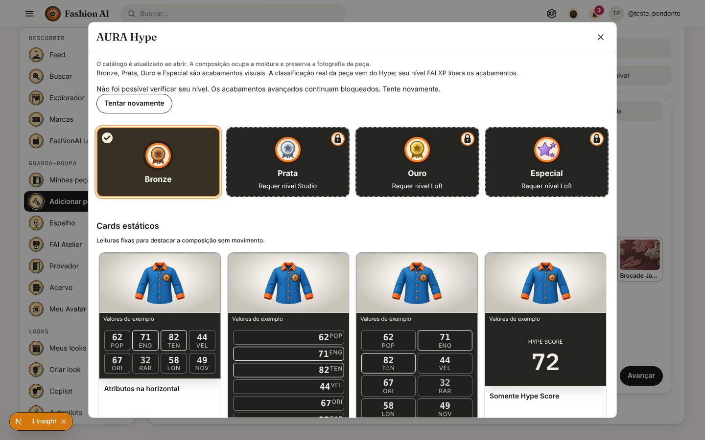
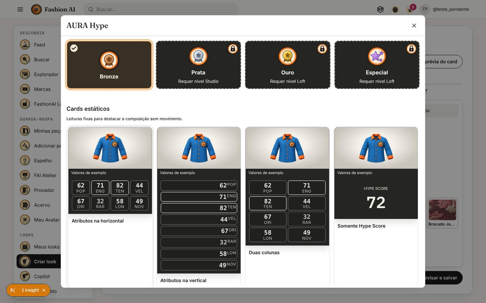
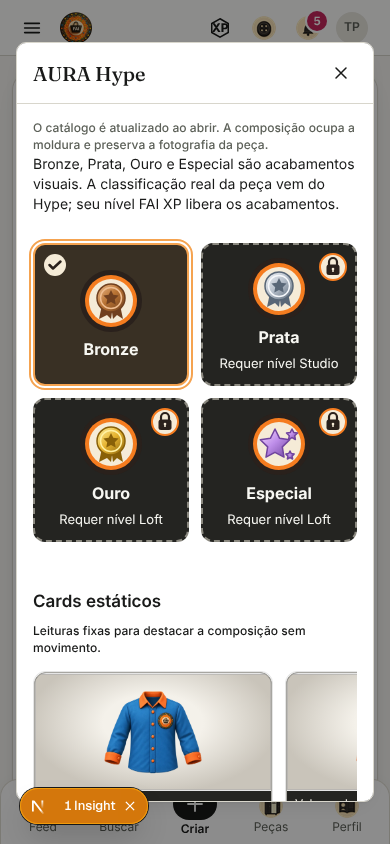
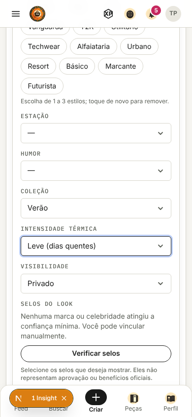

# Criadores de peça e de look: seletores AURA Hype e Metamorfose presos no erro

## O que estava bloqueado

Na etapa de arte dos dois criadores (`/pieces/new` → Arte de fundo e `/schemes/new` → Aparência), em
**Aura & Material**:

- **AURA Hype** mostrava "Não foi possível verificar seu nível. Os acabamentos avançados continuam bloqueados. Tente
  novamente." e o botão **Tentar novamente** repetia o mesmo erro.
- **AURA Metamorfose** mostrava "Não foi possível atualizar o catálogo…" e o **Tentar novamente** também não saía do erro.

Acontecia com conta de **e-mail ainda não confirmado**, que é o caso comum no ambiente local: com `EMAIL_PROVIDER=log` o
e-mail de confirmação só vai para o log da API.

## Causa

As duas leituras usadas pelos seletores passavam pela regra de **criação** (`Guard.requireCanCreate`), que recusa e-mail
não confirmado com `403 EMAIL_NAO_CONFIRMADO`:

- `GET /api/me/aura-permissions` (`AuraPermissionsController`): nível de FAI XP da própria pessoa;
- `GET /api/me/arts/metamorphoses` (`MetamorphoseInventoryService.mine`): artes que a própria pessoa já tem.

São leituras dos próprios dados, sem gravar nada. Como o erro era sempre o mesmo, o "Tentar novamente" nunca carregava.

## Correção

- `Guard.requireSession`: leitura dos próprios dados de conta exige só a sessão (sem sessão continua `401`).
- `AuraPermissionsController` e `MetamorphoseInventoryService.mine` passam a usar `requireSession`.
- Nada de gravação mudou: usar uma Metamorfose ao salvar (`MetamorphoseInventoryService.require`) continua chamando
  `requireCanCreate` e conferindo a posse; salvar peça ou look com e-mail pendente continua recusado (RF1.CA05); o
  `BackgroundStudioService` continua conferindo o nível ao gravar AURA Hype, Metamorfose e Impersonation.
- Continua valendo a regra de progressão por FAI XP: Bronze é livre; Prata pede nível Studio; Ouro e Especial pedem Loft.
  É uma regra de produto conferida no servidor ao salvar, não a trava do erro.

## Como foi conferido

- JUnit que falha sem a correção: `AuraPermissionsControllerTest` (e-mail pendente lê o próprio nível; sem sessão, 401)
  e `MetamorphoseInventoryServiceTest.pendingEmailReadsOwnArtsButCannotEquipThem` (lista as artes, mas não equipa).
- Navegador (Playwright, API e banco locais, conta de teste com e-mail pendente), nos dois criadores, a 1440×900 e a
  390×844: nenhum 403 e nenhum alerta em Aura & Material; o modelo Bronze da AURA Hype fica selecionado
  (`aria-pressed=true`); Coleção, Intensidade térmica e Estado de conservação carregam e aceitam a escolha.

