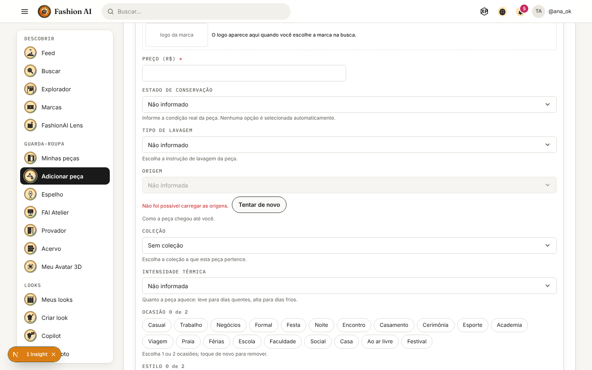
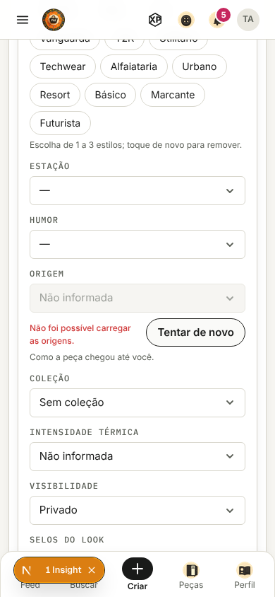
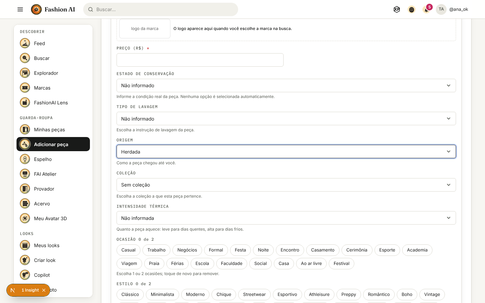
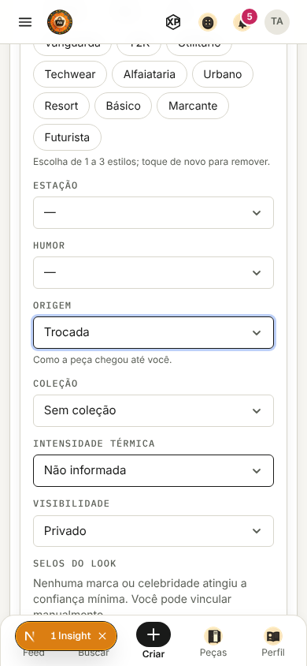

# Criadores: campo novo de seleção travado em 401 (campo Origem)

## O que acontecia

Nos dois criadores (`/pieces/new`, em "Mais detalhes", e `/schemes/new`, na etapa Detalhes), um campo de seleção novo,
como o **Origem** do exercício 5 (`GET /api/origens`), ficava desabilitado com "Não foi possível carregar as origens." e o
botão **Tentar de novo**, que repetia o erro. Acontecia com conta confirmada e com conta de e-mail pendente. Na aba Rede:
`GET /api/origens` → `401 NAO_AUTENTICADO`, enviado **sem** o cabeçalho `Authorization`.





## Causa

- Os campos de opções dos criadores (Estado de conservação, Tipo de lavagem, Coleção, Intensidade térmica) eram cópias
  de um mesmo componente que lia as opções com `api.get(rota, { anonymous: true })`. Nesse modo o cliente não manda o
  token nem tenta renovar a sessão (`lib/api/client.ts`, `request`).
- No backend, toda rota exige sessão (`anyRequest().authenticated()` em `SecurityConfig`), exceto a lista `PUBLIC_GET`,
  mantida à mão; os catálogos dos campos estavam nela um a um.
- Resultado: um campo só carregava se o GET dele tivesse sido acrescentado a `PUBLIC_GET`. Um campo novo copiado do
  padrão (Origem) respondia 401 mesmo com a pessoa logada, e "Tentar de novo" repetia a mesma chamada sem token. O mesmo
  já valia para o alias `GET /api/tipo-lavagem`, fora da lista.
- Não é regra de segurança de produto (menores, consentimento, IA paga): são tabelas de referência iguais para todos.

## Correção

- **Um componente só para os campos de opções** — `components/reference-select-field.tsx`, com o hook
  `lib/hooks/use-reference-options.ts`. A leitura vai com a sessão de quem está criando (os criadores só abrem com
  login), então qualquer GET novo de opções passa pela regra padrão "autenticado", sem entrar em `PUBLIC_GET`. Sem sessão
  a chamada sai sem token e só lê catálogos públicos. "Tentar de novo" refaz a leitura com a sessão. Os quatro campos
  existentes viraram uma linha cada, com o mesmo contrato (mesmos ids, rotas, textos e atributos `data-*-state`).
- **Convenção no backend:** `GET /api/opcoes/**` é público (uma entrada em `PUBLIC_GET`), para catálogos que páginas sem
  sessão também leiam. `OpcoesConvencaoTest` falha se algum GET nesse caminho receber a identidade de quem chama.
- **Nada foi afrouxado:** escrita (POST/PUT/PATCH/DELETE) continua exigindo sessão; criar ou editar peça com e-mail
  pendente continua `403 EMAIL_NAO_CONFIRMADO`; um catálogo fora de `PUBLIC_GET` continua `401` para quem não está logado
  (ele não virou público); CSRF, CSP e limites de requisição não mudaram.

## Receita para um campo novo (nada na segurança)

1. **Backend:** crie o GET de opções devolvendo `List<Views.ReferenceOptionView>` (id, código, nome), por exemplo um
   método `@GetMapping("/api/origens")` em `PieceReferenceController`. Não mexa em `SecurityConfig`. Se visitantes sem
   sessão também precisarem ler, use `/api/opcoes/<nome>`.
2. **Textos:** as chaves `<prefixo>.label`, `.unselected`, `.unavailable`, `.loadError`, `.empty` e `.hint` em
   `lib/i18n/messages/{pt-BR,en,es}.json`.
3. **Campo:** use o componente compartilhado e coloque o campo no formulário (`PieceFields` em `components/piece-form.tsx`
   ou `SchemeDetailFields` em `components/scheme-detail-fields.tsx`):

   ```tsx
   export function PieceOrigemField(props: ReferenceFieldProps) {
     return <ReferenceSelectField {...props} id="origemId" path="/api/origens" messages="pieceReferences.origem" />;
   }
   ```

Um `piece-origem-field.tsx` local que ainda chame `api.get("/api/origens", { anonymous: true })` continua travado: troque
o corpo pelo trecho acima.

## Como um campo futuro fica coberto

- `components/reference-select-field.contract.test.ts` falha se algum arquivo, fora do hook, buscar `ReferenceOption[]`
  por conta própria, se algum campo de opções usar `anonymous: true`, ou se algum `components/*-field(s).tsx` chamar a
  API direto em vez do componente compartilhado.
- `components/reference-select-field.test.tsx`: cada campo existente, e um campo novo cujo endpoint exige sessão,
  carrega e aceita a escolha para quem está logado; "Tentar de novo" reenvia com a sessão; sem sessão, o catálogo público
  é lido sem token. Os quatro casos dos campos existentes falham no código anterior (`anonymous: true`).
- `PieceReferenceAccessTest`: um GET novo fora de `PUBLIC_GET` responde 401 sem sessão e 200 com sessão;
  `/api/opcoes/**` é público só para leitura. `OpcoesConvencaoTest` vigia a convenção.

## Como foi conferido

- App real local (API 8094 com MySQL local próprio, Next 3009 com `next dev --webpack`), Playwright/Chromium, contas de
  teste confirmada e com e-mail pendente, criadores de peça e de look a 1440×900 e 390×844. O campo Origem da reprodução
  foi um endpoint local com três opções fixas e o campo escrito como no guia do exercício 5 — não versionados (a tabela
  e o campo Origem são o exercício).
  - Antes: `GET /api/origens` → 401 sem `Authorization`; depois de "Tentar de novo", 401 de novo; nos dois criadores, nas
    duas contas. Nenhum outro 4xx nem erro de console nos criadores.
  - Depois: `GET /api/origens` → 200 com a sessão; o campo habilita e a opção escolhida fica selecionada, nos dois
    criadores, nas duas contas e nos dois tamanhos de tela, sem nenhum 4xx nem erro de console.
- `curl` na API local: `/api/opcoes/estados-conservacao` 200 sem sessão; `/api/origens`, `/api/tipo-lavagem` e
  `/api/tipos-look` 401 sem sessão e 200 com sessão de e-mail pendente; `POST /api/opcoes/estados-conservacao` 401 sem
  sessão; `POST /api/pieces` com e-mail pendente continua 403.




