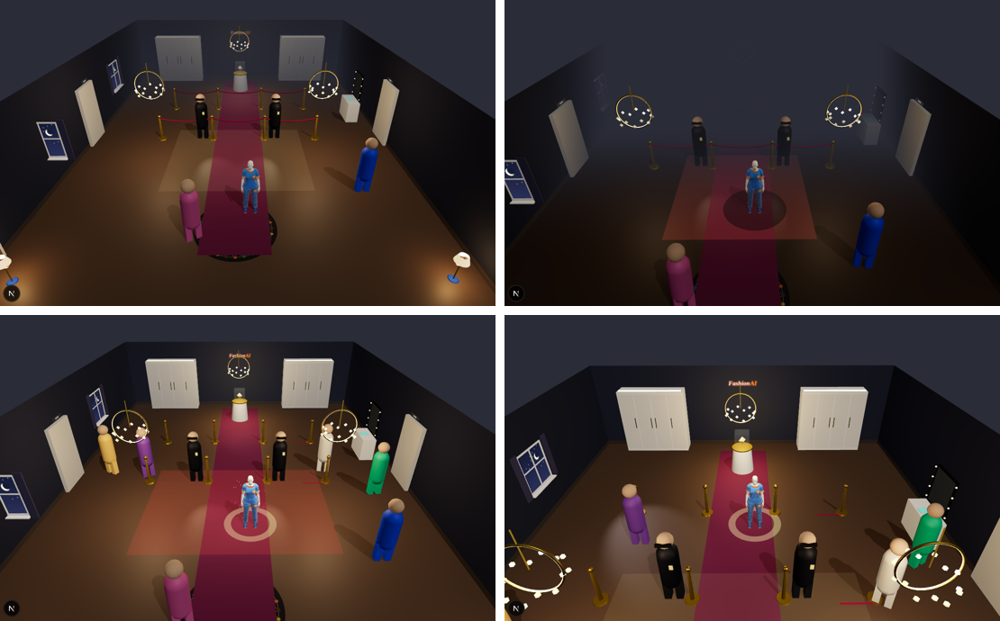

# MET Gala Heist em 3D, com cartas que mudam o avatar e o salão — 2026-10-25

**O jogo agora acontece numa versão de gala do Meu Quarto, e as cartas do deck mudam o avatar e o salão.** Um deck
pode dar mais ou menos facilidade para vencer.

Da esquerda para a direita, de cima para baixo: deck neutro na entrada; deck furtivo na portaria, com o salão na
penumbra e a sombra no avatar; deck de gala na portaria, com holofotes, seis convidados e o halo que denuncia; e o deck
de gala já dentro da área VIP, com o cordão aberto pela rota VIP.

## O salão

O cenário reaproveita o Meu Quarto à noite: piso de madeira, paredes com rodapé, janela com cortina, porta de madeira,
abajures, o tapete redondo FashionAI na entrada, o letreiro de neon e o móvel FAI Origem. A gala acrescenta o tapete
vermelho, os cordões de veludo, três lustres, os seguranças com lanterna, a penteadeira com o crachá e a vitrine da joia.
As posições são as do motor do jogo: entrada ao sul, portaria em z = 0, cordão VIP em z = −3 e joia ao fundo.

A câmera acompanha o avatar por trás, olhando para a joia. O avatar anda com passada de pernas e braços. A área que os
seguranças enxergam aparece no chão e fica vermelha quando o avatar está nela.

## O que as cartas mudam

Todas as cartas dos looks escolhidos formam o deck da partida. O servidor calcula os efeitos
(`AfterpartyMods.java`) a partir do que cada carta já tem: atributos FLAIR, estilos, ocasiões, cor, subcategoria,
material e raridade.

| Efeito | De onde vem | No jogo |
| --- | --- | --- |
| Agilidade | Tênis e estilos esportivos sobem; salto, vestido longo e bota descem | Velocidade de −15 % a +25 % |
| Furtividade | Cores escuras e estilos discretos sobem; statement e brilho descem | Suspeita de −30 % a +30 % |
| Carisma | Marca, foto, estilo e ocasião de festa | Distração mais longa e disfarce mais convincente |
| Fôlego | Peça da estação e material confortável | Energia de −30 % a +50 % |
| Luz do salão | Deck escuro: penumbra; deck claro e statement: holofotes | Os seguranças enxergam 18 % menos ou 15 % mais |
| Convidados | Ocasiões variadas | Mais convidados em cena; fora da vista, a suspeita cai mais rápido |
| Rota VIP | Três ou mais peças de alta-cultura LIMITED ou RARE | Cordão VIP aberto nos primeiros 8 segundos |

No avatar, os efeitos aparecem como rastro de velocidade (agilidade), sombra que esconde ou halo que denuncia
(furtividade) e brilho (carisma).

Antes de começar, a tela mostra "O que o seu deck muda" para os looks escolhidos, calculado pelo servidor com as
mesmas regras da partida (`POST /api/flair/adventure/preview`). Cada efeito traz o sinal de vantagem, desvantagem ou
neutro, também em texto para leitores de tela. Durante a partida aparecem só os efeitos que mudam alguma coisa, e o
objetivo mostra a contagem da rota VIP.

Os efeitos valem só na partida. Não mexem na peça, no Hype nem nos FAI Points, e uma partida salva antes desta regra
joga neutra.

## Verificação

- `AfterpartyModsTest`: deck escuro de tênis fica furtivo, ágil e na penumbra; deck de gala ganha carisma, convidados e
  rota VIP, mas perde furtividade e velocidade; a mesma rota sobe a suspeita bem menos com o deck furtivo.
- `FlairAdventureLevelGateTest`: a prévia exige o nível LOFT, soma as cartas dos looks e recusa look de outra pessoa.
- `components/flair/heist-deck.test.tsx` e `components/flair/afterparty-scene.test.tsx`: painel de vantagens, contagem
  da rota VIP e o salão no renderizador de teste.
- Laboratório: `/lab/scenes?s=heist-furtivo&z=2.2` (também `heist-neutro` e `heist-gala`).
