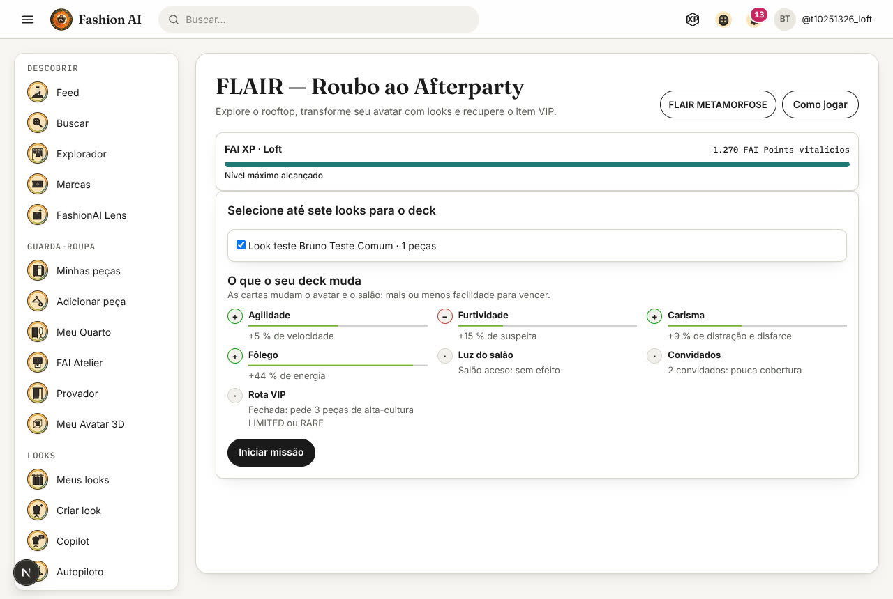
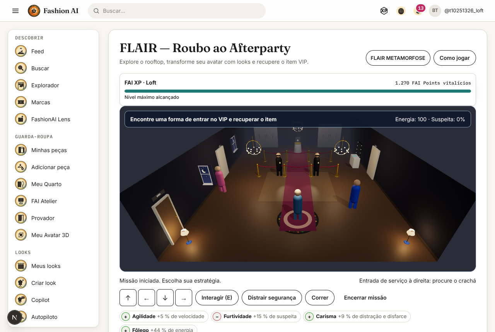
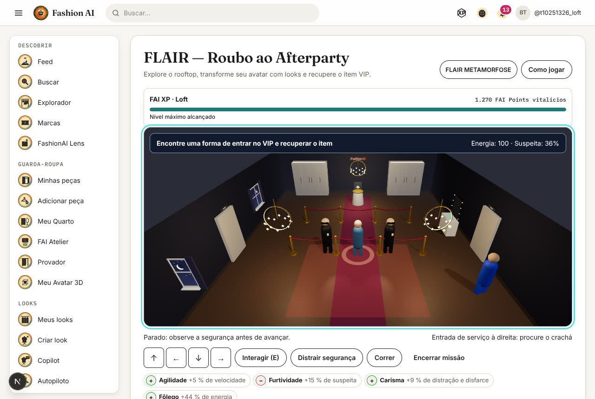
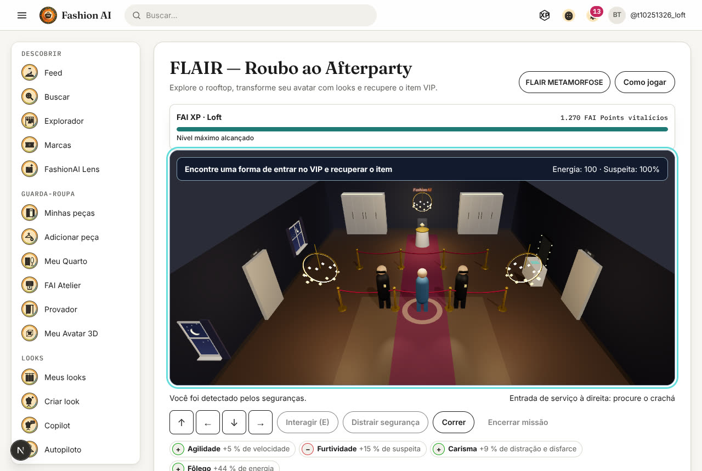
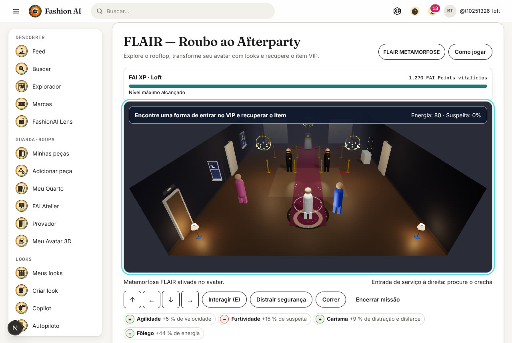
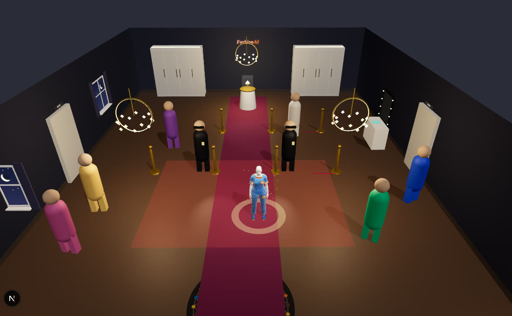

# Auditoria de IHC/UX do MET Gala Heist — 2026-10-25

**Resultado: 25,8 de 100 pelos pesos do protocolo (30,1 tirando o combate, que o jogo não tem por decisão de
design). Não aprovado:** a versão auditada não cumpre quatro das seis condições mínimas e, antes desta auditoria,
tinha um defeito crítico que impedia começar uma partida. Esse defeito foi corrigido aqui, com teste de regressão
(MH-ESTAB-001).

A auditoria aplica o protocolo "Auditoria de IHC/UX — METGALA HEIST" ao jogo que está jogável hoje: o **MET Gala
Heist v1** ("FLAIR — Roubo ao Afterparty", `/flair/aventura`). Cada nota vem de uma das cinco fontes abaixo, citada
item a item. O v2 ("The MET Gala Afterparty Heist"), ainda em desenvolvimento e sem versão jogável, **não foi
avaliado**: aparece só no plano de correção (seção 7).

## 1. Escopo, versão e método

| Item | Valor |
| --- | --- |
| Jogo auditado | MET Gala Heist v1: `components/flair/afterparty-adventure.tsx`, `afterparty-scene.tsx`, `lib/flair/afterparty.ts`, `AfterpartyEngine.java`, `AfterpartyMods.java`, `FlairAdventureService.java` |
| Versão | main `0b1ee4a0` (código do jogo idêntico na branch `claude/fashion-ai-interfaces-config-id7naj`, `1cde6302`) |
| Ambiente | Front em `next dev` local, backend local (jar) e MySQL descartável em Docker, com conta de teste de nível LOFT |
| Navegador | Chromium headless (Playwright 1.63) com SwiftShader: **renderização por CPU, sem GPU** |
| Hardware-alvo | **Não testado.** Nada aqui valida desempenho em PS5, console ou PC com placa de vídeo |

Fontes de evidência:

1. **Código** — referências `arquivo:linha` em cada nota.
2. **Testes automatizados** — 17 testes do front (`afterparty-adventure*.test.tsx`, `afterparty-scene.test.tsx`,
   `heist-deck.test.tsx`) e 11 do servidor (`AfterpartyEngineTest`, `AfterpartyModsTest`,
   `FlairAdventureLevelGateTest`): todos passam.
3. **Cenários no motor** — os testes práticos 01–06 rodados no motor autoritativo do servidor, no ritmo do cliente (um
   `MOVE` a cada 150 ms): `reproducao/Scenarios.java`, saída em `reproducao/cenarios.txt`.
4. **Partida real pela interface** — login, seleção do deck, partida e derrota dirigidas pelo teclado com Playwright,
   lendo a posição autoritativa nas respostas do servidor: `reproducao/partida-real.cjs`, registro em
   `reproducao/partida-real.txt`, capturas `captura-*.png`.
5. **Medição da cena** — quadros, tempo de quadro e chamadas de desenho WebGL por quadro nas cenas do laboratório
   (`/lab/scenes?s=heist-*`): `reproducao/desempenho.cjs`, `reproducao/desempenho.json`.

As notas seguem a escala do protocolo (0 não implementado · 1 implementado, mas não funcional · 2 funcional com
falhas relevantes · 3 funcional e adequado · 4 excelente, consistente e validado · N/A). A gravidade só aparece em
itens com defeito (nota 0–2). A pontuação de cada dimensão é a média das notas aplicáveis das seções que a compõem,
convertida para 0–100. As notas e o cálculo estão em `reproducao/notas.py` e `reproducao/gerar.py`.

## 2. Pontuação (seção 21 do protocolo)

| Dimensão | Peso | Seções | Pontuação | Contribuição |
| --- | --- | --- | --- | --- |
| Cenário, gráficos e animações 3D | 20 % | 2, 3 | 27 % | 5,4 |
| IA de convidados e seguranças | 20 % | 5, 6 | 9 % | 1,8 |
| Furtividade e mecânicas de roubo | 15 % | 7 | 30 % | 4,5 |
| Combate, armas e equipamentos | 15 % | 9, 10 | 37 % | 5,5 |
| Interface, controles e acessibilidade | 10 % | 4, 14, 17 | 37 % | 3,7 |
| Objetivos, narrativa e desafios | 10 % | 8, 11, 12, 13 | 23 % | 2,3 |
| Desempenho e estabilidade | 10 % | 16 | 28 % | 2,8 |
| **Total ponderado** | 100 % | | | **25,8 / 100** |

A variante sem combate trata a seção 9 como fora do escopo, porque o FashionAI optou por um jogo sem violência: a
dimensão "Combate, armas e equipamentos" passa a ser só a seção 10. O protocolo permite ajustar os pesos ao foco do
jogo. Mesmo assim, o total fica em **30,1 / 100**.

Seções fora da tabela de pesos: 15 Áudio 7,5 % · 18 Integração com FLAIR e FashionAI 47,9 % · 19 Segurança,
integridade e direitos 54,2 %.

Defeitos registrados (itens com nota 0–2): 39 de gravidade alta, 108 média e 34 baixa, mais um crítico observado na
partida real (MH-ESTAB-001, corrigido).

### Condições mínimas de aprovação

| Condição | Atende? | Por quê |
| --- | --- | --- |
| Sem defeitos críticos que impeçam concluir as missões | **Não** (antes da correção) · Sim (depois) | Quem não tinha partida ativa via "Algo deu errado nesta tela" ao abrir o jogo (MH-ESTAB-001). Corrigido nesta auditoria |
| Furto, detecção e fuga funcionando de verdade | Parcial | Furto de um único item fixo, detecção por um retângulo no chão e fuga até uma linha (T02, T03, T05). Não há furto de convidados, linha de visão nem perseguição |
| Comandos responsivos e câmera previsível | **Não** | Cada passo espera a ida e volta ao servidor e comandos são descartados em silêncio (MH-CTRL-001, MH-CTRL-003). Câmera fixa e sem ajuste |
| NPCs e seguranças reagem de forma consistente | **Não** | Convidados não percebem nada. Seguranças imóveis, sem estados, memória ou busca (MH-IA-001, MH-IA-002) |
| Cenários de teste com desempenho adequado ao hardware-alvo | **Não verificado** | Só houve medição em CPU sem GPU. Não há hardware-alvo definido nem testado (MH-PERF-001) |
| Informação suficiente para entender as consequências | Parcial | Bloqueios e detecção são explicados. Faltam narrativa, resultado detalhado e o motivo das opções desabilitadas |

## 3. Testes práticos obrigatórios (seção 20)

Cada teste rodou de duas formas:
- **no motor autoritativo do servidor**, no ritmo do cliente (`reproducao/cenarios.txt`);
- **numa partida real pela interface**, com login, backend e banco locais e o teclado dirigido pelo Playwright
  (`reproducao/partida-real.txt`).

A conta de teste tem um look raro, que dá o papel Convidado.

| Teste | Resultado | Observado | Evidência |
| --- | --- | --- | --- |
| **T01 — Entrada na festa** | Reprovado | O objetivo aparece ("Encontre uma forma de entrar no VIP e recuperar o item"), mas não há com quem conversar. Do tapete à portaria o avatar anda 4,9 m em 2,7 s e chega com 36 % de suspeita: a portaria fica dentro da área vista. Parado no bloqueio, a missão falha 6,0 a 6,5 s depois de sair do tapete (cinco partidas reais). No motor, chega com 30 % | Capturas 01–04; MH-PROG-003 |
| **T02 — Primeiro furto** | Parcial (motor) · Reprovado (interface) | No motor, a rota da Equipe pega o crachá e a joia em 6,9 s; o furto soma 20 % de suspeita sem aviso e o "inventário" são dois booleanos. Pela interface, a rota do Convidado falhou em três partidas. As distrações clicadas foram descartadas (seis cliques, nenhum aceito) e, enquanto o look carregava, o avatar andou a 0,34 m/s; o disfarce de 18 s venceu e a jogadora foi detectada. Não há NPC a observar nem animação de furto | `cenarios.txt` (T02); `partida-real.txt`; captura 05; MH-CTRL-001, MH-CTRL-003, MH-FURT-001 |
| **T03 — Suspeita e investigação** | Reprovado | 1,5 s parada na vista levou a suspeita de 11 % para 34 %. Na volta, chegou a 49 %; 3 s depois estava em 26 % e, ~7 s depois, em 0 %. Os seguranças não mudam de estado, não investigam, não se comunicam nem lembram de nada. Parada 8 s na vista, a partida inteira acaba (motor) | `partida-real.txt`; `cenarios.txt`; MH-IA-002, MH-PROG-002 |
| **T04 — Confronto com seguranças** | Não implementado | O motor recusa `ATTACK` (`ACTION_INVALID`). Não há esquiva, defesa nem IA tática | `cenarios.txt` (T04); MH-CMB-001 |
| **T05 — Fuga pelo edifício** | Parcial (motor) | Da vitrine à saída em 11,9 s pelo centro, concluindo com 0 % de suspeita porque o disfarce ainda valia: a operação inteira dura 18,8 s. Há a rota lateral, fora da vista; não há escadas, corredores, perseguição nem obstáculos. Pela interface não chegou a acontecer (depende do T02) | `cenarios.txt` (T05); MH-PROG-001, MH-CEN-001 |
| **T06 — Estresse técnico** | Sem evidência suficiente | Motor: 0,004 ms por ação (20 000 ações). Cena: 730–790 chamadas de desenho e ~270 mil triângulos por quadro com 2 a 6 cápsulas; heap de 86–109 MB; 1,4–1,6 quadro/s **em CPU, sem GPU** (não representa nenhum hardware real). Rede local: ida e volta média de 41–88 ms, p95 de 86–94 ms, máximo de 2 023 ms durante o carregamento do look. Nenhum erro de página depois da correção de MH-ESTAB-001. Não há "muitos convidados" a estressar (no máximo 12 cápsulas) | `desempenho.json`; `partida-real.txt`; MH-PERF-001 |

## 4. Notas por requisito (seções 2 a 19)

### 2. Cenário e ambientação 3D — 23 % (15 de 15 itens avaliados)

| # | Requisito | Nota | Gravidade | Evidência |
| --- | --- | --- | --- | --- |
| 2.1 | Arquitetura convincente, proporções de edifício de luxo | 1 | Média | Uma sala de 11,2 × 15,2 m com pé-direito de 3,2 m e a parede sul recortada (afterparty-scene.tsx:23, :186); capturas 02 e lab-* |
| 2.2 | Ambientes diferenciados (salão, tapete, VIP, serviço, camarins, bastidores) | 1 | Alta | Só zonas da mesma sala: tapete, portaria (z = 0), cordão VIP (z = −3) e penteadeira (AfterpartyEngine.java:75–77) |
| 2.3 | Circulação natural respeitando portas, escadas e corredores | 1 | Alta | Movimento preso ao retângulo x ±5, z ±7; as 'portas de serviço' são só painéis (AfterpartyEngine.java:73; afterparty-scene.tsx:112) |
| 2.4 | Objetos com geometria, materiais e dimensões coerentes | 2 | Baixa | Lustres, cordões, vitrine e guarda-roupas em primitivas com escala plausível (afterparty-scene.tsx:53–110) |
| 2.5 | Colisão correta com mesas, vitrines, lustres e estruturas | 0 | Alta | Não há colisão com móveis nem pessoas: o servidor só limita o retângulo e as linhas da portaria (AfterpartyEngine.java:69–79); o avatar atravessa a vitrine e os convidados |
| 2.6 | Objetos aparentemente utilizáveis que não respondem; o jogo deixa isso claro? | 1 | Média | Porta 'SAÍDA', janelas, abajures e guarda-roupas são decorativos; concluir vale em qualquer ponto com z > 4,4 (AfterpartyEngine.java:90) |
| 2.7 | Convidados ocupam os espaços com comportamento social | 1 | Alta | Até 12 cápsulas em pontos fixos que só balançam (afterparty-scene.tsx:29, :45) |
| 2.8 | Cenário reage às ações (esbarrões, objetos, portas, multidão) | 1 | Média | Só os cordões abrem, a joia some da redoma e o crachá some da penteadeira |
| 2.9 | Elementos arquitetônicos como cobertura | 0 | Alta | A vista dos seguranças é um retângulo fixo no chão que ignora obstáculos (AfterpartyEngine.java:33) |
| 2.10 | Múltiplas rotas de infiltração e fuga | 2 | Média | Portaria com disfarce, passagem lateral da equipe (|x| > 3,2) e fuga pela lateral fora da vista (T02, T05) |
| 2.11 | Continuidade entre salões, corredores e áreas externas | 0 | Média | Não há outros ambientes; o 'rooftop' do texto não aparece |
| 2.12 | Identificação de áreas públicas, restritas e de segurança máxima | 2 | Baixa | Cordões e a zona vista pintada no chão (amarela; vermelha quando vista) (afterparty-scene.tsx:64); sem legenda |
| 2.13 | Locais secretos ou caminhos alternativos que recompensam exploração | 0 | Média | Não existem |
| 2.14 | Decoração e iluminação de evento de moda sofisticado, sem objetos fora de contexto | 1 | Média | Móveis do Meu Quarto (guarda-roupa FAI Origem, janela, abajures, tapete redondo) dentro da gala (README do v1) |
| 2.15 | Mundo convincente com o jogador parado | 1 | Alta | Seguranças imóveis, convidados balançando no lugar; nada acontece sem o jogador (captura 05) |

### 3. Gráficos, realismo e qualidade — 31 % (12 de 14 itens avaliados)

| # | Requisito | Nota | Gravidade | Evidência |
| --- | --- | --- | --- | --- |
| 3.1 | Rostos, pele, expressões e movimentos dos personagens | 1 | Alta | NPCs são cápsula + esfera, sem rosto (afterparty-scene.tsx:31); o avatar da jogadora só vira o humano do provador com um look ativo — sem metamorfose, e enquanto o look carrega, também é cápsula (capturas 02–04) |
| 3.2 | Cabelos com volume, materiais e movimento | 1 | Média | Só o avatar da jogadora tem cabelo (sistema de cabelo do avatar); NPCs não têm |
| 3.3 | Roupas com geometria 3D real | 2 | Alta | O avatar veste o look ativo com as peças 3D do provador (com os defeitos da auditoria do pipeline de vestimenta); NPCs não vestem nada |
| 3.4 | Materiais distintos para vestidos, casacos, joias e acessórios | 1 | Média | Só os do look da jogadora; seguranças e convidados em cor sólida |
| 3.5 | Tecidos respondem a caminhada, corrida e contato | 1 | Média | Roupa presa ao esqueleto; sem simulação de tecido |
| 3.6 | Penetração de membros e acessórios através das roupas | 2 | Média | Folga verificada no provador (garment-clearance.test.ts); a passada procedural gira as pernas sem verificação de folga |
| 3.7 | Iluminação coerente ao trocar de ambiente | N/A | — | Há um só ambiente |
| 3.8 | Reflexos em espelhos, vidros, metais e pisos | 1 | Baixa | Materiais padrão sem mapa de ambiente; o 'espelho' da penteadeira é um plano metálico (afterparty-scene.tsx:92) |
| 3.9 | Animações evitam aparência de manequim | 1 | Alta | Passada procedural no avatar; NPCs não têm animação além do balanço (afterparty-scene.tsx:45, :131) |
| 3.10 | Qualidade estável com efeitos e multidões | 2 | Média | Cena leve (T06); a maior concentração é 6 cápsulas no deck de gala |
| 3.11 | Direção de arte reconhecível | 2 | Média | Paleta coerente (noite, dourado, veludo), diluída pela mobília do quarto |
| 3.12 | Transições defeituosas entre níveis de detalhe | N/A | — | Não há sistema de LOD na cena |
| 3.13 | Modo gráfico informa resolução × fidelidade × fluidez | 0 | Média | Não há opções gráficas |
| 3.14 | Câmera mostra roupas e ambiente sem atrapalhar | 1 | Média | Câmera fixa a 6,2 m de altura e 7,2 m atrás, sem órbita nem aproximação (afterparty-scene.tsx:120); o look aparece pequeno (captura 02) |

### 4. Personagem, controles e movimentação — 30 % (11 de 12 itens avaliados)

| # | Requisito | Nota | Gravidade | Evidência |
| --- | --- | --- | --- | --- |
| 4.1 | Entende quem controla e a função do personagem | 2 | Média | Objetivo 'entrar no VIP e recuperar o item'; não diz quem é a personagem nem por que rouba |
| 4.2 | Comandos com resposta rápida e previsível | 1 | Alta | Movimento autoritativo no servidor: um MOVE a cada 150 ms, esperando a resposta anterior (afterparty-adventure.tsx:36–40; AfterpartyEngine.java:72). Na partida real: 1,8 m/s normalmente, 0,34 m/s enquanto o look carrega; teclas e cliques descartados quando há envio em andamento (MH-CTRL-001, MH-CTRL-003) |
| 4.3 | Animações de andar, correr, agachar, saltar e se esconder | 1 | Alta | Só andar e correr (passada procedural); não há agachar, saltar nem esconder |
| 4.4 | Caminhar lentamente para não chamar atenção | 1 | Média | Não há passo lento; andar na vista sobe 18 %/s e correr 23 %/s (AfterpartyEngine.java:43) |
| 4.5 | Misturar-se à multidão | 1 | Alta | Multidão só acelera a queda da suspeita fora da vista (AfterpartyEngine.java:43); não há mecânica de se misturar |
| 4.6 | Transição fluida entre movimento livre, furtividade e combate | 1 | Média | Não há modos; o disfarce é o único estado |
| 4.7 | Interação com paredes, corrimãos, escadas e mobiliário | 0 | Alta | Não existe |
| 4.8 | Câmera não atravessa paredes ou objetos | 2 | Média | Não atravessa porque a parede sul foi recortada e a câmera não gira; não há colisão de câmera |
| 4.9 | Ajuste de sensibilidade, inversão de eixo e enquadramento | 0 | Média | Não existe |
| 4.10 | Comandos consistentes em controle, teclado e mouse | 1 | Alta | Teclado (WASD, E, 1–7, Shift), clique no chão e direcional na tela; sem controle — lib/input/gamepad.ts existe mas o jogo não usa (afterparty-adventure.tsx:51–56) |
| 4.11 | Interromper ou cancelar animações | N/A | — | Não há animações longas a cancelar |
| 4.12 | Feedback imediato quando uma ação não pode ser executada | 3 | — | GATE_BLOCKED, VIP_BLOCKED, STAFF_REQUIRED, TOO_FAR, ENERGY_LOW e COOLDOWN em região aria-live (afterparty-adventure.tsx:55) |

### 5. IA dos convidados — 2 % (13 de 15 itens avaliados)

| # | Requisito | Nota | Gravidade | Evidência |
| --- | --- | --- | --- | --- |
| 5.1 | Rotinas próprias | 0 | Alta | Convidados parados em GUEST_SPOTS (afterparty-scene.tsx:29) |
| 5.2 | Conversam, dançam, fotografam, comem conforme o contexto | 0 | Alta | Não |
| 5.3 | Personalidade, objetivos ou comportamentos diferenciados | 0 | Alta | Todos iguais; só a cor muda |
| 5.4 | Reagem à invasão do espaço pessoal | 0 | Alta | Sem colisão nem percepção: o avatar atravessa as cápsulas |
| 5.5 | Percebem a ausência de joia ou acessório | 0 | Média | Não há itens nos convidados |
| 5.6 | Reconhecem comportamentos estranhos do protagonista | 0 | Alta | Só os seguranças, pela zona fixa |
| 5.7 | Reagem a outro personagem sendo ameaçado | 0 | Média | Não há ameaças nem reação |
| 5.8 | Distinguem ação normal de suspeita | 0 | Alta | Convidados não percebem nada |
| 5.9 | Mantêm conversa enquanto caminham ou interagem | 0 | Média | Não |
| 5.10 | Evitam colisões entre si | N/A | — | Convidados não se movem |
| 5.11 | Multidão abre espaço em emergência | 0 | Média | Não |
| 5.12 | Reações variadas (medo, curiosidade, fuga, pedido de ajuda) | 0 | Média | Não |
| 5.13 | Identificam personagem conhecido ou suspeito por eventos anteriores | 0 | Média | Não há memória |
| 5.14 | Continuidade ao sair e voltar ao ambiente | N/A | — | Há um só ambiente |
| 5.15 | Evitam repetir falas e animações | 1 | Baixa | Sem falas; o mesmo balanço senoidal em todos |

### 6. IA dos seguranças — 15 % (15 de 16 itens avaliados)

| # | Requisito | Nota | Gravidade | Evidência |
| --- | --- | --- | --- | --- |
| 6.1 | Rotas de patrulha coerentes com a planta | 0 | Alta | Dois seguranças fixos na portaria (afterparty-scene.tsx:36) |
| 6.2 | Níveis diferentes de atenção e suspeita | 1 | Alta | Uma barra de 0 a 100 sem estados; em 100 a partida acaba (AfterpartyEngine.java:46) |
| 6.3 | Campo de visão afetado por obstáculos, luz e distância | 1 | Alta | Retângulo |x| < 2,4 × luz, −0,7 < z < 3,4; a luz escala a zona, obstáculos e distância não contam (AfterpartyEngine.java:33) |
| 6.4 | Escutam sons conforme intensidade, distância e ambiente | 0 | Média | Não há audição |
| 6.5 | Não enxergam através de paredes | 1 | Média | Sem linha de visão: a zona ignora qualquer coisa entre o segurança e a jogadora |
| 6.6 | Investigam ruídos em vez de localizar automaticamente | 0 | Média | Não |
| 6.7 | Comunicam ocorrências entre si | 0 | Média | Não |
| 6.8 | Procuram em locais plausíveis ao perder o jogador de vista | 0 | Média | Não |
| 6.9 | Lembram a última posição conhecida | 0 | Média | Não |
| 6.10 | Comportamentos distintos (comum, chefe, equipe especial) | 0 | Média | Não |
| 6.11 | Adaptam estratégia sem informação impossível | 1 | Média | Não adaptam; também não trapaceiam |
| 6.12 | Usam cobertura e rotas alternativas em confronto | N/A | — | Não há confronto (decisão de design do v1) |
| 6.13 | Pedem reforços | 0 | Baixa | Não |
| 6.14 | O jogador entende por que foi detectado | 2 | Média | A mensagem 'Você foi detectado pelos seguranças' explica, mas aparece numa linha de status sob a cena; o painel de fim fica abaixo da dobra (captura 04) |
| 6.15 | Voltam gradualmente à vigilância depois de um falso alarme | 1 | Média | A suspeita cai 7 %/s fora da vista; os seguranças não mudam de estado |
| 6.16 | Reagem a distrações sem abandonar áreas importantes | 2 | Baixa | A distração apaga a lanterna do segurança por 12 s sem tirá-lo do posto (AfterpartyEngine.java:80–85) |

### 7. Furtividade e roubo de itens — 30 % (16 de 18 itens avaliados)

| # | Requisito | Nota | Gravidade | Evidência |
| --- | --- | --- | --- | --- |
| 7.1 | Deixa claro quais objetos podem ser roubados | 2 | Média | Só a joia (brilha na redoma) e o crachá; o texto fala em 'item VIP' |
| 7.2 | Itens com valor, raridade, dificuldade e importância | 0 | Média | Um único item, sem atributos |
| 7.3 | Observar o alvo antes da abordagem | 2 | Baixa | A redoma é visível desde o início; não há modo de observação |
| 7.4 | Mecânica consistente para retirar itens de convidados | 0 | Alta | Não existe furto de NPC |
| 7.5 | Proximidade necessária para interagir é compreensível | 2 | Média | Raio de 1,2–1,3 m sem marcador; só a mensagem 'Aproxime-se para interagir' (AfterpartyEngine.java:87–90) |
| 7.6 | Feedback quando a tentativa de furto é percebida | 1 | Média | O furto soma 20 % de suspeita sem aviso (AfterpartyEngine.java:89) |
| 7.7 | Interromper a tentativa antes de concluir | N/A | — | O furto é instantâneo |
| 7.8 | Roubo bem-sucedido descoberto depois | 0 | Média | Não |
| 7.9 | Diferença entre item exposto, guardado e acessório em uso | 0 | Média | Não |
| 7.10 | Posição e comportamento dos NPCs alteram a dificuldade | 1 | Média | Só a distração e a luz do deck mudam a zona |
| 7.11 | Distrair personagens com mecânicas do jogo | 3 | — | DISTRACT com disfarce de convidado/VIP, 15 de energia e recarga de 6 s (AfterpartyEngine.java:80–85; T02) |
| 7.12 | Relação clara entre risco, valor e recompensa | 1 | Média | FAI Points fixos por jogar e por vencer (RF41); nada depende do risco |
| 7.13 | Distingue visualmente itens comuns, raros e exclusivos | 0 | Baixa | Um só item |
| 7.14 | IA reage à ausência de objetos importantes | 0 | Média | A redoma vazia não chama atenção de ninguém |
| 7.15 | Inventário funcional | 1 | Média | Crachá e item são dois booleanos mostrados em texto (afterparty-adventure.tsx:55) |
| 7.16 | Concluir missões sem combate | 3 | — | Todas as rotas são sem combate (T02, T05) |
| 7.17 | Animações de roubo não atravessam corpos e objetos | N/A | — | Não há animação de roubo |
| 7.18 | Itens roubados somem e não são coletados de novo | 3 | — | A redoma fica vazia e interagir de novo não duplica (AfterpartyEngineTest; T02) |

### 8. Falas, diálogos e interpretação — 0 % (11 de 14 itens avaliados)

| # | Requisito | Nota | Gravidade | Evidência |
| --- | --- | --- | --- | --- |
| 8.1 | Falas naturais e adequadas ao ambiente social | 0 | Alta | Não há falas nem diálogos; só mensagens do sistema |
| 8.2 | Diálogos distintos por tipo de personagem | 0 | Alta | Não |
| 8.3 | Falas variam com a missão | 0 | Média | Não |
| 8.4 | NPC reage verbalmente a tentativa de furto | 0 | Média | Não |
| 8.5 | Sincronia de fala, boca e expressões | 0 | Baixa | Não |
| 8.6 | Iniciar, interromper e encerrar conversas | 0 | Alta | Não |
| 8.7 | Escolhas de diálogo alteram o comportamento | 0 | Alta | Não |
| 8.8 | Evita repetir frases | N/A | — | Não há frases |
| 8.9 | Respeita o contexto emocional | 0 | Média | Não |
| 8.10 | Áudio de fala com distância, reverberação e direção | 0 | Média | O jogo não tem áudio |
| 8.11 | Legendas sincronizadas com identificação de quem fala | 0 | Média | Não há falas a legendar |
| 8.12 | Falas compreensíveis com música alta | N/A | — | Não há falas nem música |
| 8.13 | Personagens importantes lembram acontecimentos | 0 | Média | Não há personagens |
| 8.14 | Fala gerada por IA coerente com personalidade e limites | N/A | — | O v1 não usa geração dinâmica |

### 9. Combate — 4 % (13 de 16 itens avaliados)

| # | Requisito | Nota | Gravidade | Evidência |
| --- | --- | --- | --- | --- |
| 9.1 | Comunica quando entrou em combate | 0 | Média | Não há combate: ATTACK é recusado pelo motor (T04) |
| 9.2 | Ataques com animação e impacto | 0 | Média | Não |
| 9.3 | Defender, esquivar e interromper ataques | 0 | Média | Não |
| 9.4 | Combate corpo a corpo compreensível | 0 | Média | Não |
| 9.5 | Movimentação responsiva em combate | 0 | Média | Não |
| 9.6 | Reações físicas a impactos | 0 | Média | Não |
| 9.7 | Colisão detecta contatos | 0 | Média | Não |
| 9.8 | Inimigos atacam, defendem e recuam coordenados | 0 | Média | Não |
| 9.9 | Dificuldade vem da IA, não de vida maior | 0 | Média | Não |
| 9.10 | Câmera boa em confronto em local fechado | 0 | Média | Não |
| 9.11 | Combate com mesas, escadas, portas e obstáculos | 0 | Média | Não |
| 9.12 | Evitar ou encerrar confronto com alternativa não letal | N/A | — | Não há confronto: o jogo inteiro é não letal |
| 9.13 | Saúde, energia ou resistência comunicadas | 2 | Média | Energia e suspeita só como números no texto do objetivo, sem barras (captura 02) |
| 9.14 | Confronto muda o comportamento dos convidados | 0 | Média | Não |
| 9.15 | Combate e furtividade interagem | N/A | — | Não há combate |
| 9.16 | Inimigo derrotado entra no estado previsto | N/A | — | Não há inimigos derrotáveis |

### 10. Armas, equipamentos e inventário — 65 % (15 de 16 itens avaliados)

| # | Requisito | Nota | Gravidade | Evidência |
| --- | --- | --- | --- | --- |
| 10.1 | Categorias de equipamento necessárias | 2 | Média | O equipamento é o deck de looks (papéis EQUIPE, CONVIDADO, VIP, VIP DO EVENTO); falta ferramenta de infiltração |
| 10.2 | Função, alcance e limitações compreensíveis | 3 | — | 'Como jogar' lista as cartas do seu deck por papel, com atalho, raridade e custo (afterparty-adventure.tsx:59–65) |
| 10.3 | Sabe o que está disponível antes da missão | 3 | — | Seleção de até 7 looks e a prévia 'O que o seu deck muda' calculada no servidor (captura 01) |
| 10.4 | Interface rápida para selecionar e trocar | 3 | — | Teclas 1–7 e botões das cartas com recarga visível (sem controle — ver MH-CTRL) |
| 10.5 | Animações de equipar e usar consistentes | 2 | Média | Anel, luz e partículas na transformação; a troca do look depende do carregamento do avatar |
| 10.6 | Diferencia distração, infiltração e combate | 2 | Baixa | Disfarces e distração existem; não há armas por design |
| 10.7 | Efeitos visuais e sonoros confirmam a ação | 2 | Média | Só visual e texto; sem som |
| 10.8 | Impede usos incompatíveis | 3 | — | Energia, recarga e disfarce exigido conferidos no servidor (AfterpartyEngineTest) |
| 10.9 | Avaliar vantagens e desvantagens | 3 | — | Painel de efeitos com sinal de vantagem/desvantagem também em texto (heist-deck.test.tsx) |
| 10.10 | Custo, disponibilidade e restrições de balanceamento | 3 | — | Custo de energia e recarga por raridade |
| 10.11 | Alternativas não letais viáveis | 3 | — | Todo o jogo é não letal |
| 10.12 | Física dos objetos equipados | N/A | — | Não há objetos físicos equipados |
| 10.13 | Melhoria de equipamentos sem desequilibrar | 1 | Baixa | Só cartas melhores dão papéis melhores; não há melhoria |
| 10.14 | Explicação de itens especiais | 3 | — | Papel VIP do evento explicado (drop confirmado) |
| 10.15 | Itens persistem após salvar, carregar e mudar de cena | 3 | — | Estado inteiro no servidor (state_json) e retomado em /active |
| 10.16 | Concluir com estilos diferentes de equipamento | 3 | — | Rotas por EQUIPE, CONVIDADO e VIP (AfterpartyEngineTest, T02) |

### 11. Objetivo, narrativa e progressão — 31 % (13 de 14 itens avaliados)

| # | Requisito | Nota | Gravidade | Evidência |
| --- | --- | --- | --- | --- |
| 11.1 | Objetivo principal compreendido nos primeiros minutos | 2 | Média | Faixa de objetivo desde o início, mas 'o item' não é nomeado |
| 11.2 | Motivação narrativa para o roubo | 1 | Alta | Não há história |
| 11.3 | Introdução, desenvolvimento, clímax e resolução | 1 | Alta | Pegar o crachá, a joia e sair: a operação inteira dura 18,8 s no motor (T02 + T05) |
| 11.4 | Objetivos apresentados de forma objetiva | 3 | — | Faixa de objetivo e dica do crachá |
| 11.5 | Sabe quais itens obter e por quê | 1 | Média | Sabe qual (a joia brilha), não sabe por quê |
| 11.6 | Objetivos opcionais | 0 | Média | Não |
| 11.7 | Estratégias diferentes | 3 | — | Três papéis com rotas próprias |
| 11.8 | História reage a decisões | 0 | Alta | Não há história |
| 11.9 | Sequência lógica de dificuldade entre missões | 0 | Média | Uma única missão |
| 11.10 | Consequências narrativas de erros e descobertas | 0 | Média | Não |
| 11.11 | Resultados diferentes da operação | 1 | Média | Concluída, falhou ou abandonada |
| 11.12 | Acompanha o progresso sem sair da experiência | 3 | — | Objetivo, status aria-live e dica do crachá na tela |
| 11.13 | Cenas cinematográficas pausáveis ou puláveis | N/A | — | Não há cenas |
| 11.14 | Encerramento explica o desempenho | 1 | Média | Só 'Missão concluída!' e o botão para jogar de novo |

### 12. Desafios e rejogabilidade — 30 % (10 de 10 itens avaliados)

| # | Requisito | Nota | Gravidade | Evidência |
| --- | --- | --- | --- | --- |
| 12.1 | Regras claras antes de começar | 2 | Baixa | 'Como jogar' descreve papéis; não há desafios com regras próprias |
| 12.2 | Variedade suficiente | 0 | Média | Uma missão de ~20 s |
| 12.3 | Desafios de furtividade, exploração, social e combate | 1 | Média | Só furtividade básica |
| 12.4 | Progresso de objetivos secundários | 0 | Baixa | Não há |
| 12.5 | Recompensas proporcionais ao esforço e risco | 1 | Média | FAI Points fixos |
| 12.6 | Repetições mudam NPCs ou cenário | 1 | Média | Só o deck muda luz e número de convidados; o resto é idêntico |
| 12.7 | Objetivos que pedem planejamento | 2 | Baixa | A escolha do papel é um plano; a execução é curta |
| 12.8 | Limite de tempo com informação suficiente | 2 | Baixa | Disfarce de 18 s sem contagem na tela; a rota VIP mostra a contagem |
| 12.9 | Reiniciar sem perder progresso desnecessário | 2 | Baixa | Reinício completo; barato porque a missão é curta |
| 12.10 | Desafios ligados ao calendário de eventos | 1 | Baixa | Só o papel VIP do evento vindo de drops AFTERPARTY_ |

### 13. Complexidade e dificuldade — 29 % (12 de 12 itens avaliados)

| # | Requisito | Nota | Gravidade | Evidência |
| --- | --- | --- | --- | --- |
| 13.1 | Diferencia dificuldade de aprendizado, estratégia e execução | 1 | Baixa | Não |
| 13.2 | Tutorial gradual | 1 | Média | Só o texto de 'Como jogar' |
| 13.3 | Entende por que falhou | 2 | Média | Mensagem de detecção numa linha de status; o painel de fim fica fora da tela sem rolar (captura 04) |
| 13.4 | Níveis de dificuldade configuráveis | 0 | Média | Não |
| 13.5 | Dificuldade progressiva e previsível | 0 | Média | Uma missão |
| 13.6 | Inimigos mais difíceis com comportamento diferente | 0 | Média | Não |
| 13.7 | IA sem vantagens injustas | 3 | — | Detecção só pela zona visível no chão |
| 13.8 | Salvamento antes de situações difíceis | 1 | Média | A partida é salva a cada ação, mas a detecção a encerra sem checkpoint (T03) |
| 13.9 | Recuperar-se de erros sem reinício excessivo | 2 | Média | A suspeita cai fora da vista; em 100 % tudo recomeça |
| 13.10 | Opções para diferentes habilidades motoras | 3 | — | Clique para andar, direcional na tela, correr alternável, sem reflexo cronometrado |
| 13.11 | Dificuldade efetiva avaliada com dados de teste | 0 | Média | Não há telemetria |
| 13.12 | Interesse depois de dominar as mecânicas | 1 | Alta | Dominada a rota, a missão se repete em < 20 s |

### 14. Interface, HUD e experiência — 39 % (16 de 16 itens avaliados)

| # | Requisito | Nota | Gravidade | Evidência |
| --- | --- | --- | --- | --- |
| 14.1 | Interface preserva a visibilidade do cenário | 3 | — | HUD mínima sobre a cena; deck abaixo (captura 02) |
| 14.2 | Objetivos no momento certo | 3 | — | Troca para 'Retorne à saída' depois do furto |
| 14.3 | Mapa e destino | 1 | Média | Mapa tático só como alternativa sem WebGL |
| 14.4 | Suspeita distingue atenção, investigação e detecção | 1 | Alta | Um número em % |
| 14.5 | Inventário acessível com poucos comandos | 2 | Baixa | Crachá em texto; o item, só pela faixa de objetivo |
| 14.6 | Comandos de interação só quando relevantes | 1 | Média | 'Interagir' sempre visível; não há aviso contextual perto do alvo |
| 14.7 | Feedback visual, sonoro ou tátil para ações importantes | 1 | Média | Visual e texto; sem som e sem vibração |
| 14.8 | Consistência de ícones, tipografia e cores | 3 | — | Componentes do design system do FashionAI |
| 14.9 | Itens prioritários identificáveis | 2 | Baixa | A joia brilha; o crachá é uma placa pequena |
| 14.10 | Menu de pausa com configurações, objetivos, inventário e acessibilidade | 0 | Alta | Não há pausa |
| 14.11 | Sem telas redundantes ou modais desnecessários | 3 | — | Uma página com o jogo e um diálogo de ajuda |
| 14.12 | Retorno fácil ao jogo depois de um menu | 1 | Alta | Clicar em qualquer botão da HUD tira o foco da cena: o primeiro clique de 'Distrair'/'Interagir' depois de andar pelo teclado é descartado em silêncio (MH-CTRL-003) |
| 14.13 | Indica os momentos de salvamento | 1 | Baixa | Salva em silêncio |
| 14.14 | Textos legíveis em TV a distância | 1 | Média | Página web com texto de legenda (type-caption); sem modo TV |
| 14.15 | Opção indisponível indica o motivo | 2 | Baixa | Carta desabilitada sem motivo; ações bloqueadas explicam no status |
| 14.16 | Reduzir a HUD sem ocultar o essencial | 0 | Baixa | Não |

### 15. Áudio, música e imersão — 8 % (10 de 10 itens avaliados)

| # | Requisito | Nota | Gravidade | Evidência |
| --- | --- | --- | --- | --- |
| 15.1 | Música adequada | 0 | Média | O jogo não tem áudio |
| 15.2 | Volume se adapta a diálogos e tensão | 0 | Média | Sem áudio |
| 15.3 | Som ambiente coerente com os convidados | 0 | Média | Sem áudio |
| 15.4 | Passos, portas, objetos com sons apropriados | 0 | Média | Sem áudio |
| 15.5 | Posicionamento espacial | 0 | Média | Sem áudio |
| 15.6 | Reverberação por ambiente | 0 | Baixa | Sem áudio |
| 15.7 | Localizar ameaças pelo som | 0 | Média | Sem áudio |
| 15.8 | Variações sonoras | 0 | Baixa | Sem áudio |
| 15.9 | Alertas importantes com alternativa visual | 3 | — | Todos os alertas já são visuais e em texto |
| 15.10 | Volumes independentes de diálogo, música e efeitos | 0 | Baixa | Sem áudio |

### 16. Desempenho e estabilidade — 28 % (10 de 14 itens avaliados)

| # | Requisito | Nota | Gravidade | Evidência |
| --- | --- | --- | --- | --- |
| 16.1 | Metas de resolução, quadros e resposta | 0 | Média | Não estão definidas |
| 16.2 | Modo fidelidade e modo desempenho | 0 | Baixa | Não |
| 16.3 | Resposta estável sob carga | 2 | Alta | Depende da ida e volta da rede a cada passo (partida real); o motor gasta 0,004 ms por ação (T06) |
| 16.4 | Desempenho com muitos NPCs | 2 | Média | 730–790 chamadas de desenho e ~270 mil triângulos por quadro com 2 a 6 cápsulas — o avatar humano, as sombras e o ContactShadows dominam; medido só em CPU (T06) |
| 16.5 | Animação, tecido e IA juntos | N/A | — | Não há tecido nem IA |
| 16.6 | Travamentos em mudanças de cenário | N/A | — | Uma cena só |
| 16.7 | Carregamentos excessivos entre ambientes | N/A | — | Uma cena só |
| 16.8 | Física estável em colisões | N/A | — | Não há física |
| 16.9 | Recupera-se de pausas e retomadas | 3 | — | O cliente para de enviar com a aba oculta; o servidor limita o passo de tempo a 2 s (afterparty-adventure.tsx:37; AfterpartyEngine.java:40) |
| 16.10 | Memória de CPU e GPU dentro do previsto | 1 | Média | Sem limites definidos; heap medida em T06 |
| 16.11 | Texturas carregam sem borrão prolongado | 2 | Baixa | Só o avatar carrega texturas (look ativo) |
| 16.12 | Registros de falhas, quedas e erros de IA | 0 | Média | Sem telemetria do jogo |
| 16.13 | Verificado no hardware real de cada plataforma-alvo | 0 | Alta | Não: só Chromium sem GPU neste ambiente; PS5 não foi testado |
| 16.14 | Build identificado por número e configuração gráfica | 1 | Baixa | O jogo não mostra versão; esta auditoria registra o commit |

### 17. Acessibilidade e inclusão — 44 % (8 de 10 itens avaliados)

| # | Requisito | Nota | Gravidade | Evidência |
| --- | --- | --- | --- | --- |
| 17.1 | Remapeamento completo de comandos | 0 | Alta | Não |
| 17.2 | Legendas com tamanho, contraste e fundo | N/A | — | Não há falas |
| 17.3 | Alternativas a informação só por cor | 3 | — | Suspeita em %, efeitos com texto de vantagem/desvantagem, mensagens de status |
| 17.4 | Reduzir tremores e movimentos bruscos de câmera | 3 | — | Respeita 'reduzir movimento' do sistema (câmera sem suavização, convidados parados) |
| 17.5 | Minimizar enjoo de movimento | 2 | Baixa | Só pela preferência do sistema; sem ajuste próprio |
| 17.6 | Ajustar a dificuldade de ações com tempo limitado | 0 | Média | Não |
| 17.7 | Assistência de navegação | 3 | — | Clique no chão leva o avatar até o ponto |
| 17.8 | Indicadores visuais dos interativos | 2 | Média | Brilho na joia e no crachá; sem destaque do alvo ao chegar perto |
| 17.9 | Áudio ajustável para diferentes necessidades | N/A | — | Não há áudio |
| 17.10 | Instruções de acessibilidade antes de desafios | 1 | Baixa | Só 'Como jogar' |

### 18. Integração com FLAIR e FashionAI — 48 % (12 de 12 itens avaliados)

| # | Requisito | Nota | Gravidade | Evidência |
| --- | --- | --- | --- | --- |
| 18.1 | Itens roubados viram cartas, cosméticos ou colecionáveis | 0 | Média | A joia não vira nada |
| 18.2 | Raridade Bronze, Silver, Gold e Special | 1 | Média | O v1 usa COMMON/RARE/LEGENDARY/COLLAB_DROP |
| 18.3 | Atributos das peças compreensíveis | 3 | — | Agilidade, furtividade, carisma e fôlego por carta, com efeito numérico |
| 18.4 | Itens adquiridos no inventário | 0 | Média | Não há itens a adquirir |
| 18.5 | Roupas compatíveis com o avatar 3D | 2 | Média | O avatar veste o look ativo (com os defeitos do pipeline de vestimenta) |
| 18.6 | Miniaturas, 3D e proveniência fictícia dos itens | 1 | Baixa | Miniaturas das cartas no deck; nenhuma proveniência |
| 18.7 | Diferencia recompensa cosmética de vantagem funcional | 3 | — | Os efeitos valem só na partida; energia separada dos FAI Points |
| 18.8 | Regras transparentes de FAI Points | 2 | Baixa | Jogar e vencer pontuam (RF41), mas a tela não diz quanto |
| 18.9 | Recompensas sincronizadas com a conta | 3 | — | Os pontos são recarregados ao concluir |
| 18.10 | Permanente, temporário ou exclusivo de evento é claro | 2 | Baixa | Só no README; a tela não explica |
| 18.11 | Sem duplicação após reconexão ou reinício | 3 | — | Chave de idempotência por partida no razão de FAI Points e pedidos repetidos ignorados (AfterpartyEngineTest) |
| 18.12 | Progressão equilibrada sem compras | 3 | — | Nenhuma compra no jogo |

### 19. Segurança, integridade e direitos — 54 % (6 de 8 itens avaliados)

| # | Requisito | Nota | Gravidade | Evidência |
| --- | --- | --- | --- | --- |
| 19.1 | Progresso armazenado e recuperado com confiabilidade | 3 | — | Sessão no banco e retomada em /active |
| 19.2 | Detectar adulteração de recompensas e pontuações | 3 | — | Simulação autoritativa: o cliente só envia entradas; o motor recusa teleporte e direção inválida (AfterpartyEngineTest) |
| 19.3 | Impede resgate repetido | 3 | — | Idempotência por partida (FaiPointsService.game) |
| 19.4 | Telemetria sem dados pessoais desnecessários | N/A | — | Não há telemetria |
| 19.5 | Separação entre dados de teste e contas reais | 3 | — | Contas de teste marcadas (users.test_account) e banco descartável nesta auditoria |
| 19.6 | Personagens inspirados em pessoas reais tratados adequadamente | N/A | — | Não há personagens |
| 19.7 | Referências ao Met Gala e a marcas avaliadas juridicamente | 1 | Alta | O nome 'MET Gala Heist' usa o nome de um evento real; não há avaliação registrada (a tela usa 'Roubo ao Afterparty') |
| 19.8 | Classificação indicativa compatível | 0 | Média | Não definida |

## 5. Registro de problemas (seção 22)

Os problemas abaixo agrupam os itens de gravidade crítica e alta, mais os de média que mudam a decisão de produto.
Cada um cita os requisitos que o compõem.

### MH-ESTAB-001 — A tela do jogo quebra para quem não tem partida em andamento

| Campo | Registro |
| --- | --- |
| Funcionalidade | Abrir o jogo e começar uma missão |
| Resultado | Reprovado (corrigido durante a auditoria) |
| Esperado | Sem partida ativa, a tela mostra a seleção do deck |
| Observado | "Algo deu errado nesta tela", com `TypeError: Cannot read properties of undefined (reading 'activeDeckId')` em `AfterpartyAdventure`. Nenhuma partida pode começar |
| Gravidade | **Crítica** |
| Evidências | Partida real (registro do console); `GET /api/flair/adventure/active` responde 200 com corpo vazio e sem Content-Type; os testes do v1 simulam `null` direto e nunca exercitaram essa resposta |
| Causa provável | `request()` em `lib/api/client.ts` devolvia `res.blob()` para respostas sem JSON. O `Blob` vazio é verdadeiro, o componente o adotava como sessão (`afterparty-adventure.tsx:29`) e lia `session.state.activeDeckId` |
| Correção recomendada | Feita: resposta 200 sem corpo volta `undefined`. Recomendado também validar o formato da sessão antes de adotá-la |
| Teste de regressão | `lib/api/client.test.ts` › "200 sem corpo nem Content-Type…" (falha sem a correção, passa com ela) e a partida real (`reproducao/partida-real.cjs`) até a seleção do deck |

### MH-PROG-003 — O primeiro passo que o objetivo sugere reprova a missão em segundos

| Campo | Registro |
| --- | --- |
| Funcionalidade | Primeiros segundos da missão (T01) |
| Resultado | Reprovado |
| Esperado | Chegar à portaria sem disfarce é bloqueado com aviso, e a jogadora tem tempo de recuar |
| Observado | Do tapete à portaria o avatar anda 4,9 m em 2,7 s (1,8 m/s) e para na linha da portaria já com 36 % de suspeita; parado ali, a missão falha 6,0 a 6,5 s depois de sair do tapete, nas cinco partidas reais. No motor: 30 % ao chegar (T01) |
| Gravidade | **Alta** |
| Evidências | `reproducao/partida-real.txt`; capturas 03 e 04; `AfterpartyEngine.java:33, 43, 46` |
| Causa provável | A linha da portaria (z = 0) fica dentro da zona vista (−0,7 < z < 3,4). O bloqueio para o avatar ali, a suspeita sobe 18 %/s e em 100 % a partida inteira acaba |
| Correção recomendada | Tirar a portaria da zona de detecção imediata. Avisar e escoltar em vez de reprovar. Tutorial que ensine disfarce antes da portaria |
| Teste de regressão | Cenário roteirizado "andar até a portaria e parar 10 s" deve terminar com aviso, sem `FAILED` |

### MH-CTRL-001 — Movimento depende da rede e do ritmo do navegador

| Campo | Registro |
| --- | --- |
| Funcionalidade | Resposta dos comandos de movimento |
| Resultado | Reprovado |
| Esperado | Resposta local imediata (< 100 ms) e velocidade constante, com o servidor só validando |
| Observado | Com rede local (ida e volta de 41 a 88 ms em média, p95 de 86 a 94 ms, máximo de 2 023 ms), o avatar anda a ~1,8 m/s, 90 % da velocidade nominal. Enquanto o look ativado carrega, cai para 0,34 m/s (4,5 m em 13,4 s) e o disfarce de 18 s, que corre no servidor, acaba antes de chegar ao segurança |
| Gravidade | **Alta** |
| Evidências | `afterparty-adventure.tsx:36–40` (um `MOVE` a cada 150 ms, só depois da resposta anterior); `AfterpartyEngine.java:72` (passo limitado a 0,4 s); `reproducao/partida-real.txt` |
| Causa provável | Simulação autoritativa no servidor sem previsão no cliente. A suspeita corre pelo relógio do servidor; o movimento, pelo `setInterval` do cliente |
| Correção recomendada | Simular no cliente a 60 Hz (previsão) e validar no servidor só o que vale ponto, recompensa e progresso (é a arquitetura do v2) |
| Teste de regressão | Medir a velocidade efetiva e a latência de entrada com o mesmo roteiro: velocidade ≥ 95 % da nominal com CPU lenta (Chromium com `--cpu-throttling`) |

### MH-CTRL-003 — Comandos descartados em silêncio quando há um envio em andamento

| Campo | Registro |
| --- | --- |
| Funcionalidade | Ações da HUD e atalhos (distrair, interagir, metamorfose, encerrar) |
| Resultado | Reprovado |
| Esperado | Toda ação aceita é executada; a recusada diz o motivo |
| Observado | Clicar em "Distrair segurança" logo depois de andar pelo teclado não faz nada: a cena perde o foco, envia `WAIT` e o clique cai no envio ocupado. Em duas partidas reais, seis cliques seguidos não foram aceitos (com o foco devolvido à cena entre eles), o disfarce venceu e a jogadora foi detectada. A tecla 1 e "Encerrar missão" também foram ignoradas uma vez cada |
| Gravidade | **Alta** |
| Evidências | `reproducao/partida-real.txt` ("distração: 6 clique(s) — não aceita", "entradas descartadas: 10"); `afterparty-adventure.tsx:32` (`send` volta sem fazer nada se `busyRef` está ocupado, flag dividido com a consulta de 1 s) e `:51` (`onBlur={stop}`) |
| Causa provável | Um único flag de "ocupado" para movimento, consulta de estado e ações, sem fila; o blur da cena manda `WAIT` antes do clique do botão |
| Correção recomendada | Fila de ações (nunca descartar), movimento separado das ações discretas e nenhum `WAIT` no blur quando o foco vai para um controle da própria HUD |
| Teste de regressão | Teste de componente: andar pelo teclado e clicar em "Distrair" envia `DISTRACT`; com uma consulta em andamento a ação entra na fila e é enviada em seguida |

### MH-IA-001 — Convidados sem rotina, percepção nem reação

| Campo | Registro |
| --- | --- |
| Funcionalidade | IA social dos convidados (seção 5) |
| Resultado | Reprovado |
| Esperado | Convidados com rotina, grupos, conversas, reação à jogadora e memória |
| Observado | Até 12 cápsulas em pontos fixos com balanço senoidal; o avatar as atravessa |
| Gravidade | **Alta** (pilar 1 da recomendação do protocolo) |
| Evidências | `afterparty-scene.tsx:29, 31, 45`; capturas lab-* |
| Causa provável | Os convidados são só decoração no cliente; o motor não os conhece |
| Correção recomendada | Agentes com rotina (pontos de interesse, duração, conversa), navegação, espaço pessoal e reação a eventos, simulados no mesmo passo do jogo |
| Teste de regressão | Cenário roteirizado: 60 s parada no salão; cada convidado muda de atividade ao menos uma vez, nenhum atravessa outro nem a jogadora, nenhuma fala se repete em seguida |

### MH-IA-002 — Seguranças imóveis, sem estados, memória, busca ou comunicação

| Campo | Registro |
| --- | --- |
| Funcionalidade | IA dos seguranças (seção 6) |
| Resultado | Reprovado |
| Esperado | Patrulha, níveis de atenção (notar → investigar → avisar → agir), última posição conhecida, busca, rádio e retorno gradual |
| Observado | Dois seguranças fixos na portaria; a única reação é a suspeita global subir ou descer |
| Gravidade | **Alta** |
| Evidências | `afterparty-scene.tsx:36`; `AfterpartyEngine.java:39–47`; T03 |
| Causa provável | O motor só tem uma variável de suspeita e uma zona |
| Correção recomendada | Máquina de estados por segurança, com percepção própria e comunicação; a suspeita global vira agregado |
| Teste de regressão | T03 roteirizado: comportamento suspeito → o segurança investiga a última posição conhecida, procura e volta à patrulha depois de N s sem contato |

### MH-IA-003 — Detecção por retângulo, sem linha de visão, distância ou cobertura

| Campo | Registro |
| --- | --- |
| Funcionalidade | Percepção dos seguranças |
| Resultado | Reprovado |
| Esperado | Cone de visão bloqueado por paredes e móveis, alcance pela luz, e cobertura que esconde |
| Observado | Retângulo fixo `|x| < 2,4 × luz, −0,7 < z < 3,4`; nada bloqueia; agachar não existe |
| Gravidade | **Alta** |
| Evidências | `AfterpartyEngine.java:33`; `afterparty-scene.tsx:64` |
| Causa provável | Simplificação do v1 |
| Correção recomendada | Linha de visão na grade do mundo (o v2 já tem `sightClear` com móveis altos, baixos e vidro) |
| Teste de regressão | Testes de unidade de linha de visão (parede, coluna, vidro, móvel baixo com alvo agachado) e cenário de detecção atrás de cobertura |

### MH-DLG-001 — Não há diálogos nem falas

| Campo | Registro |
| --- | --- |
| Funcionalidade | Falas, diálogos e interpretação (seção 8) |
| Resultado | Reprovado |
| Esperado | Conversas com escolhas e consequências, falas por papel, legendas com falante |
| Observado | Só mensagens do sistema na região de status |
| Gravidade | **Alta** |
| Evidências | Ausência no código do v1; nota 0 % na seção 8 |
| Causa provável | Fora do escopo do v1 |
| Correção recomendada | Diálogos em grafo com condições e efeitos sobre um estado narrativo validado (o v2 já tem esse estado em `lib/heist/narrative.ts`) |
| Teste de regressão | Cada personagem com ao menos um caminho que libera e um que bloqueia um acesso; nenhuma prova concedida sem pré-requisito |

### MH-CEN-001 — Uma sala só, sem ambientes conectados

| Campo | Registro |
| --- | --- |
| Funcionalidade | Cenário e circulação (seção 2) |
| Resultado | Reprovado |
| Esperado | Ambientes conectados (entrada, salão, bastidores, serviço, áreas restritas) com continuidade e rotas |
| Observado | Um retângulo de 11,2 × 15,2 m, com zonas marcadas por cordões e móveis do Meu Quarto |
| Gravidade | **Alta** |
| Evidências | `afterparty-scene.tsx:23, 186`; `AfterpartyEngine.java:73`; capturas |
| Causa provável | O v1 reaproveitou a cena do Meu Quarto |
| Correção recomendada | Planta com áreas e portas reais (o v2 tem uma com dez salas e oito áreas jogáveis em `lib/heist/level.ts`) |
| Teste de regressão | Navegação liga todas as áreas; cada interação e posto é alcançável (teste de mundo do v2) |

### MH-CEN-002 — Sem colisão com móveis e pessoas

| Campo | Registro |
| --- | --- |
| Funcionalidade | Colisão física |
| Resultado | Reprovado |
| Esperado | O avatar contorna vitrines, mesas, seguranças e convidados |
| Observado | O avatar atravessa a vitrine da joia, os guarda-roupas, os seguranças e os convidados |
| Gravidade | **Alta** |
| Evidências | `AfterpartyEngine.java:69–79` (só limites do retângulo e linhas de bloqueio) |
| Causa provável | O motor não conhece os objetos da cena |
| Correção recomendada | Colisão de círculo contra a grade do mundo e os móveis, e entre agentes |
| Teste de regressão | Andar contra cada móvel não o atravessa (teste de colisão do mundo) |

### MH-GFX-001 — NPCs em cápsula, sem rosto, roupa ou animação

| Campo | Registro |
| --- | --- |
| Funcionalidade | Personagens (seção 3) |
| Resultado | Reprovado |
| Esperado | Personagens vestidos (volume, caimento, materiais) com animação de andar, falar e reagir |
| Observado | Cápsula + esfera em cor sólida; só o avatar da jogadora é humano |
| Gravidade | **Alta** |
| Evidências | `afterparty-scene.tsx:31`; capturas |
| Causa provável | O v1 desenhou NPCs como marcadores |
| Correção recomendada | Humanos do sistema de avatar para os personagens principais e figuras vestidas mais leves para a multidão, com animações |
| Teste de regressão | Renderização dos personagens no teste de cena; orçamento de chamadas de desenho por quadro (T06) |

### MH-CTRL-002 — Sem controle, remapeamento ou ajuste de câmera

| Campo | Registro |
| --- | --- |
| Funcionalidade | Controles para console (seções 4 e 17) |
| Resultado | Reprovado |
| Esperado | Controle no mapeamento padrão, remapeamento completo, sensibilidade e inversão |
| Observado | Teclado, clique e direcional na tela; `lib/input/gamepad.ts` existe no projeto mas o jogo não usa |
| Gravidade | **Alta** (o público-alvo do protocolo é console) |
| Evidências | `afterparty-adventure.tsx:51–56` |
| Causa provável | Fora do escopo do v1 |
| Correção recomendada | Usar `lib/input/gamepad.ts`; tabela de comandos editável; vibração com intensidade ajustável |
| Teste de regressão | Testes do mapeamento (zona morta, direcional, remapeamento salvo e restaurado) |

### MH-FURT-001 — Um item fixo, sem furto de convidados nem descoberta posterior

| Campo | Registro |
| --- | --- |
| Funcionalidade | Furtividade e roubo (seção 7) |
| Resultado | Reprovado |
| Esperado | Itens com valor e raridade, furto de acessórios de convidados, risco proporcional e descoberta posterior |
| Observado | A joia é o único item. A interação é instantânea e soma 20 % de suspeita sem aviso; ninguém nota a redoma vazia |
| Gravidade | **Alta** |
| Evidências | `AfterpartyEngine.java:87–90`; T02 |
| Causa provável | Fora do escopo do v1 |
| Correção recomendada | Decisão de produto antes: o v2 é investigação para recuperar uma peça, não furto de convidados. Se o furto de NPC for mantido, precisa de ação com duração, percepção dos donos e consequência |
| Teste de regressão | Cenário de furto observado (tentativa vista → reação) e não observado (descoberta depois de N s) |

### MH-PROG-001 — Operação de menos de 20 s, sem história nem resultado detalhado

| Campo | Registro |
| --- | --- |
| Funcionalidade | Objetivo, narrativa e progressão (seções 11–13) |
| Resultado | Reprovado |
| Esperado | Premissa, desenvolvimento, clímax e resolução, objetivos opcionais, resultado explicado |
| Observado | No motor, crachá + joia + saída somam 18,8 s (T02 + T05). O fim mostra só "Missão concluída!" |
| Gravidade | **Alta** |
| Evidências | `reproducao/cenarios.txt`; partida real |
| Causa provável | O v1 é um protótipo de mecânica |
| Correção recomendada | Missão com investigação e duas resoluções e tela de resultado por critérios (o v2 define o fluxo) |
| Teste de regressão | Partida roteirizada completa por cada abordagem, com tempo e critérios do resultado verificados |

### MH-PROG-002 — Ser detectada encerra a partida inteira, sem checkpoint

| Campo | Registro |
| --- | --- |
| Funcionalidade | Recuperação de erros (seção 13) |
| Resultado | Reprovado |
| Esperado | Consequência adaptativa (aviso, escolta, outra rota) e checkpoint antes de trechos difíceis |
| Observado | Em 100 % de suspeita o status vira `FAILED` e tudo recomeça (T01, T03) |
| Gravidade | **Alta** |
| Evidências | `AfterpartyEngine.java:46`; capturas 04 e 05 |
| Causa provável | Regra binária do v1 |
| Correção recomendada | Escolta para fora da área com a suspeita reduzida, checkpoints automáticos e nenhuma derrota que encerre a missão |
| Teste de regressão | Suspeita em 100 % nunca produz `FAILED`; a partida continua do último checkpoint |

### MH-HUD-001 — Sem pausa; a suspeita é um número único

| Campo | Registro |
| --- | --- |
| Funcionalidade | HUD e menus (seção 14) |
| Resultado | Reprovado |
| Esperado | Pausa com objetivos, inventário, configurações e acessibilidade; suspeita por estados |
| Observado | Não há pausa; suspeita e energia aparecem em texto ("Suspeita: 54 %") |
| Gravidade | **Alta** |
| Evidências | `afterparty-adventure.tsx:52–55`; captura 02 |
| Causa provável | O jogo é uma seção de página web |
| Correção recomendada | Menu de pausa no padrão de console; barras separadas para vida, suspeita, confiança e investigação, com texto e ícone |
| Teste de regressão | Teste de componente da pausa (abrir, navegar só com o controle, voltar ao jogo com o mesmo foco) |

### MH-PERF-001 — Sem metas de desempenho nem teste em hardware-alvo

| Campo | Registro |
| --- | --- |
| Funcionalidade | Desempenho e estabilidade (seção 16) |
| Resultado | Sem evidência |
| Esperado | Metas (resolução, quadros, latência), modos gráficos e medição no hardware de cada plataforma |
| Observado | Nada definido; esta auditoria só mediu em CPU sem GPU (T06) |
| Gravidade | **Alta** |
| Evidências | `reproducao/desempenho.json` |
| Causa provável | Fora do escopo do v1 |
| Correção recomendada | Definir o hardware-alvo real (navegador em PC e celular; PS5 só se houver build nativo) e medir lá, com número de build |
| Teste de regressão | Roteiro de desempenho em CI com orçamento de chamadas de desenho e de tempo de simulação por quadro |

### MH-LEG-001 — Uso do nome "MET Gala" sem avaliação jurídica

| Campo | Registro |
| --- | --- |
| Funcionalidade | Direitos e marcas (seção 19) |
| Resultado | Reprovado |
| Esperado | Nomes de eventos e marcas reais avaliados antes de publicar |
| Observado | "MET Gala Heist" na documentação e no nome do projeto; a tela usa "FLAIR — Roubo ao Afterparty" |
| Gravidade | **Alta** |
| Evidências | `docs/flair/met-gala-heist-3d-2026-10-25/README.md` |
| Causa provável | Título de trabalho |
| Correção recomendada | Manter evento e personagens ficcionais (o v2 usa "Gala Lumière" no "Museu Vesper de Moda") até haver autorização |
| Teste de regressão | Verificação de textos: nenhuma chave de tradução visível ao jogador com o nome do evento real |

### MH-AUD-001 — O jogo não tem áudio

| Campo | Registro |
| --- | --- |
| Funcionalidade | Áudio, música e imersão (seção 15) |
| Resultado | Reprovado |
| Esperado | Música, ambiente, efeitos espaciais e volumes separados |
| Observado | Nenhum som |
| Gravidade | Média |
| Evidências | Nenhuma referência a áudio nos arquivos do v1 |
| Causa provável | Fora do escopo do v1 |
| Correção recomendada | Áudio espacial com volumes separados e alternativa visual para cada alerta |
| Teste de regressão | Teste de configuração de volumes e de legendas/alertas visuais equivalentes |

### MH-CMB-001 — Combate ausente (decisão de produto)

| Campo | Registro |
| --- | --- |
| Funcionalidade | Combate (seção 9) |
| Resultado | Não implementado |
| Esperado (protocolo) | Combate corpo a corpo com defesa, esquiva e IA tática |
| Observado | O motor recusa `ATTACK` (T04); o jogo inteiro é não letal |
| Gravidade | Média (decisão de produto) |
| Evidências | `reproducao/cenarios.txt` (T04) |
| Causa provável | Escolha de design: a especificação do v2 pede que enfrentar seguranças não seja o centro |
| Correção recomendada | Manter a ação não letal (fuga de sabotagem com esquiva e perigos telegrafados) e ajustar os pesos da auditoria do v2 a esse foco, declarando o ajuste |
| Teste de regressão | — |

## 6. Correção feita durante a auditoria

**MH-ESTAB-001.** `lib/api/client.ts` passou a devolver `undefined` para respostas 200 sem corpo, em vez de um `Blob`
vazio. O teste novo em `lib/api/client.test.ts` ("200 sem corpo nem Content-Type…") falha sem a correção e passa com
ela, e os 21 testes do cliente passam. A correção vale para qualquer rota do app que devolva `null`, não só para o
jogo. Nenhuma outra mudança foi feita no v1: a nota de cada requisito descreve o v1 como ele está.

## 7. Recomendações e plano

A recomendação do protocolo, dar prioridade à inteligência social dos convidados, à furtividade com consequências e
ao realismo das interações 3D, coincide com o que a auditoria mede: as três piores dimensões são IA (10 %),
narrativa e desafios (23 %) e cenário 3D (27 %).

| Prioridade | Problema | O que o v2 já tem (sem versão jogável) | O que falta |
| --- | --- | --- | --- |
| 1 | MH-IA-001, MH-IA-002, MH-IA-003 | Planta com 10 salas, paredes em grade de 0,5 m, linha de visão por DDA com móveis altos e baixos e vidro, navegação A* (`lib/heist/world.ts`, `nav.ts`); equipe de segurança com estados (patrulha, aviso, acompanhar até o salão) e personagens com rotina por relógio da festa (`lib/heist/types.ts`, `level.ts`) | Implementar e testar percepção, memória, busca, comunicação e rotinas sociais; medir com cenários roteirizados como os deste relatório |
| 2 | MH-DLG-001, MH-PROG-001 | Estado narrativo validado: evidências com pré-requisitos, depoimentos, confiança por personagem, objetivos em ordem parcial e relógio que espera a jogadora (`lib/heist/narrative.ts`) | Diálogos com escolhas, diretor de eventos, puzzles, resolução social e de ação, resultado detalhado |
| 3 | MH-CTRL-001, MH-CTRL-002, MH-CTRL-003, MH-PROG-003 | Simulação no cliente a 60 Hz (servidor valida loadout, checkpoint e recompensa); `lib/input/gamepad.ts` já existe | Ligar controle, remapeamento, câmera em 3ª pessoa com colisão e sensibilidade; fila de ações; tutorial antes da primeira área vigiada |
| 4 | MH-CEN-001, MH-CEN-002, MH-GFX-001 | Planta com oito áreas e colisão por círculos contra paredes, portas e móveis | Cena 3D das oito áreas, humanos vestidos para os personagens, animações |
| 5 | MH-PROG-002, MH-HUD-001, MH-AUD-001 | Barras separadas de vida, suspeita, confiança e investigação definidas no estado | Checkpoint, menu de pausa, HUD por estado, áudio |
| 6 | MH-PERF-001, MH-LEG-001 | — | Definir hardware e metas; avaliar o uso do nome "MET Gala" (o v2 usa evento e personagens ficcionais, "Gala Lumière") |

O combate (MH-CMB-001) fica como decisão de produto, não como defeito a corrigir: o protocolo pesa combate em 15 %,
mas a especificação do v2 pede que enfrentar seguranças não seja o centro. A recomendação é manter a ação não letal
(fuga de sabotagem, esquiva) e ajustar os pesos da auditoria do v2 a esse foco, declarando o ajuste.

## 8. Limitações desta auditoria

- **Sem GPU:** os números de desempenho são de renderização por CPU (SwiftShader) e servem só para comparar cenas
  entre si. Não dizem nada sobre PS5, console ou PC com GPU.
- **Rede local:** a latência medida (frontend e backend na mesma máquina) é o melhor caso. Em produção, o tempo de
  ida e volta até o backend soma a cada passo.
- **Sem áudio para avaliar:** o v1 não tem som; as notas de áudio registram a ausência.
- **Avaliador único:** as notas são de quem fez a auditoria, com as evidências citadas. Não houve teste com
  jogadores.
- **v2 fora da nota:** o v2 não tem versão jogável e não recebeu nota.

## 9. Capturas e reprodução

| | |
| --- | --- |
|  |  |
| **01** Seleção do deck e prévia dos efeitos | **02** Início: avatar sem look ativo é uma cápsula |
|  |  |
| **03** T01: parada no bloqueio da portaria, dentro da área vista | **04** T01: 6 s depois de sair do tapete, a missão falha |
|  |  |
| **05** T02: metamorfose ativada, avatar ainda em cápsula enquanto o look carrega | **lab** Deck de gala: holofotes e convidados (T06) |

Vídeo: `partida-t01-t03.webm` (40 s, T01 e T03 na partida real).

Para repetir:

- **Cenários no motor:** compilar `reproducao/Scenarios.java` contra `fai-application/target/classes` e os jars
  `spring-core` e `spring-context`, depois rodar `java Scenarios`.
- **Partida real:** com o front em `localhost:3123`, o backend em `localhost:8080` e uma conta de nível LOFT, rodar
  `FAI_TEST_PASSWORD=… node reproducao/partida-real.cjs <pasta de saída> <usuário>`. A senha vem do ambiente e
  nunca do arquivo.
- **Desempenho:** com o front no ar, rodar `node reproducao/desempenho.cjs <pasta de saída>`.
- **Notas e pontuação:** `python3 reproducao/gerar.py reproducao <pasta de saída>`.
