# FashionAI Garment Delivery — peça criada no Atelier, produzida sob encomenda pela Fábrica FashionAI

**Estado:** retirada do app em 2026-11-26 a pedido da dona do projeto ("esta modalidade ficará como uma opção de projeto
futuro"). O código saiu (backend, frontend, testes); ficam esta proposta, as capturas e as tabelas da V103
(`garment_orders`, `garment_order_events` e a coluna `garment_passports.manufacturing_json`), órfãs e reservadas ao
projeto futuro — ver `docs/futuro/README.md`. O texto abaixo descreve a implementação como ela era.
Numeração oficial no Trello pendente; aqui os requisitos usam o prefixo provisório **RF-GD**.

> Pedido da dona do projeto: "A ideia geral é que o usuário possa criar uma peça de roupa no editor do atelier, enviar
> para delivery e receber a peça sob encomenda produzida pela fictícia fábrica FashionAI, inclua também detalhes de
> passaporte e cuidado da peça." Antes: "API backend de serviço de criação de peças no Atelier e delivery por demanda".

## 1. Visão

Quem desenha uma peça no Atelier (projeto, revisões e ficha técnica) pode encomendá-la à **Fábrica FashionAI**, uma
fábrica **fictícia**. A encomenda congela a revisão escolhida, calcula prazo e preço fictícios por regras puras,
acompanha a produção etapa por etapa e termina com a confirmação de recebimento: a peça entra no guarda-roupa e no
ACERVO com **passaporte** (número de série, lote, datas de cada etapa, ficha de origem, designers, composição, tamanho,
medidas e cuidados) e **etiqueta de cuidados** (símbolos desenhados no próprio app e dicas de conservação).

Tudo é simulação: **não há pagamento, nenhum dado de pagamento é pedido e nenhuma peça física é enviada**. O endereço
se reduz ao CEP (e só os 5 primeiros dígitos ficam guardados).

Este fluxo é diferente do RF-PESQ-06 (amostra e lote pedidos a um produtor humano, B2B): aqui a encomenda é da pessoa
para a fábrica fictícia, em entidade própria. Do RF-PESQ-06 reaproveitamos o padrão (revisão e BOM congelados,
idempotência por `requestId`, entidade versionada) e a BOM como fonte da composição.

## 2. Jornada

1. No projeto do Atelier (aba *Desenho*), na ficha técnica imprimível ou no editor 3D, o botão **"Encomendar à Fábrica
   FashionAI"** leva ao checkout da revisão publicada mais recente. Ele só confirma a encomenda quando a revisão tem
   ficha completa (mesma regra `missing` da ficha: família, modelagem, tecido e medidas com protocolo); se faltar algo,
   a tela lista o que falta, com link para completar a ficha no projeto e para o editor.
2. **Checkout:** prévia da peça (imagem do tipo de peça e amostra da cor da ficha), escolha de tamanho (grade do
   `SizeOptionsService`), composição, **prévia da etiqueta de cuidados**, **prévia do passaporte**, prazo e preço
   fictícios, CEP e apelido opcional da entrega e velocidade (**Padrão** ou **Demonstração**).
3. **Confirmar encomenda (simulação, sem cobrança):** cria a encomenda com número de série e lote.
4. **Acompanhamento** em `/atelier/orders/{id}`: linha do tempo animada das etapas, cada uma com o que a fábrica faz,
   barra de progresso, previsão de entrega, código de rastreio (a partir da expedição), cancelar (antes do corte).
5. **Entregue → "Confirmar recebimento"**: momento de *unboxing* com a peça, o número de série e a etiqueta de cuidados;
   botões para a peça, o passaporte e o ACERVO.
6. A peça aparece no guarda-roupa e no ACERVO (sem lugar, até a pessoa guardá-la), com passaporte de origem
   **Sob encomenda**, eventos de produção registrados pelo sistema e o tipo de lavagem que a Lavanderia já agrupa.

## 3. Requisitos funcionais e critérios de aceite

### RF-GD-01 — Encomendar uma revisão do Atelier
- CA01: só participantes do projeto (autoria ou convite aceito) podem pedir prévia e encomendar; outra pessoa recebe a
  mesma negação do restante do Atelier.
- CA02: a encomenda usa uma revisão publicada (imutável) e congela a ficha (snapshot + SHA-256 da ficha), a BOM, a
  composição, a etiqueta de cuidados, as medidas no tamanho escolhido e o preço.
- CA03: ficha incompleta (regra `missing`) → a prévia diz `eligible=false` com os campos; a criação é recusada com
  `GARMENT_ORDER_INCOMPLETE_TECH_PACK` e a lista dos campos.
- CA04: idempotência por `requestId` por pessoa: repetir com o mesmo conteúdo devolve a mesma encomenda; reutilizar a
  chave com outro conteúdo responde 409 `GARMENT_ORDER_KEY_REUSED`.
- CA05: o botão diz "Confirmar encomenda (simulação, sem cobrança)" e a criação exige `acceptSimulation=true`.

### RF-GD-02 — Prévia do checkout
- CA01: devolve tipo de peça, grade de tamanhos, tamanho-base, medidas-chave graduadas, composição (BOM ou tecido),
  etiqueta de cuidados, passaporte previsto, plano de etapas projetado a partir de agora, previsão de entrega e preço.
- CA02: o preço é igual para todos os tamanhos (nunca depende do tamanho nem do corpo).
- CA03: CEP inválido (não tiver 8 dígitos) → 400 `GARMENT_ORDER_INVALID_CEP`; sem CEP, a prévia sai sem frete.

### RF-GD-03 — Produção pela Fábrica FashionAI
- CA01: plano determinístico calculado na criação; o estado atual é derivado do relógio (`Clock`) contra o plano.
- CA02: os eventos de etapa são gravados de forma idempotente (único por encomenda e etapa) quando a encomenda é lida e
  por uma varredura agendada leve.
- CA03: notificação no sino ao expedir (com o código de rastreio) e ao entregar; nenhuma notificação duplicada.
- CA04: velocidade Demonstração percorre o ciclo inteiro em cerca de 3 minutos e aparece rotulada como demonstração.

### RF-GD-04 — Acompanhar e cancelar
- CA01: lista "Encomendas" e página de acompanhamento só para a dona; outra pessoa recebe 404.
- CA02: cancelar só antes do corte (Recebida ou Modelagem), com versão esperada; depois responde 409
  `GARMENT_ORDER_NOT_CANCELLABLE`. Repetir o cancelamento devolve a encomenda já cancelada.

### RF-GD-05 — Confirmar recebimento
- CA01: só com a encomenda Entregue e com a versão esperada; antes responde 409 `GARMENT_ORDER_NOT_DELIVERED`.
- CA02: cria uma peça no guarda-roupa (tipo, cor, material, tamanho, imagem padrão do tipo, SKU = número de série,
  origem `SOB_ENCOMENDA`, cuidados em texto e `TipoLavagem` correspondente) e o passaporte com o registro de fabricação.
- CA03: repetir a confirmação devolve a mesma peça (sem duplicar peça, passaporte nem eventos).

### RF-GD-06 — Passaporte da peça recebida
- CA01: origem `SOB_ENCOMENDA`; composição e cuidados preenchidos; um evento por etapa com data, proveniência
  `SYSTEM_RECORDED` (registrado pelo sistema, não pela pessoa) e nota da fábrica.
- CA02: registro de fabricação: número de série, lote, fábrica e local fictícios, projeto e revisão de origem (número e
  digest da ficha), designers (a pessoa e os membros com crédito), tamanho, medidas-chave com tolerância e medida
  conferida, etiqueta de cuidados e código de rastreio (este só no passaporte privado).
- CA03: o compartilhamento público continua o mesmo fluxo de link com campos escolhidos; o novo campo
  **Registro de fabricação** (`MANUFACTURING`) publica série, lote, fábrica, revisão/digest, tamanho, medidas e
  etiqueta; designers e rastreio nunca vão para o link público.

### RF-GD-07 — Etiqueta de cuidados
- CA01: regras puras a partir da composição e do tecido: lavagem (temperatura, à mão ou não lavar), alvejante, secagem
  em tambor, passadoria (temperatura), limpeza a seco, secagem natural e dicas de conservação.
- CA02: ícones desenhados no próprio app (SVG simples e genéricos); mostrada no checkout, na encomenda, no unboxing, no
  passaporte e na ficha da peça.
- CA03: grava o `TipoLavagem` correspondente na peça (a Lavanderia agrupa pelo código).

## 4. Estados e transições

Códigos em inglês, como no sourcing:

| Estado | Rótulo | Como chega |
|---|---|---|
| `PLACED` | Encomenda recebida | criação |
| `PATTERN` | Modelagem | relógio |
| `CUTTING` | Corte | relógio |
| `SEWING` | Costura | relógio |
| `FINISHING` | Acabamento (etiquetas de composição e de cuidados) | relógio |
| `QUALITY_CHECK` | Controle de qualidade (tolerâncias da ficha) | relógio |
| `SHIPPED` | Expedida (código de rastreio fictício) | relógio · notifica |
| `OUT_FOR_DELIVERY` | Em rota de entrega | relógio |
| `DELIVERED` | Entregue | relógio · notifica |
| `RECEIVED` | Recebida (confirmada pela pessoa) | `POST …/receive` |
| `CANCELLED` | Cancelada | `POST …/cancel`, só em `PLACED` ou `PATTERN` |

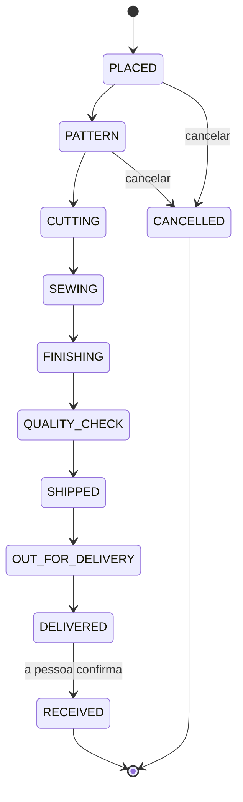

O estado gravado na tabela (`status`) é só um índice para a varredura; a verdade é o plano mais o relógio. A gravação
do índice não muda a versão da encomenda, para que a varredura não invalide a versão que a tela tem em mãos.

## 5. A fábrica fictícia

**Fábrica FashionAI — Unidade Aurora**, Polo Têxtil da Serra do Carretel, Vale das Agulhas (**local fictício**;
nenhuma empresa ou endereço real). Código `FAI-FAB-01`.

| Etapa | O que a fábrica faz |
|---|---|
| Encomenda recebida | Confere a ficha técnica congelada e reserva o tecido. |
| Modelagem | Traça o molde a partir das medidas da ficha e gradua para o tamanho escolhido. |
| Corte | Enfesta e corta o tecido; daqui em diante não é possível cancelar. |
| Costura | Une as partes na ordem de montagem: costuras, bolsos, gola e mangas. |
| Acabamento | Arremates, passadoria e as etiquetas de composição e de cuidados. |
| Controle de qualidade | Confere cada medida-chave contra a tolerância. |
| Expedida | Embala a peça e gera o código de rastreio. |
| Em rota de entrega | A transportadora fictícia segue para o CEP. |
| Entregue | Registra a entrega; falta a pessoa confirmar o recebimento. |

Identificadores: número de série `FAI-AAAA-XXXXXX` (6 caracteres sem ambiguidade, único), lote
`LAAAA-SS-LINHA` (ano e semana ISO + linha de produção: CAM camisetaria, CMS camisaria, MAL malharia, ALF alfaiataria
e agasalhos, CAL calças, CUR peças curtas, VES vestidos e peças inteiras) e rastreio `FAI-TRK-XXXX-XXXX` (fictício,
mostrado só depois da expedição).

## 6. Regras puras

### 6.1 Tipo de peça
Palavras da família e da modelagem (pt, en, es) → subcategoria da taxonomia (camiseta, camisa, blusa, regata, polo,
suéter, moletom, cardigã, colete, blazer, jaqueta, casaco, parka, calça jeans, alfaiataria, chino, cargo, jogger,
legging, pantacourt, short, saia, vestido, macacão, macaquinho, jardineira, conjunto…). Sem correspondência → *Top*.
Cor: primeira cor reconhecida no campo *Cores* → código da paleta; sem cor reconhecida → `multicolor`.

### 6.2 Composição
1. Percentuais explícitos no tecido ("95% algodão, 5% elastano") → usados como estão (normalizados para 100%).
2. Senão, itens `MATERIAL` da BOM da revisão → fibras reconhecidas nos nomes, proporcionais à quantidade.
3. Senão, fibras reconhecidas no texto do tecido: uma fibra → 100%; elastano junto de outras → 3% de elastano e o
   restante dividido entre as demais.
4. Nada reconhecido → "fibra não especificada" (a etiqueta usa o perfil mais cuidadoso).

### 6.3 Etiqueta de cuidados
O perfil mais delicado entre as fibras com pelo menos 10% define a etiqueta:

| Perfil | Fibras/tecidos | Lavagem | Alvejante | Tambor | Passar | A seco | Secagem natural | `TipoLavagem` |
|---|---|---|---|---|---|---|---|---|
| Couro | couro, camurça, couro sintético | não lavar | não | não | não | só profissional (sintético: não) | pendurada à sombra | `NAO_LAVAR` |
| Nobre | seda, lã, caxemira | à mão até 30 °C | não | não | baixa (110 °C) | permitida | na horizontal à sombra (seda: pendurada à sombra) | `LAVAR_A_MAO` |
| Delicado | viscose, cetim, veludo, malha/tricô | máquina 30 °C, ciclo delicado | não | não | baixa | permitida | pendurada à sombra (malha: na horizontal) | `MAQUINA_30_DELICADO` |
| Jeans | denim | máquina 40 °C | não | baixa | média (150 °C) | permitida | pendurada | `MAQUINA_40` |
| Sintético | poliéster, poliamida, acrílico, moletom | máquina 40 °C | não | baixa | baixa | permitida | pendurada | `MAQUINA_40` |
| Resistente | algodão, linho, lona, veludo cotelê | máquina 40 °C | sem cloro | média (linho: baixa) | alta (200 °C) | permitida | pendurada | `MAQUINA_40` |
| Não especificado | — | à mão até 30 °C | não | não | baixa | permitida | pendurada à sombra | `LAVAR_A_MAO` |

Elastano presente limita o tambor a "baixa" e o ferro a "baixa". Dicas de conservação em texto (código + tradução):
guardar no cabide ou dobrada (malhas), vincos com vapor, frequência de lavagem (jeans e lã: arejar entre usos),
lavar do avesso, lavar separado na primeira vez, e manchas comuns de forma genérica (agir rápido, água fria e sabão
neutro, testar numa parte escondida, não esfregar; gordura com detergente neutro). Os códigos de lavagem viram linhas de
`TipoLavagem` criadas pela migration quando ainda não existirem.

### 6.4 Tamanho e medidas
Grade do `SizeOptionsService` para o tipo de peça (letras PP…XG ou numeração 34…50). Tamanho-base da ficha: M (letras)
ou 40 (numeração). Gradação fictícia: ±3% por tamanho, arredondada a 0,5 cm. Tolerância: ±1 cm abaixo de 50 cm,
±1,5 cm até 100 cm e ±2 cm acima. O controle de qualidade registra uma medida conferida determinística dentro da
tolerância.

### 6.5 Preço fictício (R$)
`preço da peça = base(família) × fator(tecido) × fator(complexidade)`, arredondado para o real de cima menos R$ 0,10,
mais frete fictício pela região do CEP. **Nunca depende do tamanho nem do corpo.**

- Base: camisetaria 89 · camisaria 149 · malharia 179 · alfaiataria/agasalhos 279 · calças 169 · peças curtas 129 ·
  vestidos/peças inteiras 219.
- Tecido: algodão 1,00 · jeans 1,10 · linho 1,25 · lã 1,45 · caxemira 2,10 · seda 1,60 · cetim 1,20 · viscose 1,05 ·
  poliéster 0,95 · poliamida 1,00 · acrílico 0,95 · moletom 1,05 · malha 1,00 · veludo cotelê 1,15 · veludo 1,30 ·
  lona 1,05 · couro 2,40 · camurça 2,30 · couro sintético 1,35 · misto/não reconhecido 1,10.
- Complexidade: detalhes preenchidos (bolsos, gola, mangas, fechamentos, acabamentos, estampa) + 1 a cada 4 medidas:
  até 2 → baixa ×1,00; 3–5 → média ×1,12; 6 ou mais → alta ×1,25.
- Frete por região (primeiro dígito do CEP): SP 0–1 R$ 14,90 · RJ/ES 2 R$ 19,90 · MG 3 R$ 19,90 · BA/SE 4 R$ 27,90 ·
  PE/AL/PB/RN 5 R$ 29,90 · Norte e CE/PI/MA 6 R$ 34,90 · Centro-Oeste/TO/RO 7 R$ 24,90 · PR/SC 8 R$ 21,90 · RS 9 R$ 22,90.

### 6.6 Prazo (plano da fábrica)
**Padrão:** horas úteis (seg–sex, 9h–18h, horário de Brasília) a partir da confirmação:
modelagem +3 h; corte +9 h (alta complexidade +14 h); costura +5 h (tecidos delicados +4 h); acabamento + horas de
costura por família (camisetaria 9, camisaria 18, malharia 14, alfaiataria 36, calças 18, curtas 9, peças inteiras 27;
complexidade média +4, alta +9); controle de qualidade +6 h; expedição +4 h; em rota + trânsito da região
(SP 1, RJ/ES/MG/PR/SC 2, CO/RS 3, BA/SE/PE… 4, Norte/CE/PI/MA 5 dias úteis); entregue +4 h.
**Demonstração:** modelagem 15 s, corte 40 s, costura 65 s, acabamento 95 s, controle 120 s, expedição 140 s, em rota
160 s, entregue 180 s.

## 7. Passaporte

Reaproveita o passaporte da peça (`GarmentPassportService`) em vez de criar outro:

- origem nova `SOB_ENCOMENDA` (também disponível para quem declara uma peça feita sob encomenda por costureira);
- eventos novos `FACTORY_PLACED`, `FACTORY_PATTERN`, `FACTORY_CUTTING`, `FACTORY_SEWING`, `FACTORY_FINISHING`,
  `FACTORY_QUALITY_CHECK`, `FACTORY_SHIPPED`, `FACTORY_OUT_FOR_DELIVERY`, `FACTORY_DELIVERED` e `FACTORY_RECEIVED`,
  com proveniência `SYSTEM_RECORDED` (a pessoa não consegue criá-los à mão);
- campo `manufacturing` (registro de fabricação, coluna `garment_passports.manufacturing_json`) e campo de
  compartilhamento `MANUFACTURING`;
- composição e cuidados preenchidos em texto, no idioma de quem confirmou o recebimento.

| Campo | Passaporte privado | Link público (se o campo for escolhido) |
|---|---|---|
| Número de série, lote, fábrica e local fictícios | sim | `MANUFACTURING` |
| Datas de cada etapa | eventos | `HISTORY` (tipo e data) |
| Projeto e revisão de origem (número + digest da ficha) | sim | `MANUFACTURING` (revisão e digest) |
| Designers (a pessoa e membros com crédito) | sim | não |
| Composição | sim | `COMPOSITION` |
| Tamanho e medidas-chave (tolerância e conferida) | sim | `MANUFACTURING` |
| Etiqueta de cuidados | sim (`CARE` em texto + símbolos) | `CARE` e `MANUFACTURING` |
| Código de rastreio | só na encomenda | não |

## 8. Privacidade

- Dado mínimo de entrega: CEP de 8 dígitos e apelido opcional ("Casa"). Sem rua, número, nome ou telefone. Só os 5
  primeiros dígitos e a região ficam gravados; a tela mostra `01310-***`.
- Nenhum dado de pagamento: não há campos de cartão ou PIX; o preço é fictício e nada é cobrado.
- Aviso permanente: nenhuma peça física é enviada.
- Exclusão de conta: `GarmentDeliveryAccountDataCleanup` apaga as encomendas e eventos da pessoa; designers excluídos
  aparecem como "Conta excluída"; o passaporte segue a limpeza existente (o registro de fabricação sai junto com
  composição e cuidados).

## 9. Endpoints (6)

| Método e rota | O que faz | Autorização |
|---|---|---|
| `GET /api/atelier/projects/{id}/revisions/{revisionId}/garment-orders/quote?size=&cep=&speed=` | Prévia do checkout | participante do projeto |
| `POST /api/atelier/projects/{id}/revisions/{revisionId}/garment-orders` | Cria (idempotente por `requestId`) | participante do projeto |
| `GET /api/me/atelier/garment-orders` | Lista as encomendas da pessoa | dona |
| `GET /api/atelier/garment-orders/{id}` | Detalhe com linha do tempo | dona (outra pessoa: 404) |
| `POST /api/atelier/garment-orders/{id}/cancel` | Cancela antes do corte (`expectedVersion`) | dona |
| `POST /api/atelier/garment-orders/{id}/receive` | Confirma o recebimento (`expectedVersion`) | dona |

Corpo da criação: `{ "requestId", "size", "cep", "deliveryLabel", "speed": "STANDARD" | "DEMO", "acceptSimulation": true }`.

## 10. Modelo de dados (migration `V103__garment_delivery.sql`)

| Tabela/coluna | O que guarda |
|---|---|
| `garment_orders` | dona, projeto/revisão de origem (sem FK: a encomenda sobrevive ao projeto), número e título da revisão, digest e snapshot da ficha, cotação congelada (`quote_json`: tipo, composição, cuidados, medidas, preço, designers), plano (`plan_json`), tamanho, velocidade, prefixo do CEP e região, apelido, total, série, lote, rastreio, índice de estado, datas (feita, cancelada, recebida), peça criada, `request_id`/`request_digest` e versão. |
| `garment_order_events` | uma linha por encomenda e etapa (`UNIQUE(order_id, stage)`), com a data prevista em que a etapa aconteceu. |
| `garment_passports.manufacturing_json` | registro de fabricação do passaporte. |
| `TipoLavagem` | `MAQUINA_40`, `MAQUINA_30_DELICADO`, `LAVAR_A_MAO`, `NAO_LAVAR`, inseridos só se o código ainda não existir. |

Código: `fai-domain/.../model/garmentdelivery`, `fai-application/.../garmentdelivery` (regras puras
`GarmentFamilyRules`, `GarmentCompositionRules`, `GarmentCareRules`, `GarmentSizeRules`, `GarmentPriceRules`,
`FactoryPlanRules`; serviço `GarmentDeliveryService`; progresso `GarmentOrderProgress`; varredura
`GarmentOrderSweep`; recebimento `GarmentOrderReceipt`), passaporte em `application/passport/FactoryPassportIssuer`,
controller `fai-web/.../atelierproject/GarmentDeliveryController`, telas em `components/garment-delivery/`.

## 11. Fora de escopo

Pagamento, nota fiscal, endereço completo, transportadora real, fábrica real, produção física, devolução/troca,
mais de uma peça por encomenda, edição da encomenda depois de confirmada, FAI Points por encomenda e escolha de outro
tamanho-base além de M/40.

## 12. Como demonstrar

1. Entrar com uma conta local, abrir um projeto do Atelier com ficha completa e revisão publicada.
2. "Encomendar à Fábrica FashionAI" → escolher tamanho, CEP e **Demonstração** → "Confirmar encomenda (simulação, sem
   cobrança)".
3. Acompanhar em `/atelier/orders/{id}` (≈ 3 min): cancelar fica disponível até o corte; rastreio aparece na expedição;
   o sino avisa a expedição e a entrega.
4. "Confirmar recebimento" → unboxing → abrir a peça, o passaporte (registro de fabricação, eventos do sistema,
   etiqueta) e o ACERVO; a Lavanderia mostra a peça no grupo do tipo de lavagem quando ela for marcada como usada.

## 13. Verificação no navegador (2026-11-16)

Stack local: API na porta 8097 com banco próprio `fashionai_gd` (MySQL local; a V103 foi aplicada pelo Flyway junto
com as anteriores), mídia local, Next na porta 3007; conta de demonstração local `marina.costa`; projeto "Camisa Aurora
de linho" com ficha completa, revisão nº 1 publicada e BOM (linho lavado 1,6 m e entretela de algodão 0,2 m). Fluxo
percorrido em velocidade **Demonstração** com Playwright (Chromium), desktop 1360×900 e celular 390×844, escala 2.
Resultado: tipo Camisa, composição 89% linho e 11% algodão (da BOM), perfil Resistente, `TipoLavagem` `MAQUINA_40`,
preço fictício R$ 232,90 + frete SP R$ 14,90, ciclo completo em 3 minutos, notificações de expedição e entrega no sino,
peça no guarda-roupa, no ACERVO e na Lavanderia (grupo "Instrução MAQUINA_40" ao marcar a peça como usada).

| # | Captura | O que mostra |
|---|---|---|
| 1 | 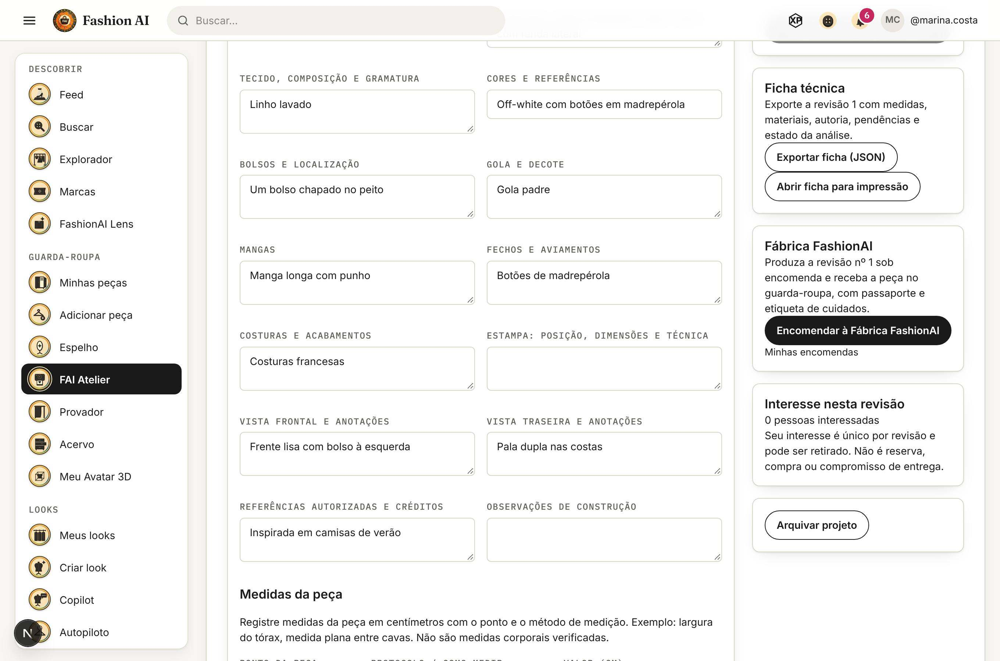 | Cartão "Fábrica FashionAI" no projeto, habilitado pela ficha completa |
| 2 | 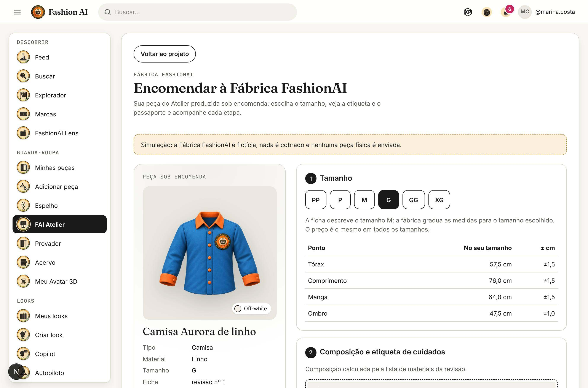 | Checkout: prévia da peça, passaporte previsto, tamanho G com medidas graduadas |
| 3 | 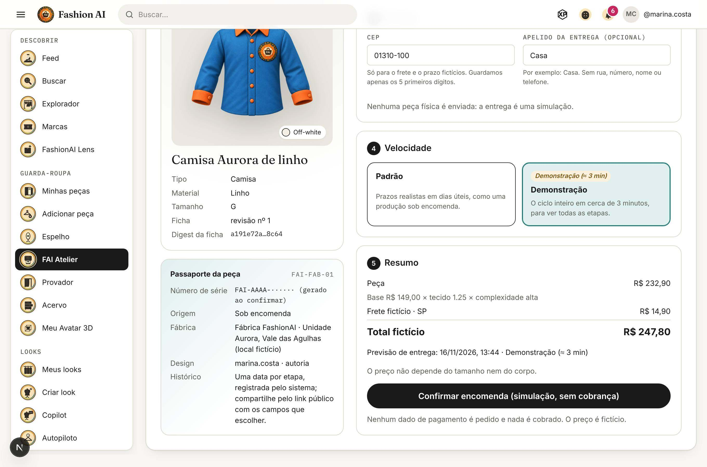 | Entrega só com CEP e apelido, velocidade Demonstração, preço fictício e o botão "simulação, sem cobrança" |
| 4 | 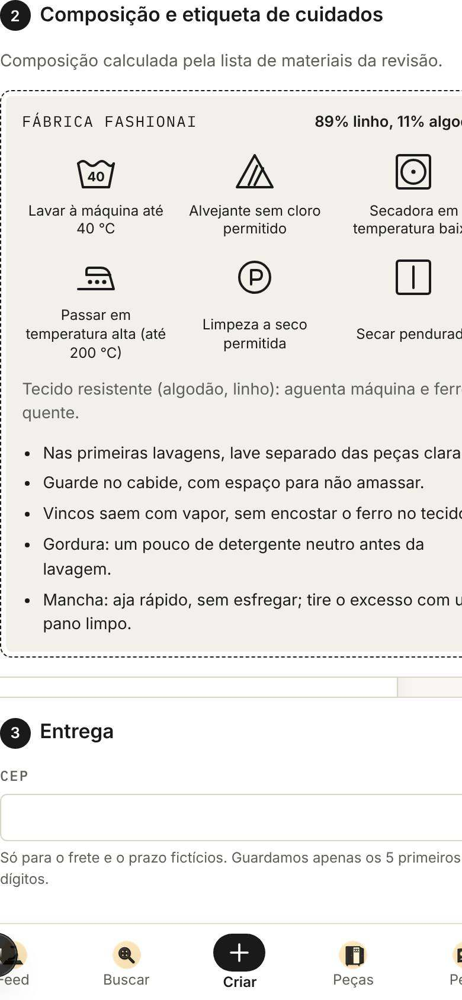 | Composição e etiqueta de cuidados no celular |
| 5 | 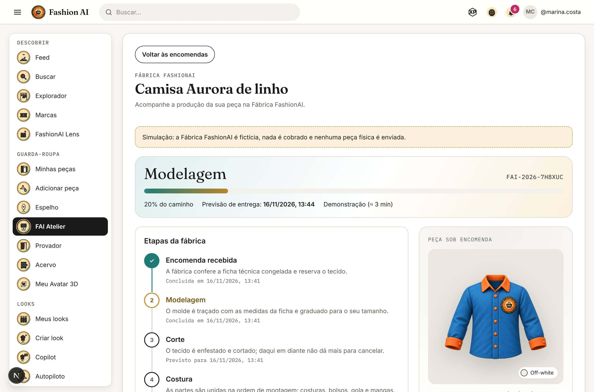 | Acompanhamento durante a produção |
| 6 | 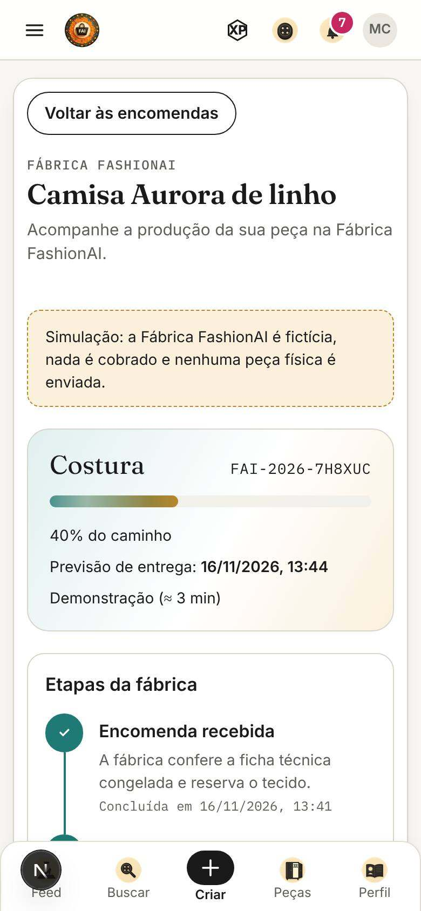 | Progresso e previsão no celular |
| 7 | 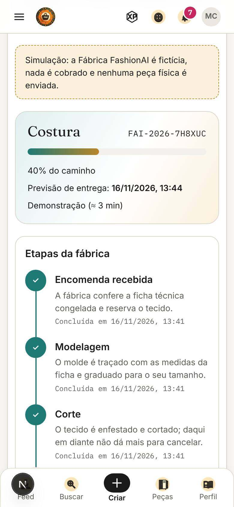 | Linha do tempo das etapas com o que a fábrica faz |
| 8 | 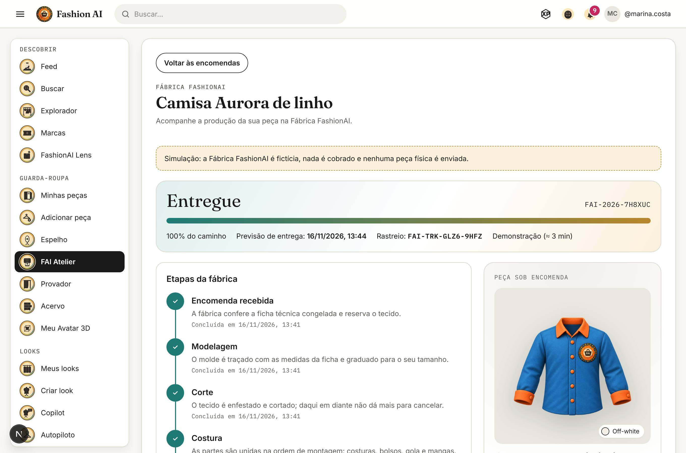 | Entregue, com rastreio e "Confirmar recebimento" |
| 9 | 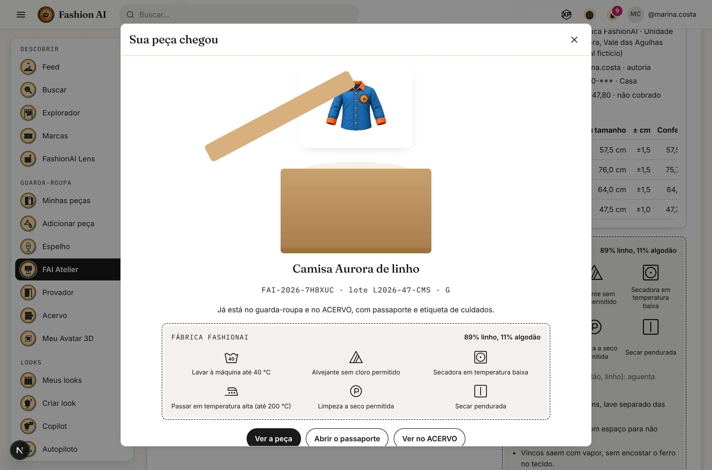 | Unboxing: série, lote, tamanho, etiqueta e links para peça, passaporte e ACERVO |
| 10 | 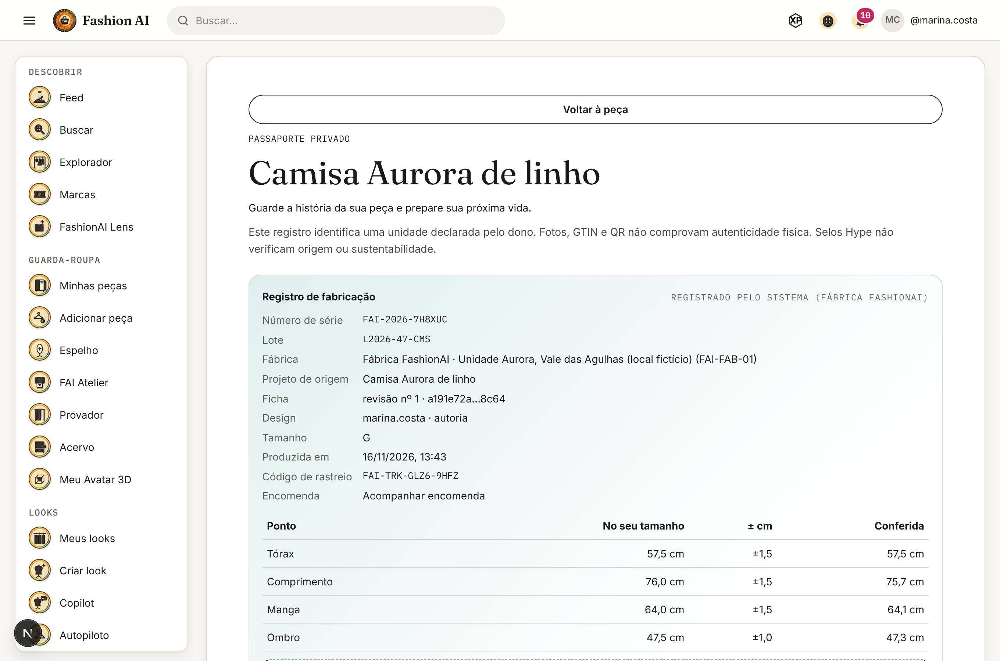 | Passaporte: registro de fabricação com revisão/digest, designers, medidas conferidas |
| 11 | 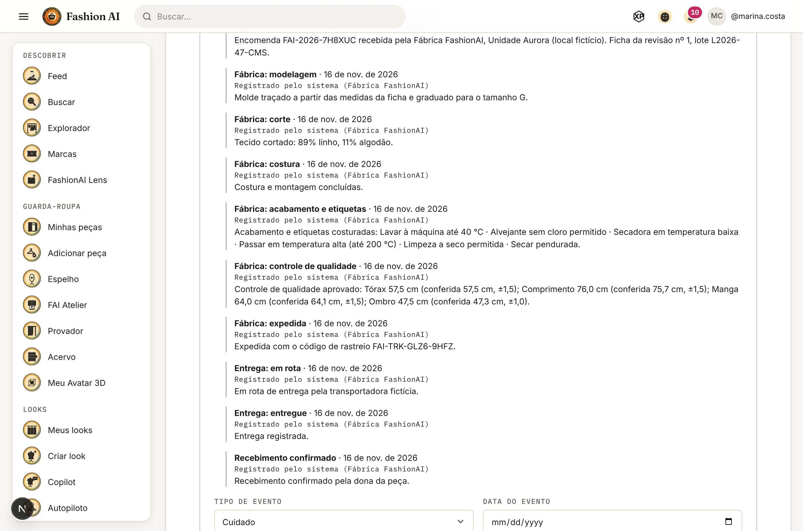 | Passaporte: eventos de cada etapa "Registrado pelo sistema" |
| 12 | 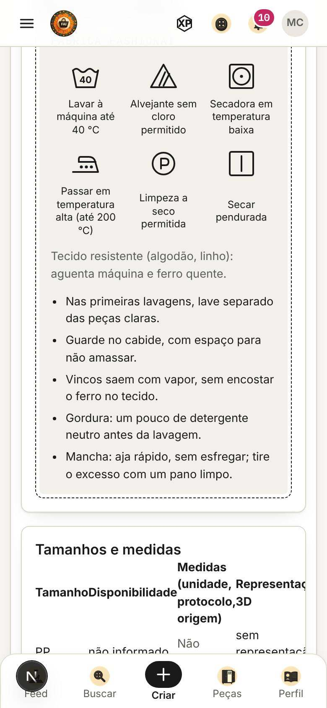 | Ficha da peça com a etiqueta de cuidados (celular) |
| 13 | 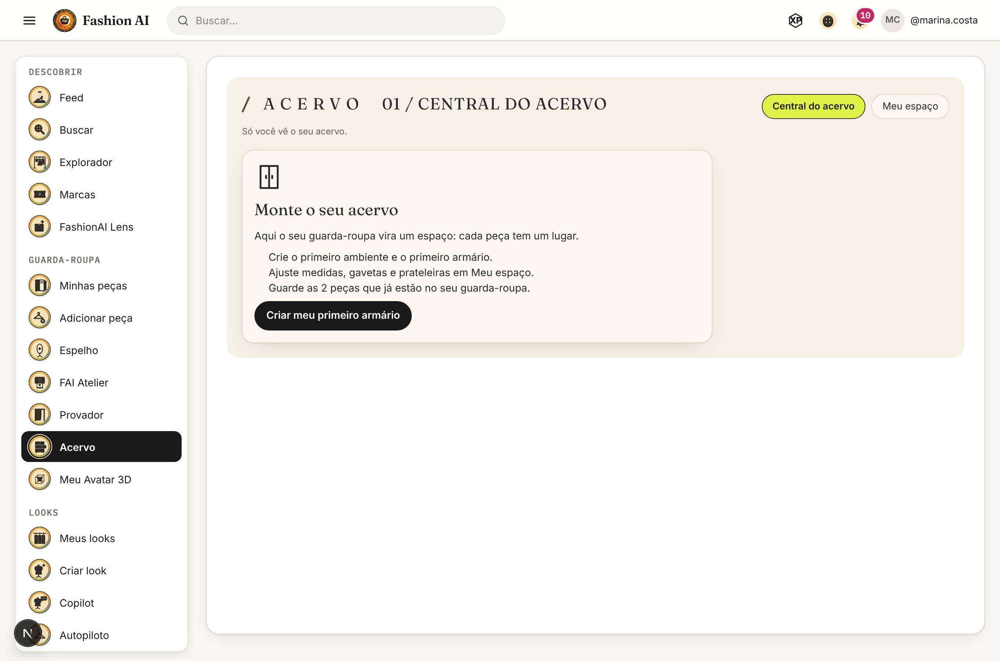 | A peça recebida no ACERVO |
| 14 | 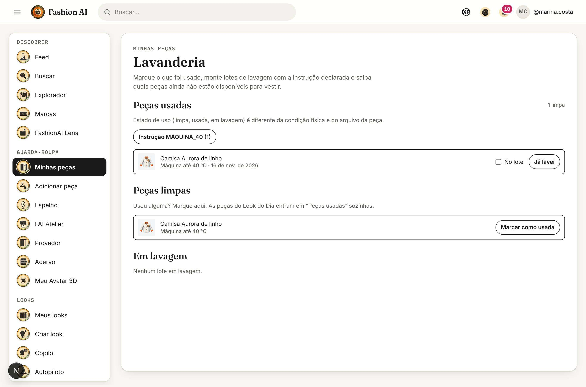 | Lavanderia agrupando pela instrução `MAQUINA_40` |
| 15 | 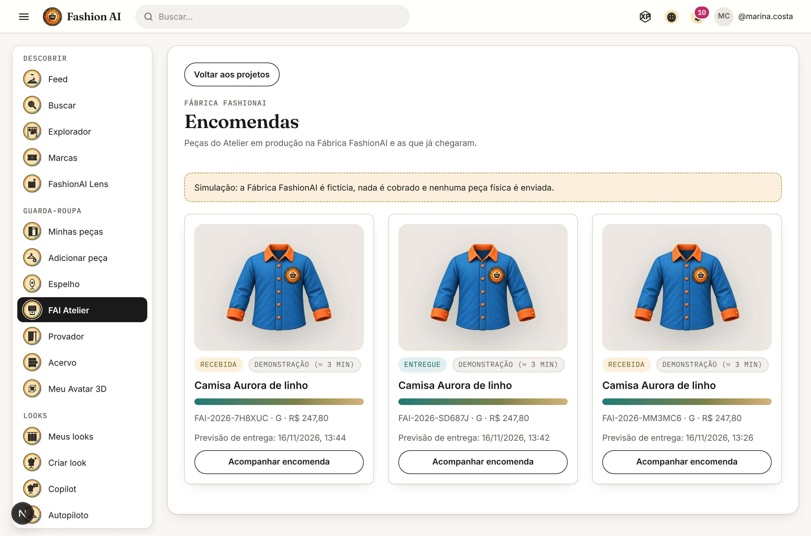 | Lista "Encomendas" do Atelier |

Limitações vistas: a imagem da peça é a ilustração padrão do tipo (a cor da ficha aparece na amostra ao lado); o
`TipoLavagem` aparece pelo código nos grupos da Lavanderia, como para qualquer opção cadastrada.
