# As dez fases e a ligação entre os cenários

O jogo tem dez fases, cada uma com cenário próprio, mapa de áreas e chefe. Cada arquivo em [fases/](fases/) traz o mapa
com salas, elevadores, escadas, esconderijos, passarelas, pontes e zonas de combate.

## Resumo

| # | Fase | Cenário | Chefe (arquétipo) | Vestimenta obrigatória |
| --- | --- | --- | --- | --- |
| 1 | [Porto das Vitrines](fases/fase-01-porto-das-vitrines.md) | Porto, navio, armazéns | Capataz do Cais | Macacão de Estivador |
| 2 | [Linha Carmesim e Bairro dos Retalhos](fases/fase-02-linha-carmesim-e-bairro-dos-retalhos.md) | Metrô, cidade velha, mercado | Fiscal das Traças | Uniforme de Metroviário |
| 3 | [Ateliê Vertical](fases/fase-03-atelie-vertical.md) | Torres, telhados, terraços | Lâmina do Ateliê | Macacão-Ventosa e Capa-Asa |
| 4 | [Mansão Cristal](fases/fase-04-mansao-cristal.md) | Mansão, jardins, piscinas | Anfitrião dos Espelhos | Traje de Gala e Maiô Hidrodinâmico |
| 5 | [Costa dos Naufrágios](fases/fase-05-costa-dos-naufragios.md) | Praia, cavernas, naufrágio, farol | Faroleiro | Traje de Mergulho de Naufrágio |
| 6 | [Expresso do Algodão](fases/fase-06-expresso-do-algodao.md) | Trem em movimento | Chefe do Trem | Uniforme de Ferroviário |
| 7 | [Campos de Algodão e Estrada do Fio](fases/fase-07-campos-de-algodao-e-estrada-do-fio.md) | Campos, fazenda, estrada | Rei da Estrada | Guarda-pó de Algodão Cru |
| 8 | [Floresta de Névoa e Selva de Seda](fases/fase-08-floresta-de-nevoa-e-selva-de-seda.md) | Floresta, selva, rio, ruínas | Sericultor e a Mariposa-Rainha | Casulo de Seda Viva |
| 9 | [Fábrica dos Teares](fases/fase-09-fabrica-dos-teares.md) | Represa, usina, fábrica | Tear-Mãe | Macacão Térmico Aluminizado |
| 10 | [Catedral e Coroa de Vidro](fases/fase-10-catedral-e-coroa-de-vidro.md) | Arquivo, catedral, topo da cidade | Coroa de Vidro (antagonista) | Traje Imperial de Vidro e a especial da história |

## Mapa do mundo

A jornada é um laço: sai da cidade pelo norte, entra no interior pelo leste e volta por baixo da cidade.

```mermaid
flowchart LR
    subgraph Cidade["Vítrea, a cidade"]
        F1["1 Porto das Vitrines"]
        F2["2 Linha Carmesim e Bairro dos Retalhos"]
        F3["3 Ateliê Vertical"]
        F4["4 Mansão Cristal"]
        F10["10 Catedral e Coroa de Vidro"]
    end
    subgraph Litoral["Litoral norte"]
        F5["5 Costa dos Naufrágios"]
    end
    subgraph Interior["Interior"]
        F6["6 Expresso do Algodão"]
        F7["7 Campos de Algodão e Estrada do Fio"]
        F8["8 Floresta de Névoa e Selva de Seda"]
        F9["9 Fábrica dos Teares"]
    end
    F1 -- "túnel do metrô de carga" --> F2
    F2 -- "Elevador Público da Encosta" --> F3
    F3 -- "voo de Capa-Asa" --> F4
    F4 -- "gruta e escadaria da falésia" --> F5
    F5 -- "cabo do farol até a estação" --> F6
    F6 -- "descarrilamento no viaduto" --> F7
    F7 -- "ponte de madeira e porteira" --> F8
    F8 -- "barcaça pelo rio" --> F9
    F9 -- "cápsula do Tubo de Fio" --> F10
```

## Por que cada ligação faz sentido

| De | Para | Ligação física | Motivo na história |
| --- | --- | --- | --- |
| 1 | 2 | O túnel que leva os fardos do porto ao bairro têxtil | A pessoa precisa de aliados e só os tem no bairro |
| 2 | 3 | O elevador público que une a cidade baixa à alta | Os aliados indicam que a prova está nos ateliês das torres |
| 3 | 4 | Planar do ponto mais alto das torres até a colina vizinha | Os documentos das torres citam o cofre da mansão |
| 4 | 5 | A queda pelo piso da piscina até a gruta da falésia | O cofre aponta para fora da cidade, e a saída por terra está fechada |
| 5 | 6 | O farol controla o sinal que para o trem | O trem é o único transporte para o interior |
| 6 | 7 | O trem cai do viaduto na beira das plantações | Sem trem, o caminho segue a pé e de caminhonete |
| 7 | 8 | A estrada acaba onde a mata começa | A fábrica fica depois da mata, rio abaixo |
| 8 | 9 | As barcaças de casulos descem o rio até a represa | A carga da selva é a matéria-prima da fábrica |
| 9 | 10 | O tubo de cápsulas que manda tecido para a Catedral | É a única entrada da cidade que ninguém vigia |

## Regras de desenho de fase

- Toda fase tem pelo menos dois refúgios ou esconderijos com bancada ou comerciante.
- Toda zona de combate tem uma rota furtiva e, quando o cenário permite, uma rota alta.
- A vestimenta obrigatória da fase é sempre obtida dentro dela, antes do trecho que a exige.
- O chefe entrega uma arma, um item de mobilidade ou uma vestimenta que a fase seguinte usa.
- Fases concluídas podem ser revisitadas pelo quadro de missões da Estação Bobina para buscar segredos.
