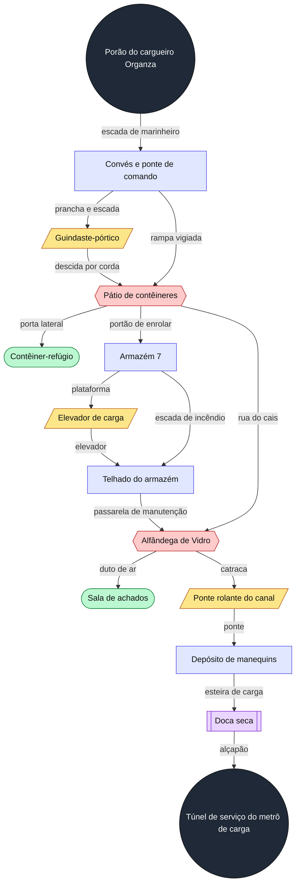

# Fase 1 — Porto das Vitrines

| Ambiente | Clima e hora | Nível | Dificuldade |
| --- | --- | --- | --- |
| Porto de carga, navio, armazéns e alfândega | Noite de chuva | 1 a 3 | Baixa: ensina cobertura, escalada e furtividade |

Entrada clandestina em Vítrea. O porto é um labirinto de contêineres de vidro que mostram a mercadoria. A fase ensina os comandos e termina com a primeira descida ao subsolo da cidade.

## Chegada

O jogo abre no porão do cargueiro Organza, atracado no cais. Não há fase anterior.

## Mapa

Formas: círculo é início ou saída; retângulo é sala ou área; hexágono é zona de combate; cápsula é esconderijo; paralelogramo é travessia; retângulo duplo é a arena do chefe. O texto de cada linha é o meio de ligação.

## Áreas

| Código | Área | Tipo | O que há |
| --- | --- | --- | --- |
| A1 | Porão do cargueiro Organza | Início | Tutorial de movimento entre fardos de tecido |
| A2 | Convés e ponte de comando | Sala ou área | Primeira arma; manifesto de carga indica o Armazém 7 |
| A3 | Guindaste-pórtico | Travessia | Passarela alta com vista do porto; ensina corda |
| A4 | Pátio de contêineres | Zona de combate | Primeiro combate aberto, com três alturas de empilhamento |
| A5 | Contêiner-refúgio | Esconderijo | Refúgio com bancada; primeiro kit de costura |
| A6 | Armazém 7 | Sala ou área | Mezanino, escritório e a vestimenta Macacão de Estivador |
| A7 | Elevador de carga | Travessia | Liga o piso do armazém ao telhado |
| A8 | Telhado do armazém | Sala ou área | Rota alta; colecionável e tirolesa improvisada |
| A9 | Alfândega de Vidro | Zona de combate | Scanners de roupa e catracas; combate ou disfarce |
| A10 | Sala de achados | Esconderijo | Armários para se esconder; atalho por duto |
| A11 | Ponte rolante do canal | Travessia | Ponte móvel sobre a água, operada por alavanca |
| A12 | Depósito de manequins | Sala ou área | Corredores escuros; manequins servem de esconderijo |
| A13 | Doca seca | Chefe | Arena do chefe, com guindastes e contêineres suspensos |
| A14 | Túnel de serviço do metrô de carga | Saída | Saída para a fase 2 |

## Conexões

| De | Para | Meio |
| --- | --- | --- |
| Porão do cargueiro Organza | Convés e ponte de comando | escada de marinheiro |
| Convés e ponte de comando | Guindaste-pórtico | prancha e escada |
| Guindaste-pórtico | Pátio de contêineres | descida por corda |
| Convés e ponte de comando | Pátio de contêineres | rampa vigiada |
| Pátio de contêineres | Contêiner-refúgio | porta lateral |
| Pátio de contêineres | Armazém 7 | portão de enrolar |
| Armazém 7 | Elevador de carga | plataforma |
| Elevador de carga | Telhado do armazém | elevador |
| Armazém 7 | Telhado do armazém | escada de incêndio |
| Telhado do armazém | Alfândega de Vidro | passarela de manutenção |
| Pátio de contêineres | Alfândega de Vidro | rua do cais |
| Alfândega de Vidro | Sala de achados | duto de ar |
| Alfândega de Vidro | Ponte rolante do canal | catraca |
| Ponte rolante do canal | Depósito de manequins | ponte |
| Depósito de manequins | Doca seca | esteira de carga |
| Doca seca | Túnel de serviço do metrô de carga | alçapão |

## Zonas de combate

| Zona | Inimigos | Perigos e cobertura | Rota furtiva |
| --- | --- | --- | --- |
| Pátio de contêineres | Estivadores armados e vigias | Contêineres como cobertura; carga suspensa pode ser solta | Por cima das pilhas, via guindaste |
| Alfândega de Vidro | Agentes da alfândega e scanners | Scanner dispara alarme se a roupa não for de estivador | Disfarce com o Macacão de Estivador ou duto da Sala de achados |
| Depósito de manequins | Patrulha com lanternas | Escuro; manequins quebram e fazem barulho | Ficar imóvel entre os manequins |

## Vestimentas da fase

Macacão de Estivador (obrigatório para cruzar a alfândega sem alarme); Capa de Chuva Espelhada (opcional). Detalhes em [05-vestimentas.md](../05-vestimentas.md).

## Exploração

Três croquis escondidos (telhado, ponte de comando, depósito). Missão secundária: devolver a caixa de linhas de um estivador, que passa a vender munição.

## Chefe da fase: Capataz do Cais

Arquétipo: bruto em exoesqueleto de carga. Arena: Doca seca.

1. Ele arremessa contêineres; a pessoa se protege e atira na bateria das costas quando ele ergue os braços.
2. A doca alaga até o joelho e ele eletrifica a água; é preciso subir nas passarelas e soltar cargas suspensas sobre ele.
3. Sem bateria, ele parte para o corpo a corpo; aparar três golpes abre a finalização.

Recompensa: Gancho-agulha (mobilidade) e a chave do túnel de serviço.

| História | Quem é o chefe |
| --- | --- |
| 1 Modelo Zero | Bastien Roque, o Guindaste |
| 2 Licença Vencida | Chefe de alfândega Morrow, o Lacre |
| 3 Antivitrine | Sargento Dock Halloran |
| 4 Fio Único | Goro, o Âncora |
| 5 Vidro Tropical | Capataz Tibério Contêiner |

## Saída

O alçapão da doca seca dá no túnel do metrô de carga, que leva os fardos do porto ao Bairro dos Retalhos. A pessoa segue os trilhos a pé e entra na fase 2 sem trocar de lugar.
