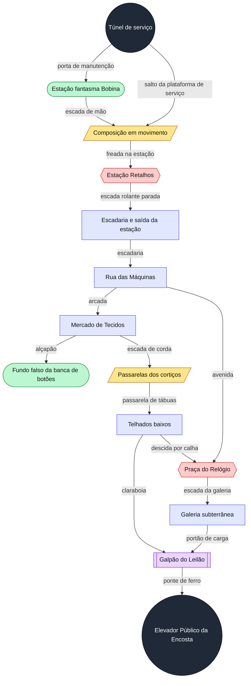

# Fase 2 — Linha Carmesim e Bairro dos Retalhos

| Ambiente | Clima e hora | Nível | Dificuldade |
| --- | --- | --- | --- |
| Metrô, cidade velha, mercado de tecidos e cortiços | Madrugada e amanhecer | 3 a 6 | Baixa a média: primeiro distrito aberto, com lojas e missões |

O metrô leva ao coração popular de Vítrea. O Bairro dos Retalhos é o distrito mais aberto da cidade e funciona como base: comerciantes, bancada, aliados e missões secundárias.

## Chegada

O túnel de serviço do porto (fase 1) desemboca nos trilhos da Linha Carmesim.

## Mapa

Formas: círculo é início ou saída; retângulo é sala ou área; hexágono é zona de combate; cápsula é esconderijo; paralelogramo é travessia; retângulo duplo é a arena do chefe. O texto de cada linha é o meio de ligação.

## Áreas

| Código | Área | Tipo | O que há |
| --- | --- | --- | --- |
| B1 | Túnel de serviço | Início | Trilhos energizados; exige o Uniforme de Metroviário para cruzar |
| B2 | Estação fantasma Bobina | Esconderijo | Refúgio dos aliados, com bancada e quadro de missões |
| B3 | Composição em movimento | Travessia | Travessia pelo teto e pelos vagões do metrô |
| B4 | Estação Retalhos | Zona de combate | Plataformas, catracas e bilheteria; combate em dois níveis |
| B5 | Escadaria e saída da estação | Sala ou área | Sobe à rua; primeira vista do bairro |
| B6 | Rua das Máquinas | Sala ou área | Oficinas de costura, lojas de armas e de vestimentas |
| B7 | Mercado de Tecidos | Sala ou área | Bazar coberto com três andares de bancas |
| B8 | Fundo falso da banca de botões | Esconderijo | Esconderijo e comerciante de munição |
| B9 | Passarelas dos cortiços | Travessia | Tábuas e varais entre prédios; rota alta |
| B10 | Telhados baixos | Sala ou área | Caixas d'água, antenas e pombais; colecionáveis |
| B11 | Praça do Relógio | Zona de combate | Blitz de fiscalização; combate aberto |
| B12 | Galeria subterrânea | Sala ou área | Lojas fechadas e passagem sob a praça |
| B13 | Galpão do Leilão | Chefe | Arena do chefe, com mezaninos e claraboia |
| B14 | Elevador Público da Encosta | Saída | Saída para a fase 3 |

## Conexões

| De | Para | Meio |
| --- | --- | --- |
| Túnel de serviço | Estação fantasma Bobina | porta de manutenção |
| Túnel de serviço | Composição em movimento | salto da plataforma de serviço |
| Estação fantasma Bobina | Composição em movimento | escada de mão |
| Composição em movimento | Estação Retalhos | freada na estação |
| Estação Retalhos | Escadaria e saída da estação | escada rolante parada |
| Escadaria e saída da estação | Rua das Máquinas | escadaria |
| Rua das Máquinas | Mercado de Tecidos | arcada |
| Mercado de Tecidos | Fundo falso da banca de botões | alçapão |
| Mercado de Tecidos | Passarelas dos cortiços | escada de corda |
| Passarelas dos cortiços | Telhados baixos | passarela de tábuas |
| Rua das Máquinas | Praça do Relógio | avenida |
| Telhados baixos | Praça do Relógio | descida por calha |
| Praça do Relógio | Galeria subterrânea | escada da galeria |
| Galeria subterrânea | Galpão do Leilão | portão de carga |
| Telhados baixos | Galpão do Leilão | claraboia |
| Galpão do Leilão | Elevador Público da Encosta | ponte de ferro |

## Zonas de combate

| Zona | Inimigos | Perigos e cobertura | Rota furtiva |
| --- | --- | --- | --- |
| Estação Retalhos | Guardas de estação | Trens passam sem parar e matam em um golpe | Pelos dutos acima das plataformas |
| Praça do Relógio | Fiscais, drones-traça e viatura | Bancas viram cobertura frágil; vitrines denunciam a posição | Pela Galeria subterrânea |
| Telhados baixos | Bandidos locais | Telhas soltas cedem | Varais permitem derrubar inimigos em silêncio |

## Vestimentas da fase

Uniforme de Metroviário (obrigatório nos trilhos energizados); Jaqueta de Retalhos (opcional, dá desconto no mercado). Detalhes em [05-vestimentas.md](../05-vestimentas.md).

## Exploração

Seis croquis. Missões secundárias: recuperar a máquina de costura roubada de uma oficina; escoltar um carregamento de retalhos; corrida de telhados contra o relógio.

## Chefe da fase: Fiscal das Traças

Arquétipo: comandante de enxame de drones que roem roupa. Arena: Galpão do Leilão.

1. O enxame cobre o galpão; é preciso destruir as três colmeias nos mezaninos enquanto as traças desgastam a vestimenta.
2. O chefe ergue um escudo de drones; tinta ou fumaça desorienta o enxame e abre a guarda.
3. As traças se juntam num único drone pesado; derrubá-lo pela claraboia encerra a luta.

Recompensa: Lançador de botões e o passe do Elevador Público.

| História | Quem é o chefe |
| --- | --- |
| 1 Modelo Zero | Inspetora Maëlle Corbin |
| 2 Licença Vencida | Auditora Priya Stone |
| 3 Antivitrine | Agente Fenwick, o Lente |
| 4 Fio Único | Fiscal Hisoka Nara |
| 5 Vidro Tropical | Fiscal Dalva Queiroga |

## Saída

A ponte de ferro do galpão leva ao Elevador Público da Encosta, que liga a cidade baixa à cidade alta. A subida mostra as torres de vidro se aproximando e termina no saguão da fase 3.
