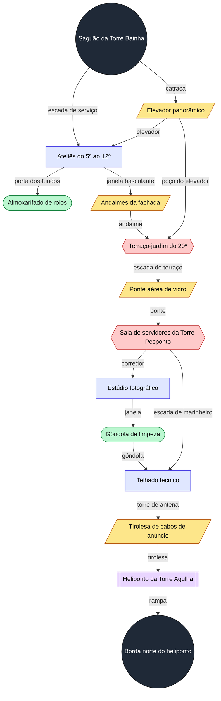

# Fase 3 — Ateliê Vertical

| Ambiente | Clima e hora | Nível | Dificuldade |
| --- | --- | --- | --- |
| Torres de vidro, telhados, terraços, andaimes e pontes aéreas | Dia claro com vento forte | 6 a 9 | Média: fase de escalada, com queda mortal |

O centro de Vítrea é vertical. A fase sobe uma torre de ateliês por dentro e por fora, cruza para as torres vizinhas e termina no ponto mais alto, de onde se vê a colina das mansões.

## Chegada

O Elevador Público da Encosta (fase 2) abre no saguão térreo da Torre Bainha.

## Mapa

Formas: círculo é início ou saída; retângulo é sala ou área; hexágono é zona de combate; cápsula é esconderijo; paralelogramo é travessia; retângulo duplo é a arena do chefe. O texto de cada linha é o meio de ligação.

## Áreas

| Código | Área | Tipo | O que há |
| --- | --- | --- | --- |
| C1 | Saguão da Torre Bainha | Início | Recepção com catracas e vitrines de identificação |
| C2 | Ateliês do 5º ao 12º | Sala ou área | Salas de corte e prova; documentos da história |
| C3 | Elevador panorâmico | Travessia | Para no 12º; o poço serve de rota de escalada |
| C4 | Almoxarifado de rolos | Esconderijo | Refúgio com bancada, atrás das prateleiras |
| C5 | Andaimes da fachada | Travessia | Escalada externa; exige o Macacão-Ventosa no trecho de vidro liso |
| C6 | Terraço-jardim do 20º | Zona de combate | Combate entre canteiros e espelhos d'água |
| C7 | Ponte aérea de vidro | Travessia | Liga a Torre Bainha à Torre Pesponto; o piso racha sob tiros |
| C8 | Sala de servidores da Torre Pesponto | Zona de combate | Combate em corredores estreitos; invasão de vitrines |
| C9 | Estúdio fotográfico | Sala ou área | Fundos infinitos e refletores; quebra-cabeça de luz |
| C10 | Gôndola de limpeza | Esconderijo | Esconderijo móvel na fachada; sobe e desce |
| C11 | Telhado técnico | Sala ou área | Antenas, dutos e caixas de ar; rota alta |
| C12 | Tirolesa de cabos de anúncio | Travessia | Travessia até a Torre Agulha |
| C13 | Heliponto da Torre Agulha | Chefe | Arena do chefe, sem parapeito |
| C14 | Borda norte do heliponto | Saída | Saída para a fase 4 |

## Conexões

| De | Para | Meio |
| --- | --- | --- |
| Saguão da Torre Bainha | Ateliês do 5º ao 12º | escada de serviço |
| Saguão da Torre Bainha | Elevador panorâmico | catraca |
| Elevador panorâmico | Ateliês do 5º ao 12º | elevador |
| Ateliês do 5º ao 12º | Almoxarifado de rolos | porta dos fundos |
| Ateliês do 5º ao 12º | Andaimes da fachada | janela basculante |
| Elevador panorâmico | Terraço-jardim do 20º | poço do elevador |
| Andaimes da fachada | Terraço-jardim do 20º | andaime |
| Terraço-jardim do 20º | Ponte aérea de vidro | escada do terraço |
| Ponte aérea de vidro | Sala de servidores da Torre Pesponto | ponte |
| Sala de servidores da Torre Pesponto | Estúdio fotográfico | corredor |
| Estúdio fotográfico | Gôndola de limpeza | janela |
| Gôndola de limpeza | Telhado técnico | gôndola |
| Sala de servidores da Torre Pesponto | Telhado técnico | escada de marinheiro |
| Telhado técnico | Tirolesa de cabos de anúncio | torre de antena |
| Tirolesa de cabos de anúncio | Heliponto da Torre Agulha | tirolesa |
| Heliponto da Torre Agulha | Borda norte do heliponto | rampa |

## Zonas de combate

| Zona | Inimigos | Perigos e cobertura | Rota furtiva |
| --- | --- | --- | --- |
| Terraço-jardim do 20º | Seguranças de torre e atiradores | Vento empurra quem fica na borda; espelhos d'água refletem a posição | Por baixo, pendurado na laje |
| Sala de servidores da Torre Pesponto | Técnicos armados e torretas | Torretas ligadas às vitrines | Desligar a energia no quadro e avançar no escuro |
| Telhado técnico | Patrulha de telhado | Claraboias quebram | Dutos de ar |

## Vestimentas da fase

Macacão-Ventosa (obrigatório no vidro liso da fachada); Capa-Asa (obrigatória para a saída). Detalhes em [05-vestimentas.md](../05-vestimentas.md).

## Exploração

Cinco croquis nos ateliês. Missão secundária: fotografar três peças proibidas para um aliado. Desafio de escalada cronometrado nos andaimes.

## Chefe da fase: Lâmina do Ateliê

Arquétipo: duelista com tesouras longas. Arena: Heliponto da Torre Agulha.

1. Duelo no centro do heliponto; aparar no tempo certo quebra a postura do chefe.
2. O chefe corta os cabos de anúncio, que chicoteiam a arena; é preciso desviar e usar o gancho para voltar da borda.
3. Com o vento no auge, o chefe investe em linha reta; desviar na borda o deixa pendurado e abre a finalização.

Recompensa: Tesouras gêmeas (corpo a corpo) e a vestimenta Capa-Asa.

| História | Quem é o chefe |
| --- | --- |
| 1 Modelo Zero | Contramestre Lucien Arnaud, o Bisturi |
| 2 Licença Vencida | Kincaid, o Navalha |
| 3 Antivitrine | Lady Shears |
| 4 Fio Único | Kiri, a Cortadora |
| 5 Vidro Tropical | Mestre Zé Tesoura |

## Saída

Do heliponto se vê a Colina dos Mecenas, do outro lado de um vale de avenidas. Com a Capa-Asa, a pessoa plana da borda norte até os jardins da Mansão Cristal, onde a fase 4 começa.
