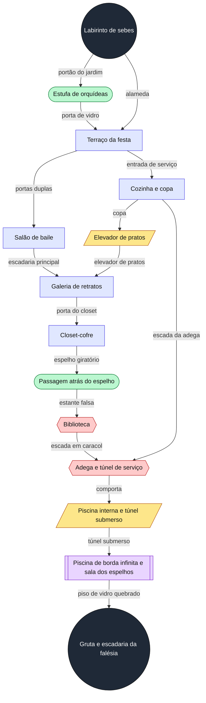

# Fase 4 — Mansão Cristal

| Ambiente | Clima e hora | Nível | Dificuldade |
| --- | --- | --- | --- |
| Mansão no alto da falésia, jardins, piscinas, salões e adega | Noite de gala | 9 a 12 | Média: infiltração social, com combate só se o disfarce cair |

A elite de Vítrea se reúne num baile. A fase é de infiltração: circular entre convidados, abrir o cofre e descobrir que a origem do poder do Império fica fora da cidade.

## Chegada

O voo com a Capa-Asa (fase 3) termina no labirinto de sebes do jardim.

## Mapa

Formas: círculo é início ou saída; retângulo é sala ou área; hexágono é zona de combate; cápsula é esconderijo; paralelogramo é travessia; retângulo duplo é a arena do chefe. O texto de cada linha é o meio de ligação.

## Áreas

| Código | Área | Tipo | O que há |
| --- | --- | --- | --- |
| D1 | Labirinto de sebes | Início | Pouso; guardas com cães mecânicos |
| D2 | Estufa de orquídeas | Esconderijo | Refúgio com bancada; aqui se veste o Traje de Gala |
| D3 | Terraço da festa | Sala ou área | Convidados, garçons e orquestra; área social sem armas |
| D4 | Salão de baile | Sala ou área | Pista de dança; escuta de conversas revela a senha do cofre |
| D5 | Cozinha e copa | Sala ou área | Rota dos empregados; elevador de pratos |
| D6 | Elevador de pratos | Travessia | Sobe ao andar íntimo sem passar pela escadaria vigiada |
| D7 | Galeria de retratos | Sala ou área | Sensores no piso; quebra-cabeça de passos |
| D8 | Closet-cofre | Sala ou área | Objetivo da fase: o documento que aponta para o interior |
| D9 | Passagem atrás do espelho | Esconderijo | Corredor secreto entre o closet e a biblioteca |
| D10 | Biblioteca | Zona de combate | Combate se o alarme tocar; estantes móveis |
| D11 | Adega e túnel de serviço | Zona de combate | Barris, prateleiras e pouca luz |
| D12 | Piscina interna e túnel submerso | Travessia | Liga a adega à piscina de borda infinita; exige fôlego |
| D13 | Piscina de borda infinita e sala dos espelhos | Chefe | Arena do chefe, sobre a falésia |
| D14 | Gruta e escadaria da falésia | Saída | Saída para a fase 5 |

## Conexões

| De | Para | Meio |
| --- | --- | --- |
| Labirinto de sebes | Estufa de orquídeas | portão do jardim |
| Labirinto de sebes | Terraço da festa | alameda |
| Estufa de orquídeas | Terraço da festa | porta de vidro |
| Terraço da festa | Salão de baile | portas duplas |
| Terraço da festa | Cozinha e copa | entrada de serviço |
| Cozinha e copa | Elevador de pratos | copa |
| Elevador de pratos | Galeria de retratos | elevador de pratos |
| Salão de baile | Galeria de retratos | escadaria principal |
| Galeria de retratos | Closet-cofre | porta do closet |
| Closet-cofre | Passagem atrás do espelho | espelho giratório |
| Passagem atrás do espelho | Biblioteca | estante falsa |
| Biblioteca | Adega e túnel de serviço | escada em caracol |
| Cozinha e copa | Adega e túnel de serviço | escada da adega |
| Adega e túnel de serviço | Piscina interna e túnel submerso | comporta |
| Piscina interna e túnel submerso | Piscina de borda infinita e sala dos espelhos | túnel submerso |
| Piscina de borda infinita e sala dos espelhos | Gruta e escadaria da falésia | piso de vidro quebrado |

## Zonas de combate

| Zona | Inimigos | Perigos e cobertura | Rota furtiva |
| --- | --- | --- | --- |
| Labirinto de sebes | Guardas e cães mecânicos | Holofotes giratórios | Seguir as sebes altas |
| Biblioteca | Seguranças de terno | Estantes podem ser derrubadas | Passagem atrás do espelho |
| Adega e túnel de serviço | Capangas da casa | Barris de vinho rolam; álcool pega fogo | Prateleiras altas |

## Vestimentas da fase

Traje de Gala (obrigatório para circular no baile); Maiô Hidrodinâmico (obrigatório no túnel submerso, obtido na estufa em versão simples e melhorado pelo chefe). Detalhes em [05-vestimentas.md](../05-vestimentas.md).

## Exploração

Quatro croquis. Missão secundária: trocar a joia falsa de uma convidada pela verdadeira. Diálogos opcionais com convidados dão pistas e Fios.

## Chefe da fase: Anfitrião dos Espelhos

Arquétipo: colecionador que luta entre reflexos. Arena: Piscina de borda infinita e sala dos espelhos.

1. Na sala dos espelhos, só um reflexo é real; pegadas molhadas no piso denunciam o verdadeiro.
2. O chefe leva a luta para a piscina de borda infinita e solta drones-garçom; lutar na água reduz a mobilidade.
3. O piso de vidro da piscina racha; cada golpe certo o quebra mais, e a queda final leva os dois à gruta.

Recompensa: Pistola de alfinetes de precisão e a vestimenta Maiô Hidrodinâmico.

| História | Quem é o chefe |
| --- | --- |
| 1 Modelo Zero | Madame Séraphine d'Orsel |
| 2 Licença Vencida | Magnata Gideon Laurier |
| 3 Antivitrine | Lorde Ashby Crane |
| 4 Fio Único | Senhora Mayumi Shirogane |
| 5 Vidro Tropical | Dona Carlota Albuquerque Leal |

## Saída

A queda pelo piso da piscina termina numa gruta dentro da falésia. Uma escadaria talhada na pedra desce até a areia, onde começa a fase 5.
