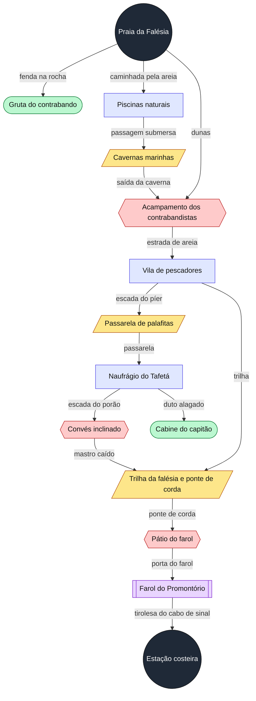

# Fase 5 — Costa dos Naufrágios

| Ambiente | Clima e hora | Nível | Dificuldade |
| --- | --- | --- | --- |
| Praia, falésias, cavernas marinhas, naufrágio, vila de pescadores e farol | Amanhecer com maré subindo | 12 a 15 | Média: exploração com água e tempo de maré |

A primeira fase fora da cidade. A praia guarda os navios que o Império afundou e os contrabandistas que vivem deles. O objetivo é chegar ao farol, que controla o sinal da ferrovia costeira.

## Chegada

A escadaria da falésia (fase 4) termina na areia, sob a mansão.

## Mapa

Formas: círculo é início ou saída; retângulo é sala ou área; hexágono é zona de combate; cápsula é esconderijo; paralelogramo é travessia; retângulo duplo é a arena do chefe. O texto de cada linha é o meio de ligação.

## Áreas

| Código | Área | Tipo | O que há |
| --- | --- | --- | --- |
| E1 | Praia da Falésia | Início | Areia aberta; destroços de vitrines trazidos pelo mar |
| E2 | Gruta do contrabando | Esconderijo | Refúgio com bancada; comerciante de munição |
| E3 | Piscinas naturais | Sala ou área | Poças de maré com passagens submersas |
| E4 | Cavernas marinhas | Travessia | Travessia a nado; alaga com a maré |
| E5 | Acampamento dos contrabandistas | Zona de combate | Barracas, botes e caixas na areia |
| E6 | Vila de pescadores | Sala ou área | Casas sobre palafitas; aliados e missões |
| E7 | Passarela de palafitas | Travessia | Tábuas sobre a água; liga a vila ao recife |
| E8 | Naufrágio do Tafetá | Sala ou área | Navio partido ao meio; porões alagados com carga |
| E9 | Convés inclinado | Zona de combate | Combate em piso torto, com contêineres que deslizam |
| E10 | Cabine do capitão | Esconderijo | Esconderijo com mapa das marés |
| E11 | Trilha da falésia e ponte de corda | Travessia | Subida até o promontório do farol |
| E12 | Pátio do farol | Zona de combate | Atiradores e holofote |
| E13 | Farol do Promontório | Chefe | Arena vertical: escada interna e lanterna no topo |
| E14 | Estação costeira | Saída | Saída para a fase 6 |

## Conexões

| De | Para | Meio |
| --- | --- | --- |
| Praia da Falésia | Gruta do contrabando | fenda na rocha |
| Praia da Falésia | Piscinas naturais | caminhada pela areia |
| Piscinas naturais | Cavernas marinhas | passagem submersa |
| Cavernas marinhas | Acampamento dos contrabandistas | saída da caverna |
| Praia da Falésia | Acampamento dos contrabandistas | dunas |
| Acampamento dos contrabandistas | Vila de pescadores | estrada de areia |
| Vila de pescadores | Passarela de palafitas | escada do píer |
| Passarela de palafitas | Naufrágio do Tafetá | passarela |
| Naufrágio do Tafetá | Convés inclinado | escada do porão |
| Naufrágio do Tafetá | Cabine do capitão | duto alagado |
| Convés inclinado | Trilha da falésia e ponte de corda | mastro caído |
| Vila de pescadores | Trilha da falésia e ponte de corda | trilha |
| Trilha da falésia e ponte de corda | Pátio do farol | ponte de corda |
| Pátio do farol | Farol do Promontório | porta do farol |
| Farol do Promontório | Estação costeira | tirolesa do cabo de sinal |

## Zonas de combate

| Zona | Inimigos | Perigos e cobertura | Rota furtiva |
| --- | --- | --- | --- |
| Acampamento dos contrabandistas | Contrabandistas | Areia fofa reduz corrida; barris de combustível | Chegar pela água, saindo da caverna |
| Convés inclinado | Mergulhadores armados | Contêineres deslizam com as ondas | Pelos porões alagados |
| Pátio do farol | Atiradores do farol | O facho do farol revela e cega | Avançar entre as rochas quando o facho passa |

## Vestimentas da fase

Traje de Mergulho de Naufrágio (obrigatório nos porões alagados); Maiô Hidrodinâmico (encurta as cavernas); Colete de Pescador (opcional, mostra as marés). Detalhes em [05-vestimentas.md](../05-vestimentas.md).

## Exploração

Cinco croquis, dois deles submersos. Missão secundária: resgatar o barco de uma família de pescadores. Tesouro do naufrágio só alcançável na maré baixa.

## Chefe da fase: Faroleiro

Arquétipo: atirador de elite que domina a luz. Arena: Farol do Promontório.

1. Subida pela praia sob o facho do farol; ficar na luz é levar tiro. Rochas e destroços dão cobertura.
2. Dentro do farol, a escada em espiral é disputada andar por andar, com armadilhas de corda.
3. No topo, o chefe usa a lanterna para cegar; virar a lente contra ele o deixa exposto.

Recompensa: Fuzil de agulhas e o controle do sinal ferroviário.

| História | Quem é o chefe |
| --- | --- |
| 1 Modelo Zero | Capitão Yves Kerouan, o Farol |
| 2 Licença Vencida | Dupree, o Longshot |
| 3 Antivitrine | Major Tamsin Rook |
| 4 Fio Único | Atiradora Umi Sazanami |
| 5 Vidro Tropical | Seu Honório Maré |

## Saída

Do topo do farol, a pessoa fecha o sinal da ferrovia e desce pelo cabo até a estação costeira. O Expresso do Algodão é obrigado a parar ali, e a fase 6 começa no embarque.
