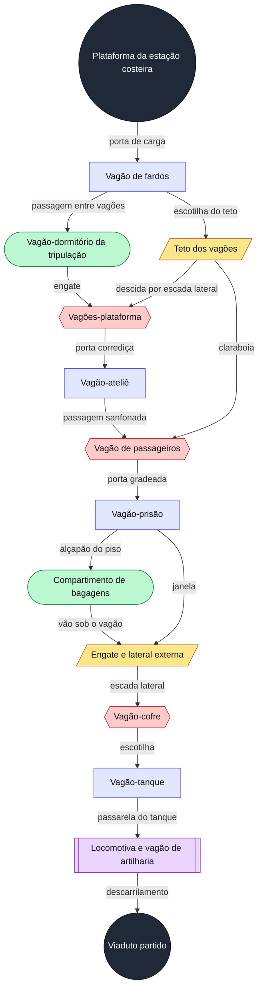

# Fase 6 — Expresso do Algodão

| Ambiente | Clima e hora | Nível | Dificuldade |
| --- | --- | --- | --- |
| Trem de carga em movimento, do litoral ao interior | Dia, com túneis e viadutos | 15 a 18 | Média a alta: fase linear de ação contínua |

O trem de abastecimento do Império leva fardos, máquinas e presos para o interior. A fase percorre a composição do último vagão à locomotiva, por dentro e pelo teto, enquanto a paisagem muda de mar para campo.

## Chegada

O sinal fechado no farol (fase 5) para o trem na estação costeira.

## Mapa

Formas: círculo é início ou saída; retângulo é sala ou área; hexágono é zona de combate; cápsula é esconderijo; paralelogramo é travessia; retângulo duplo é a arena do chefe. O texto de cada linha é o meio de ligação.

## Áreas

| Código | Área | Tipo | O que há |
| --- | --- | --- | --- |
| G1 | Plataforma da estação costeira | Início | Embarque escondido no último vagão |
| G2 | Vagão de fardos | Sala ou área | Corredores apertados entre pilhas de algodão |
| G3 | Vagão-dormitório da tripulação | Esconderijo | Refúgio com bancada; aqui se obtém o Uniforme de Ferroviário |
| G4 | Vagões-plataforma | Zona de combate | Combate a céu aberto entre máquinas amarradas |
| G5 | Teto dos vagões | Travessia | Travessia com vento; túneis obrigam a deitar |
| G6 | Vagão-ateliê | Sala ou área | Oficina móvel do Império; documentos e vestimenta |
| G7 | Vagão de passageiros | Zona de combate | Combate entre poltronas, com civis |
| G8 | Vagão-prisão | Sala ou área | Celas; libertar presos rende aliados |
| G9 | Compartimento de bagagens | Esconderijo | Esconderijo sob lonas; atalho por baixo do vagão |
| G10 | Engate e lateral externa | Travessia | Travessia pendurada na lateral, sobre o viaduto |
| G11 | Vagão-cofre | Zona de combate | Torretas internas e porta blindada |
| G12 | Vagão-tanque | Sala ou área | Teto curvo e escorregadio; vazamento inflamável |
| G13 | Locomotiva e vagão de artilharia | Chefe | Arena do chefe, com a aeronave Libélula |
| G14 | Viaduto partido | Saída | Saída para a fase 7 |

## Conexões

| De | Para | Meio |
| --- | --- | --- |
| Plataforma da estação costeira | Vagão de fardos | porta de carga |
| Vagão de fardos | Vagão-dormitório da tripulação | passagem entre vagões |
| Vagão de fardos | Teto dos vagões | escotilha do teto |
| Vagão-dormitório da tripulação | Vagões-plataforma | engate |
| Teto dos vagões | Vagões-plataforma | descida por escada lateral |
| Vagões-plataforma | Vagão-ateliê | porta corrediça |
| Vagão-ateliê | Vagão de passageiros | passagem sanfonada |
| Teto dos vagões | Vagão de passageiros | claraboia |
| Vagão de passageiros | Vagão-prisão | porta gradeada |
| Vagão-prisão | Compartimento de bagagens | alçapão do piso |
| Compartimento de bagagens | Engate e lateral externa | vão sob o vagão |
| Vagão-prisão | Engate e lateral externa | janela |
| Engate e lateral externa | Vagão-cofre | escada lateral |
| Vagão-cofre | Vagão-tanque | escotilha |
| Vagão-tanque | Locomotiva e vagão de artilharia | passarela do tanque |
| Locomotiva e vagão de artilharia | Viaduto partido | descarrilamento |

## Zonas de combate

| Zona | Inimigos | Perigos e cobertura | Rota furtiva |
| --- | --- | --- | --- |
| Vagões-plataforma | Guardas ferroviários | Máquinas soltas rolam nas curvas | Por baixo das lonas |
| Vagão de passageiros | Agentes à paisana | Civis; tiros perdidos tiram reputação | Disfarce com o Uniforme de Ferroviário |
| Vagão-cofre | Torretas e guardas de elite | Espaço fechado, granadas ricocheteiam | Cortar a energia pelo teto |

## Vestimentas da fase

Uniforme de Ferroviário com Botas Imantadas (obrigatório no teto com vento e para cruzar o vagão de passageiros sem alarme); Luvas de Engate (opcional, isola vagões). Detalhes em [05-vestimentas.md](../05-vestimentas.md).

## Exploração

Três croquis. Missão secundária: soltar os presos do vagão-prisão antes do túnel longo. Cada história coloca ali um aliado importante.

## Chefe da fase: Chefe do Trem

Arquétipo: comandante apoiado pela aeronave Libélula. Arena: Locomotiva e vagão de artilharia.

1. A Libélula metralha o teto; túneis dão cobertura e o canhão de rebites do vagão de artilharia a derruba.
2. O chefe desengata vagões para isolar a pessoa; é preciso saltar com o gancho antes que o vão aumente.
3. Duelo na cabine da locomotiva, com o freio travado e o viaduto partido se aproximando.

Recompensa: Grampeador industrial pesado e o mapa das fazendas.

| História | Quem é o chefe |
| --- | --- |
| 1 Modelo Zero | Condutor-chefe Armand Vasseur |
| 2 Licença Vencida | Marshal Colt Brannigan |
| 3 Antivitrine | Inspetora de linha Edith Marlowe |
| 4 Fio Único | Chefe de estação Tetsuo Kanda |
| 5 Vidro Tropical | Maquinista Rubão Ferreira |

## Saída

A locomotiva não freia a tempo e cai do viaduto partido sobre o leito seco de um rio. A pessoa salta antes e rola pelo barranco até a borda dos campos, onde a fase 7 começa.
