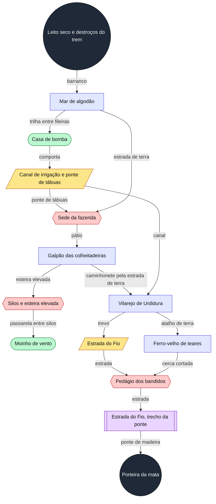

# Fase 7 — Campos de Algodão e Estrada do Fio

| Ambiente | Clima e hora | Nível | Dificuldade |
| --- | --- | --- | --- |
| Campos, fazenda, silos, vilarejo e estrada | Tarde seca com tempestade de poeira | 18 a 21 | Alta: maior área do jogo, com veículo e inimigos em grupo |

A fase mais aberta. Os campos abastecem o Império e são disputados por bandos de estrada. A pessoa cruza a pé e de caminhonete, escolhe a ordem dos objetivos e termina numa perseguição pela estrada.

## Chegada

O barranco do viaduto (fase 6) desce até a primeira plantação.

## Mapa

Formas: círculo é início ou saída; retângulo é sala ou área; hexágono é zona de combate; cápsula é esconderijo; paralelogramo é travessia; retângulo duplo é a arena do chefe. O texto de cada linha é o meio de ligação.

## Áreas

| Código | Área | Tipo | O que há |
| --- | --- | --- | --- |
| H1 | Leito seco e destroços do trem | Início | Recolher suprimentos do descarrilamento |
| H2 | Mar de algodão | Sala ou área | Plantação alta; esconde quem anda agachado |
| H3 | Casa de bomba | Esconderijo | Refúgio com bancada, junto ao canal de irrigação |
| H4 | Canal de irrigação e ponte de tábuas | Travessia | Travessia rasa que evita a estrada |
| H5 | Sede da fazenda | Zona de combate | Casarão, varanda e curral; combate em campo aberto |
| H6 | Galpão das colheitadeiras | Sala ou área | Aqui se consegue a caminhonete |
| H7 | Silos e esteira elevada | Zona de combate | Combate vertical; passarela entre os silos |
| H8 | Moinho de vento | Esconderijo | Esconderijo alto, com vista do mapa |
| H9 | Vilarejo de Urdidura | Sala ou área | Comerciantes, missões e posto de combustível |
| H10 | Estrada do Fio | Travessia | Asfalto reto; trecho de veículo |
| H11 | Pedágio dos bandidos | Zona de combate | Barricada de carros e torre de vigia |
| H12 | Ferro-velho de teares | Sala ou área | Sucata; peças para melhorar armas |
| H13 | Estrada do Fio, trecho da ponte | Chefe | Arena do chefe: perseguição em movimento |
| H14 | Porteira da mata | Saída | Saída para a fase 8 |

## Conexões

| De | Para | Meio |
| --- | --- | --- |
| Leito seco e destroços do trem | Mar de algodão | barranco |
| Mar de algodão | Casa de bomba | trilha entre fileiras |
| Casa de bomba | Canal de irrigação e ponte de tábuas | comporta |
| Canal de irrigação e ponte de tábuas | Sede da fazenda | ponte de tábuas |
| Mar de algodão | Sede da fazenda | estrada de terra |
| Sede da fazenda | Galpão das colheitadeiras | pátio |
| Galpão das colheitadeiras | Silos e esteira elevada | esteira elevada |
| Silos e esteira elevada | Moinho de vento | passarela entre silos |
| Galpão das colheitadeiras | Vilarejo de Urdidura | caminhonete pela estrada de terra |
| Canal de irrigação e ponte de tábuas | Vilarejo de Urdidura | canal |
| Vilarejo de Urdidura | Estrada do Fio | trevo |
| Estrada do Fio | Pedágio dos bandidos | estrada |
| Vilarejo de Urdidura | Ferro-velho de teares | atalho de terra |
| Ferro-velho de teares | Pedágio dos bandidos | cerca cortada |
| Pedágio dos bandidos | Estrada do Fio, trecho da ponte | estrada |
| Estrada do Fio, trecho da ponte | Porteira da mata | ponte de madeira |

## Zonas de combate

| Zona | Inimigos | Perigos e cobertura | Rota furtiva |
| --- | --- | --- | --- |
| Sede da fazenda | Capangas da fazenda | Tempestade de poeira reduz a visão de todos | Pelo canal de irrigação |
| Silos e esteira elevada | Atiradores nos silos | Grão solto engole quem cai | Subir por dentro do silo vazio |
| Pedágio dos bandidos | Bandidos de estrada | Carros explodem | Entrar pelo ferro-velho, por trás |

## Vestimentas da fase

Guarda-pó de Algodão Cru (obrigatório para sobreviver à tempestade de poeira); Colete de Comboio (opcional, melhora a direção). Detalhes em [05-vestimentas.md](../05-vestimentas.md).

## Exploração

Seis croquis. Missões secundárias: devolver água ao vilarejo abrindo três comportas; corrida de caminhonete; caçar o drone de pulverização que envenena a plantação.

## Chefe da fase: Rei da Estrada

Arquétipo: chefe de comboio em caminhão de guerra. Arena: Estrada do Fio, trecho da ponte.

1. Perseguição: a pessoa dirige ou vai na caçamba e atira nos batedores de moto.
2. O caminhão de guerra emparelha; é preciso saltar para ele com o gancho e destruir os dois motores laterais.
3. Luta na carroceria até a ponte de madeira, que cede sob o peso; o caminhão cai e a pessoa atravessa a pé.

Recompensa: Pistola de rebites e a vestimenta Colete de Comboio.

| História | Quem é o chefe |
| --- | --- |
| 1 Modelo Zero | Gaspard, o Duque dos Trapos |
| 2 Licença Vencida | Silas Crowe, o Barão do Bootleg |
| 3 Antivitrine | Mad Mabel, rainha dos Molambos |
| 4 Fio Único | Jirō, o Javali |
| 5 Vidro Tropical | Coronel Juvêncio Algodão |

## Saída

Depois da ponte de madeira a estrada vira trilha e a plantação dá lugar a árvores. A porteira da mata marca o começo da fase 8.
