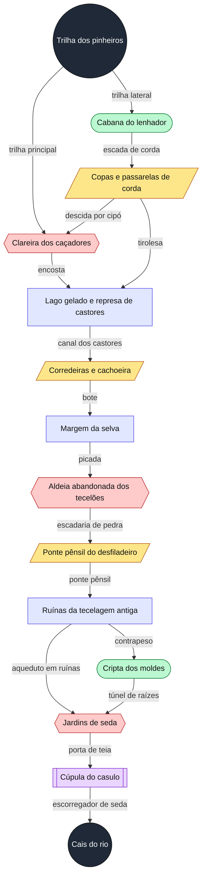

# Fase 8 — Floresta de Névoa e Selva de Seda

| Ambiente | Clima e hora | Nível | Dificuldade |
| --- | --- | --- | --- |
| Floresta fria, selva úmida, rio, cachoeira, ruínas e jardins de seda | Névoa pela manhã, chuva quente à tarde | 21 a 24 | Alta: orientação difícil, perigos naturais e inimigos camuflados |

A mata tem duas partes. A floresta de pinheiros é silenciosa e pede furtividade. Rio abaixo, a selva foi tomada pelos jardins de seda do Império, onde organismos cultivados tecem entre as árvores.

## Chegada

A trilha depois da porteira (fase 7) entra na floresta.

## Mapa

Formas: círculo é início ou saída; retângulo é sala ou área; hexágono é zona de combate; cápsula é esconderijo; paralelogramo é travessia; retângulo duplo é a arena do chefe. O texto de cada linha é o meio de ligação.

## Áreas

| Código | Área | Tipo | O que há |
| --- | --- | --- | --- |
| J1 | Trilha dos pinheiros | Início | Névoa densa; pegadas e marcas guiam o caminho |
| J2 | Cabana do lenhador | Esconderijo | Refúgio com bancada; aqui se obtém o Ghillie de Musgo |
| J3 | Clareira dos caçadores | Zona de combate | Acampamento inimigo com armadilhas |
| J4 | Copas e passarelas de corda | Travessia | Rota alta entre plataformas nas árvores |
| J5 | Lago gelado e represa de castores | Sala ou área | Travessia por troncos; segredo submerso |
| J6 | Corredeiras e cachoeira | Travessia | Descida de bote ou por corda ao lado da queda |
| J7 | Margem da selva | Sala ou área | A vegetação muda; primeiros casulos nas árvores |
| J8 | Aldeia abandonada dos tecelões | Zona de combate | Casas sobre estacas; combate com emboscadas |
| J9 | Ponte pênsil do desfiladeiro | Travessia | Ponte de corda longa; pode ser cortada |
| J10 | Ruínas da tecelagem antiga | Sala ou área | Quebra-cabeça de teares de pedra e contrapesos |
| J11 | Cripta dos moldes | Esconderijo | Esconderijo e sala de tesouro das ruínas |
| J12 | Jardins de seda | Zona de combate | Estufas rasgadas e teias; ar tóxico sem a vestimenta certa |
| J13 | Cúpula do casulo | Chefe | Arena do chefe, dentro da maior estufa |
| J14 | Cais do rio | Saída | Saída para a fase 9 |

## Conexões

| De | Para | Meio |
| --- | --- | --- |
| Trilha dos pinheiros | Cabana do lenhador | trilha lateral |
| Trilha dos pinheiros | Clareira dos caçadores | trilha principal |
| Cabana do lenhador | Copas e passarelas de corda | escada de corda |
| Copas e passarelas de corda | Clareira dos caçadores | descida por cipó |
| Clareira dos caçadores | Lago gelado e represa de castores | encosta |
| Copas e passarelas de corda | Lago gelado e represa de castores | tirolesa |
| Lago gelado e represa de castores | Corredeiras e cachoeira | canal dos castores |
| Corredeiras e cachoeira | Margem da selva | bote |
| Margem da selva | Aldeia abandonada dos tecelões | picada |
| Aldeia abandonada dos tecelões | Ponte pênsil do desfiladeiro | escadaria de pedra |
| Ponte pênsil do desfiladeiro | Ruínas da tecelagem antiga | ponte pênsil |
| Ruínas da tecelagem antiga | Cripta dos moldes | contrapeso |
| Ruínas da tecelagem antiga | Jardins de seda | aqueduto em ruínas |
| Cripta dos moldes | Jardins de seda | túnel de raízes |
| Jardins de seda | Cúpula do casulo | porta de teia |
| Cúpula do casulo | Cais do rio | escorregador de seda |

## Zonas de combate

| Zona | Inimigos | Perigos e cobertura | Rota furtiva |
| --- | --- | --- | --- |
| Clareira dos caçadores | Caçadores com cães | Armadilhas de laço e de urso | Pelas copas |
| Aldeia abandonada dos tecelões | Emboscada dos bandidos da mata | Pisos de estaca cedem | Por baixo das casas, na lama |
| Jardins de seda | Técnicos do Império e crias de seda | Esporos e teias que prendem | Queimar as teias abre rotas novas |

## Vestimentas da fase

Ghillie de Musgo (opcional, quase invisível na floresta); Casulo de Seda Viva (obrigatório nos jardins de seda, protege dos esporos). Detalhes em [05-vestimentas.md](../05-vestimentas.md).

## Exploração

Cinco croquis e a cripta dos moldes. Missão secundária: seguir um animal ferido até um posto de pesquisa abandonado, que explica a origem do organismo.

## Chefe da fase: Sericultor e a Mariposa-Rainha

Arquétipo: cientista que controla uma criatura de seda. Arena: Cúpula do casulo.

1. O chefe fica numa plataforma alta e prende a pessoa em teias; fogo ou lâmina abrem caminho até as três bombas de nutriente.
2. A Mariposa-Rainha desce; as asas soltam pó que cega, e os pontos fracos são as bolsas de seda nas laterais.
3. A cúpula começa a desabar; a criatura se enrola num casulo e é preciso derrubar o lustre de vidro sobre ela.

Recompensa: Lança-fio (mobilidade) e a vestimenta Casulo de Seda Viva completa.

| História | Quem é o chefe |
| --- | --- |
| 1 Modelo Zero | Dra. Hélène Marchais |
| 2 Licença Vencida | Dr. Elias Thorne |
| 3 Antivitrine | Professora Rowan Thistlewood |
| 4 Fio Único | Dra. Kaiko Mayuzumi |
| 5 Vidro Tropical | Dra. Iracema Paiva |

## Saída

Um escorregador de seda leva da cúpula ao cais do rio, onde as barcaças do Império carregam os casulos. A pessoa embarca escondida e desce o rio até a represa da fase 9.
