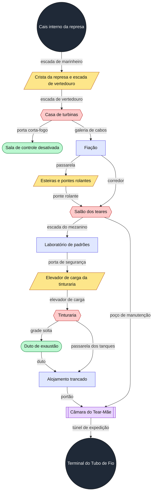

# Fase 9 — Fábrica dos Teares

| Ambiente | Clima e hora | Nível | Dificuldade |
| --- | --- | --- | --- |
| Represa, usina, fábrica automatizada, tinturaria e terminal de carga | Noite, calor e vapor | 24 a 27 | Alta: plataformas móveis, perigos de máquina e ondas de inimigos |

A origem do poder do Império. A fábrica fica na represa e funciona quase sem gente. A fase desce da crista da represa ao fundo da fábrica e revela o segredo de cada história.

## Chegada

A barcaça de casulos (fase 8) atraca no cais interno da represa.

## Mapa

Formas: círculo é início ou saída; retângulo é sala ou área; hexágono é zona de combate; cápsula é esconderijo; paralelogramo é travessia; retângulo duplo é a arena do chefe. O texto de cada linha é o meio de ligação.

## Áreas

| Código | Área | Tipo | O que há |
| --- | --- | --- | --- |
| K1 | Cais interno da represa | Início | Guindastes descarregam casulos |
| K2 | Crista da represa e escada de vertedouro | Travessia | Passarela estreita sobre a queda d'água |
| K3 | Casa de turbinas | Zona de combate | Combate entre geradores; arcos elétricos |
| K4 | Sala de controle desativada | Esconderijo | Refúgio com bancada |
| K5 | Fiação | Sala ou área | Salas de bobinas gigantes; o fio corre no ar |
| K6 | Esteiras e pontes rolantes | Travessia | Travessia sobre máquinas em movimento |
| K7 | Salão dos teares | Zona de combate | A maior arena da fase; teares autônomos atacam |
| K8 | Laboratório de padrões | Sala ou área | Documentos centrais da história |
| K9 | Elevador de carga da tinturaria | Travessia | Desce três níveis; para no meio se a energia cair |
| K10 | Tinturaria | Zona de combate | Tanques ferventes e vapor; exige vestimenta térmica |
| K11 | Duto de exaustão | Esconderijo | Esconderijo e atalho sobre os tanques |
| K12 | Alojamento trancado | Sala ou área | Em algumas histórias, os desaparecidos estão aqui |
| K13 | Câmara do Tear-Mãe | Chefe | Arena do chefe, circular, em três andares |
| K14 | Terminal do Tubo de Fio | Saída | Saída para a fase 10 |

## Conexões

| De | Para | Meio |
| --- | --- | --- |
| Cais interno da represa | Crista da represa e escada de vertedouro | escada de marinheiro |
| Crista da represa e escada de vertedouro | Casa de turbinas | escada de vertedouro |
| Casa de turbinas | Sala de controle desativada | porta corta-fogo |
| Casa de turbinas | Fiação | galeria de cabos |
| Fiação | Esteiras e pontes rolantes | passarela |
| Esteiras e pontes rolantes | Salão dos teares | ponte rolante |
| Fiação | Salão dos teares | corredor |
| Salão dos teares | Laboratório de padrões | escada do mezanino |
| Laboratório de padrões | Elevador de carga da tinturaria | porta de segurança |
| Elevador de carga da tinturaria | Tinturaria | elevador de carga |
| Tinturaria | Duto de exaustão | grade solta |
| Duto de exaustão | Alojamento trancado | duto |
| Tinturaria | Alojamento trancado | passarela dos tanques |
| Alojamento trancado | Câmara do Tear-Mãe | portão |
| Salão dos teares | Câmara do Tear-Mãe | poço de manutenção |
| Câmara do Tear-Mãe | Terminal do Tubo de Fio | túnel de expedição |

## Zonas de combate

| Zona | Inimigos | Perigos e cobertura | Rota furtiva |
| --- | --- | --- | --- |
| Casa de turbinas | Engenheiros armados e drones de solda | Arcos elétricos entre geradores | Pela galeria de cabos, com o Jaleco Antiestático |
| Salão dos teares | Teares autônomos e guardas | Lançadeiras cruzam o salão como projéteis | Desligar fileiras no painel |
| Tinturaria | Operários blindados | Vapor queima sem a vestimenta térmica | Pelo duto de exaustão |

## Vestimentas da fase

Macacão Térmico Aluminizado (obrigatório na tinturaria); Jaleco Antiestático (opcional, anula os arcos elétricos). Detalhes em [05-vestimentas.md](../05-vestimentas.md).

## Exploração

Quatro croquis. Missão secundária: sabotar as três bombas de tinta. O Laboratório de padrões traz a revelação de cada história.

## Chefe da fase: Tear-Mãe

Arquétipo: máquina gigante operada pelo responsável da fábrica. Arena: Câmara do Tear-Mãe.

1. O Tear-Mãe dispara lançadeiras e prende a pessoa com fios; cortar os quatro carretéis laterais o desarma.
2. O operador inunda a câmara de vapor; é preciso subir os três andares pelas pontes rolantes e destruir os pentes.
3. O núcleo fica exposto no topo; o operador desce para lutar e, vencido, a máquina para.

Recompensa: Cortador a laser e o passe do Tubo de Fio.

| História | Quem é o chefe |
| --- | --- |
| 1 Modelo Zero | Engenheiro-chefe Octave Renard |
| 2 Licença Vencida | Capataz Buck Harlan |
| 3 Antivitrine | Superintendente Agnes Loom |
| 4 Fio Único | Engenheira Chiyo Hatamoto |
| 5 Vidro Tropical | Gerente de metas Evaldo Pimentel |

## Saída

O túnel de expedição leva ao Tubo de Fio, a linha de cápsulas que manda tecido da fábrica para o subsolo da Catedral de Vidro. A pessoa viaja numa cápsula de carga e chega à fase 10 por baixo da cidade.
