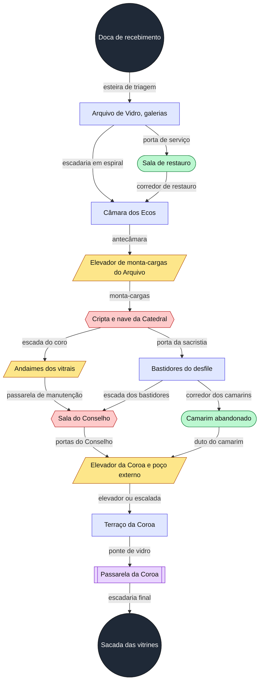

# Fase 10 — Catedral e Coroa de Vidro

| Ambiente | Clima e hora | Nível | Dificuldade |
| --- | --- | --- | --- |
| Arquivo subterrâneo, catedral, bastidores, torre e passarela no topo | Noite do desfile de gala | 27 a 30 | Máxima: usa todas as mecânicas e todas as vestimentas |

A volta à cidade. A fase sobe do subsolo ao ponto mais alto de Vítrea em três partes: furtividade no Arquivo, combate na Catedral e a luta final na Coroa, durante o desfile transmitido para todas as vitrines.

## Chegada

A cápsula do Tubo de Fio (fase 9) chega à doca de recebimento, sob a Catedral.

## Mapa

Formas: círculo é início ou saída; retângulo é sala ou área; hexágono é zona de combate; cápsula é esconderijo; paralelogramo é travessia; retângulo duplo é a arena do chefe. O texto de cada linha é o meio de ligação.

## Áreas

| Código | Área | Tipo | O que há |
| --- | --- | --- | --- |
| L1 | Doca de recebimento | Início | Robôs separam os rolos; entrada furtiva |
| L2 | Arquivo de Vidro, galerias | Sala ou área | Corredores de vitrines com peças históricas; lasers de identidade |
| L3 | Sala de restauro | Esconderijo | Refúgio com bancada; último ponto de fabricação |
| L4 | Câmara dos Ecos | Sala ou área | Encontro com os mentores da história |
| L5 | Elevador de monta-cargas do Arquivo | Travessia | Sobe à cripta da Catedral |
| L6 | Cripta e nave da Catedral | Zona de combate | Combate entre colunas e bancos, sob vitrais digitais |
| L7 | Andaimes dos vitrais | Travessia | Escalada interna pelas paredes de vidro |
| L8 | Bastidores do desfile | Sala ou área | Camarins, araras e modelos; disfarce possível |
| L9 | Sala do Conselho | Zona de combate | Combate contra a guarda de elite |
| L10 | Camarim abandonado | Esconderijo | Esconderijo; aliado entrega a vestimenta final |
| L11 | Elevador da Coroa e poço externo | Travessia | Subida pela fachada quando o elevador é travado |
| L12 | Terraço da Coroa | Sala ou área | Jardim suspenso e espelho d'água; última troca de equipamento |
| L13 | Passarela da Coroa | Chefe | Arena do chefe final, a céu aberto |
| L14 | Sacada das vitrines | Saída | Desfecho da história |

## Conexões

| De | Para | Meio |
| --- | --- | --- |
| Doca de recebimento | Arquivo de Vidro, galerias | esteira de triagem |
| Arquivo de Vidro, galerias | Sala de restauro | porta de serviço |
| Arquivo de Vidro, galerias | Câmara dos Ecos | escadaria em espiral |
| Sala de restauro | Câmara dos Ecos | corredor de restauro |
| Câmara dos Ecos | Elevador de monta-cargas do Arquivo | antecâmara |
| Elevador de monta-cargas do Arquivo | Cripta e nave da Catedral | monta-cargas |
| Cripta e nave da Catedral | Andaimes dos vitrais | escada do coro |
| Cripta e nave da Catedral | Bastidores do desfile | porta da sacristia |
| Andaimes dos vitrais | Sala do Conselho | passarela de manutenção |
| Bastidores do desfile | Sala do Conselho | escada dos bastidores |
| Bastidores do desfile | Camarim abandonado | corredor dos camarins |
| Sala do Conselho | Elevador da Coroa e poço externo | portas do Conselho |
| Camarim abandonado | Elevador da Coroa e poço externo | duto do camarim |
| Elevador da Coroa e poço externo | Terraço da Coroa | elevador ou escalada |
| Terraço da Coroa | Passarela da Coroa | ponte de vidro |
| Passarela da Coroa | Sacada das vitrines | escadaria final |

## Zonas de combate

| Zona | Inimigos | Perigos e cobertura | Rota furtiva |
| --- | --- | --- | --- |
| Arquivo de Vidro, galerias | Curadores armados e sentinelas de vitrine | Lasers de identidade e alarmes | Hábito de Curador ou rota pelos dutos de climatização |
| Cripta e nave da Catedral | Guarda da Catedral | Vitrais projetam a posição de quem se move | Pelos andaimes dos vitrais |
| Sala do Conselho | Guarda de elite do Conselho | Mesa central com escudo de energia | Entrar pela passarela de manutenção, por cima |

## Vestimentas da fase

Hábito de Curador (opcional, atravessa o Arquivo sem alarme); Traje Imperial de Vidro (obrigatório nos lasers da Coroa); vestimenta especial da história (obrigatória na etapa final do chefe). Detalhes em [05-vestimentas.md](../05-vestimentas.md).

## Exploração

Os últimos croquis completam o livro de moldes. Na Câmara dos Ecos, cada mentor da história dá um bônus conforme as missões cumpridas.

## Chefe da fase: Coroa de Vidro

Arquétipo: antagonista da história escolhida. Arena: Passarela da Coroa.

1. O antagonista luta na passarela com a guarda pessoal; os refletores do desfile cegam e é preciso quebrá-los.
2. O antagonista usa o poder central da história contra a pessoa (copiar golpes, revogar armas, espelhar a imagem, prender em fio ou impor metas de tempo).
3. Só a vestimenta especial da história anula esse poder; com ela vestida, a luta vira duelo direto até a queda da Coroa.

Recompensa: Fim da campanha e modo Nova Coleção, que reinicia o jogo com as vestimentas mantidas.

| História | Quem é o chefe |
| --- | --- |
| 1 Modelo Zero | Modelo Zero e Diretora Odile Sarrazin |
| 2 Licença Vencida | Chanceler Sterling Vale, o Licenciador |
| 3 Antivitrine | Comissária Honor Pryce e o Olho-Mãe |
| 4 Fio Único | Diretora Kagami e a Tecelã |
| 5 Vidro Tropical | Comendador Leôncio Brandt e a Máquina de Metas |

## Saída

Vencido o antagonista, a pessoa desce à sacada das vitrines, de onde se vê a cidade inteira. O desfecho de cada história acontece ali.
