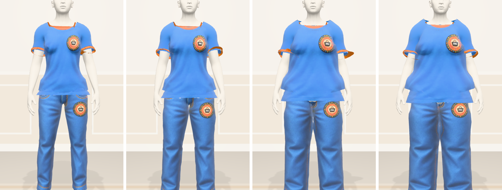
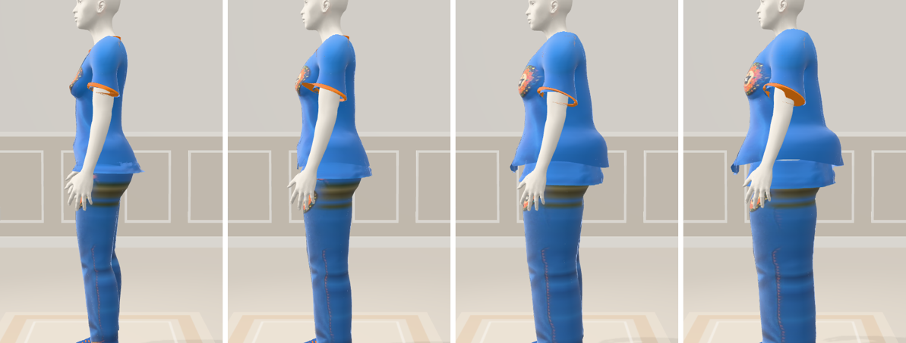

# Caimento por tamanho e medidas pessoais — 2026-10-25

**A peça agora se adapta ao tamanho escolhido região por região, e o provador diz como ela ficou.**




Corpo padrão feminino (veste M e calça 40), com a camiseta e o jeans do laboratório em PP/34, M/40, GG/46 e XG/50.

## Como a roupa muda com o tamanho

O tamanho do corpo sai de cada região que a peça veste (`lib/tryon/sizes.ts`):

| Peça | Regiões |
| --- | --- |
| Parte de cima | peito, cintura e comprimento |
| Parte de baixo | cintura, quadril e comprimento |
| Peça inteira | peito, cintura, quadril e comprimento |
| Calçado | pé |

A diferença entre o tamanho escolhido e o do corpo, em cada região, vira molde (`garment-fit.ts` e `garments.ts`):

- **Folga por região.** A parte comum entra na folga da peça. O que uma região tem a mais fica só nela: o peito pode
  sobrar enquanto a cintura fecha.
- **Comprimento.** Cada tamanho acima alonga a barra, a manga e a perna; abaixo, encurta. Cada 5 cm de altura acima do
  corpo padrão pedem um tamanho a mais de comprimento.
- **Sobra.** Pregas verticais, mais fundas para a barra, o tornozelo e o punho. A peça larga cai reta do busto ao
  quadril, inclusive dos lados, sem desenhar a cintura.
- **Aperto.** O tecido cola no busto e aparecem rugas de tensão horizontais na frente da cintura, do quadril e das coxas.
- **Comprido.** A barra da calça acumula no tornozelo e a manga, no punho.

O relevo sempre soma para fora do corpo e entra depois do caimento do busto.

## Medidas pessoais

O cartão **Suas medidas** em Meu Avatar pede altura e peso. Em "Mais medidas" entram busto, cintura, quadril e o número
do calçado, todos opcionais.

- **Altura** vira a estatura do avatar.
- **Peso** estima a compleição quando nenhuma largura foi medida na foto.
- **Medidas de fita** valem mais que a estimativa pelo corpo e só servem ao tamanho do provador.
- **Antes do primeiro avatar,** as medidas vão junto quando ele é salvo. Refazer o avatar mantém as medidas salvas.
- **Privacidade.** Quem vê o avatar de outra pessoa recebe as proporções do corpo, sem altura, peso ou medidas
  (`Avatar3dService.publicModel`).

## Retorno no provador

Cada peça mostra uma frase, as regiões e o tamanho do avatar:

```
Vestiu bem
Está justo no quadril
Ficou apertado no peito e na cintura · fica comprido
Ficou largo demais na cintura e no quadril
```

A região mais crítica decide a frase, e apertar pesa mais que sobrar. Sem altura e peso informados, a linha convida a
personalizar em Meu Avatar. A grade é uma referência do FashionAI, não a tabela oficial de cada marca.

## Verificação

- `lib/tryon/sizes.test.ts`: regiões, medidas de fita, altura e veredito.
- `lib/avatar3d/human/garments.test.ts`: pregas da sobra, rugas do aperto e barra acumulada, na malha do corpo real.
- `components/try-on/fit-feedback.test.tsx` e `components/avatar3d/body-measures.test.tsx`: frases e cartão.
- `Avatar3dServiceTest`: medidas de fita validadas e fora da visão de outras pessoas.
- Laboratório: `/lab/scenes?s=fitting-neutral&close=1&sizes=letter:GG,numeric:46,shoes:39`.
