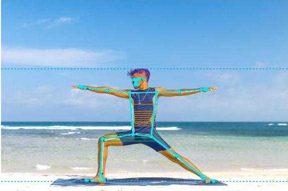
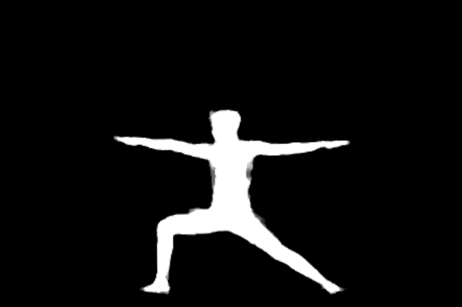

# Integração backend e teste de pose real

## Evidência de inferência

O modelo **MediaPipe Pose Landmarker Full** existente em
`public/mediapipe/pose_landmarker_full.task` foi executado em CPU com MediaPipe
0.10.35. Não se trata de um double nem de uma chamada simulada.

- Entrada: recorte `(10,34,582,414)` da imagem já existente
  `docs/avatar3d/img/04-T2-pose-nao-neutra.jpg`, isolando a fotografia à esquerda.
- A imagem de origem já contém anotações anteriores. Este teste demonstra
  execução/integridade do fluxo; **não é benchmark independente de acurácia**.
- Resultado: 33 landmarks em quadro com presença/visibilidade >= 0,8; máscara
  corporal produzida pelo modelo.
- SHA-256 do modelo: `4eaa5eb7a98365221087693fcc286334cf0858e2eb6e15b506aa4a7ecdcec4ad`.
- A execução emitiu o aviso MediaPipe `NORM_RECT without IMAGE_DIMENSIONS`.
  A projeção em diferentes proporções precisa de validação com referências reais.
- Saída: `POSE_ONLY`, `anatomicalAnchorsComplete=false`, `physicalFitCertified=false`.





[Landmarks e metadados completos](pose.json).

## Rotas adicionadas

| Rota | Autorização / função |
| --- | --- |
| `POST /api/try-on/body-pose` | Usuário autenticado, foto própria e consentimento explícito; retorna somente diagnóstico parcial |
| `POST /api/try-on/anatomical-renders` | Peça e foto próprias, consentimento; salva um PNG validado em nova chave sob o prefixo do usuário quando o worker retorna READY |
| `GET /api/admin/vton/catalog-feed` | Administrador; paginação incremental por timestamp e UUID, até 100 fotos canônicas aprovadas e persistidas |
| `POST /api/admin/vton/annotate` | Administrador; reaproveita AiEngine, com governança/cotas/consentimento existentes; rejeita fallback não verificado |
| `POST /v1/body/pose` no worker | Bearer interno; MediaPipe opcional, sem inferir evidências de gola/axila/punho que o modelo não fornece |

As respostas pessoais usam `Cache-Control: no-store`. O resultado nunca substitui
a fotografia original. O backend rejeita PNG truncado e dimensões acima de 1536 px
antes de armazenar o resultado. O cursor inválido produz 400, não 500.

## Configuração

No backend, `VTON_WORKER_URL` e `VTON_WORKER_TOKEN` ativam a ponte. Sem ambos,
retorna 503 tratado. O profile Spring `vton` é opcional quando essas variáveis
são utilizadas diretamente; não há chamada automática ao Vertex ao iniciar a API.

No worker CPU, para habilitar o diagnóstico real:

```bash
pip install -r services/anatomical_vton/requirements-pose.txt
export VTON_POSE_MODEL_PATH=/caminho/public/mediapipe/pose_landmarker_full.task
```

Linux precisa de `libGLESv2` e das dependências nativas do MediaPipe mesmo usando
CPU. Neste ambiente sem privilégios, a biblioteca Debian `libgles2` foi extraída
apenas no diretório de trabalho e selecionada por `LD_LIBRARY_PATH`, sem alterar
as bibliotecas globais. Ela não está incluída no commit.

Reprodução do diagnóstico, a partir do diretório raiz:

```bash
python3 -m services.anatomical_vton.body_pose \
  --model public/mediapipe/pose_landmarker_full.task \
  --image CAMINHO_DA_IMAGEM_RGB \
  --output-dir work/pose-diagnostic
```

O diretório de saída contém imagem, máscara e landmarks pessoais: mantenha-o
privado quando usar fotos de usuários. Os arquivos neste documento derivam apenas
da imagem de demonstração já existente no repositório.

## Validação e limites

A verificação Python passou em 45 testes (37 VTON e 8 numéricos de digital twin).
A compilação Maven direcionada passou em `fai-web` e `ai-providers` com seus
módulos dependentes; 26 testes Java passaram (incluindo 19 novos de integração
de serviço/contrato e 7 regressões do provador). Total local: 71 testes aprovados.
Isso não equivale à execução de toda a suíte do monorepositório.

Os testes locais cobrem propriedade/consentimento antes de qualquer envio ao
worker, respostas pendentes, rejeição de PNG/dimensões inválidas, chave nova de
armazenamento, autorização administrativa e cursor incremental. As chamadas ao
worker/AiEngine são simuladas nesses testes Java; o teste MediaPipe acima é real.

Ainda faltam correspondências de seams da roupa, curvas cervicais, seções dos
membros e oclusão de pele para preencher `BodyEvidence`. O diagnóstico parcial
não é usado como fallback de encaixe completo. Os modelos GPU e os pesos
FLAME/SMPL-X continuam ausentes. Não foi provisionada GPU nem feito deploy.
