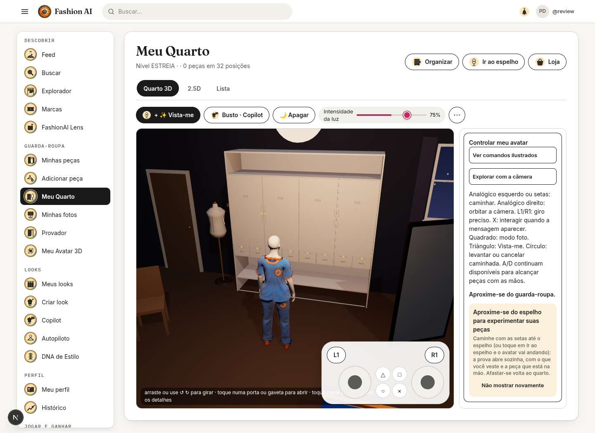
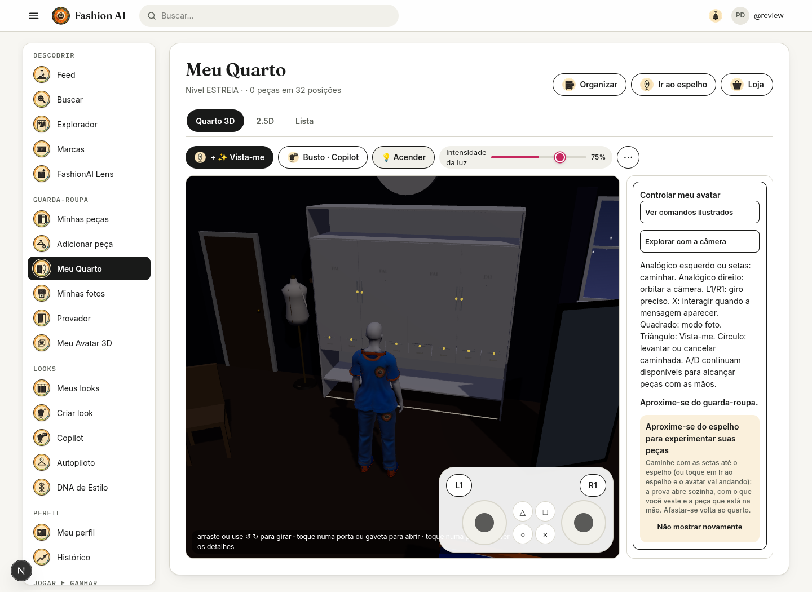
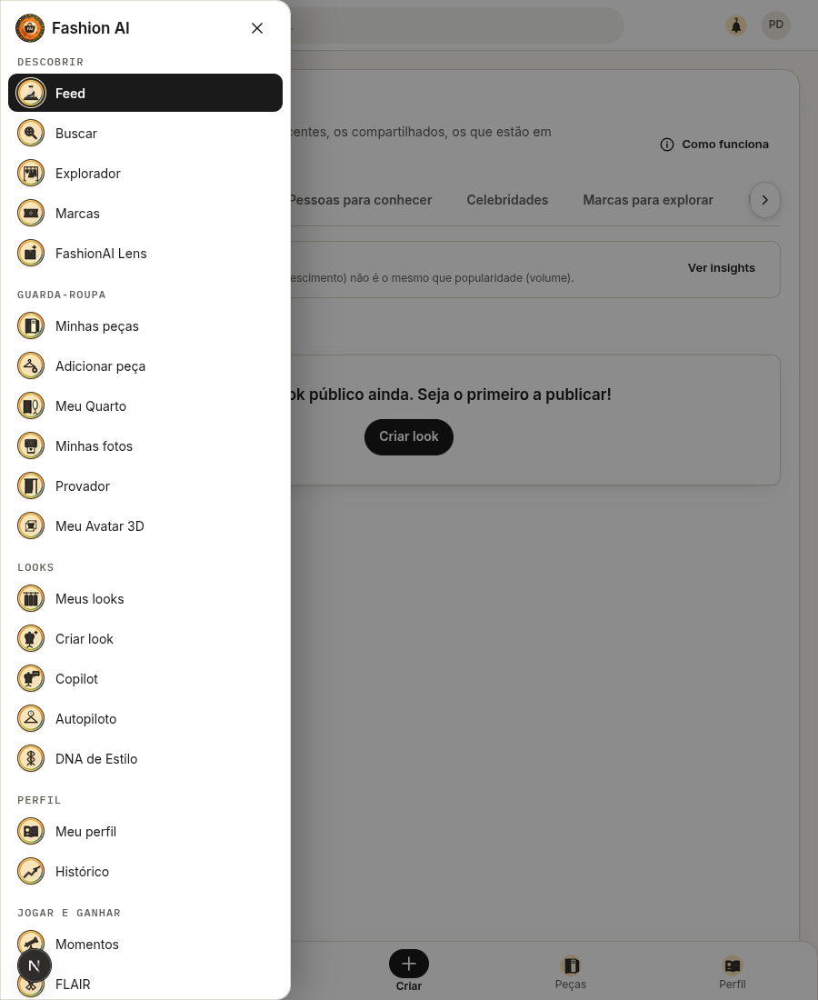
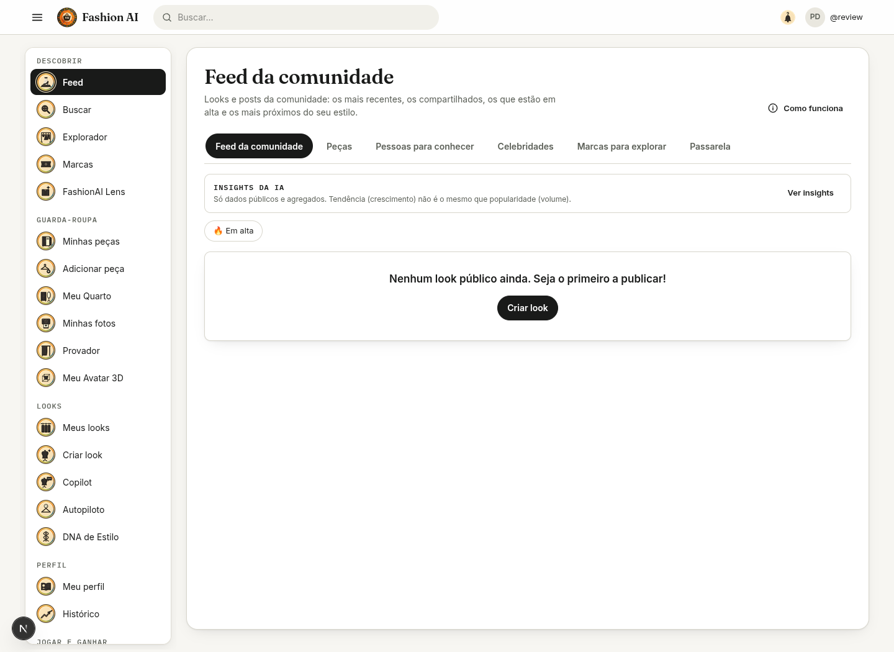
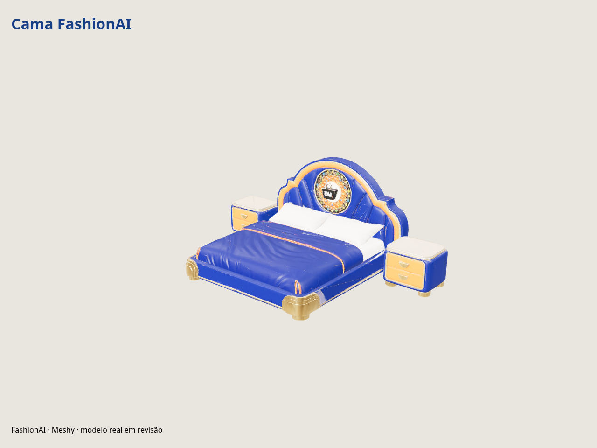
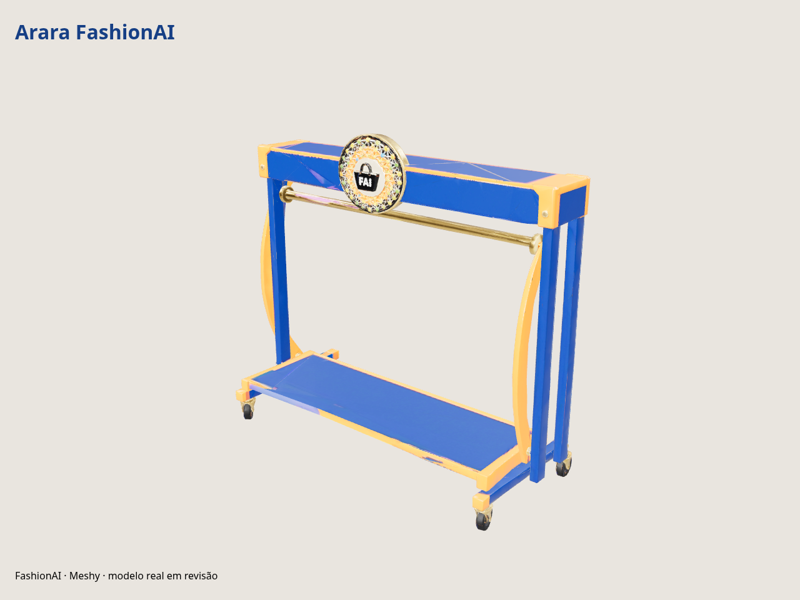

# Quarto, criador e feed

## Entrega

- A análise de várias fotografias apresenta progresso pelo número real de análises finalizadas. Falhas são contabilizadas como tentativas finalizadas e continuam identificadas na fotografia correspondente.
- A projeção da fotografia no molde identifica ombros, decote e barra na silhueta isolada; a correspondência por faixas de ombro, tronco e barra substitui a escala única da caixa da imagem. Sem recorte confiável, mantém o caminho anterior. Isso não reconstrói detalhes ocultos ou as costas de uma peça a partir de uma única foto.
- A luminária do teto liga à noite; interruptor e dimmer alteram luzes da cena, sem mudar o tema da interface. Estado e intensidade são persistidos no módulo de iluminação; controle básico está disponível em todos os níveis. A temperatura de cor mantém a regra do Studio.
- Dois analógicos, L1/R1 e quatro botões de ação substituem o direcional visual. Esquerdo caminha, direito orbita, L1/R1 permitem giro contínuo. No modo fotografia, esquerdo aproxima/afasta. X interage com o objeto próximo, quadrado alterna fotografia, triângulo chama Vista-me e círculo levanta/cancela caminhada. O navegador também pode ler um controle físico com mapeamento Gamepad padrão quando o canvas ou controle tem foco.
- Cadeira, cama e arara têm volumes de colisão. A cadeira tem pose sentada; movimento ou círculo levantam. Mensagens de proximidade anunciam X para cadeira, armário e interruptor.
- Peças soltas são reunidas na arara de apoio, preservando os IDs. Caixas de looks/peças não são exibidas. Compras pendentes continuam acessíveis pelo botão de recebimento.
- O feed separa comunidade, peças, pessoas, celebridades e marcas em painéis; descoberta deixa de aparecer solta ao fim do scroll. Cards têm largura limitada.
- Ícones laterais recebem medallhões de 30 px, aro escuro e detalhes dourados/coloridos; imagens internas continuam legíveis e os links preservam seus nomes acessíveis.

## Meshy: gerar uma vez

Os blocos `BED` (`BED-DBL`, 280 cm) e `SALE_RACK` (`RACK-MOB`, 160 cm) foram adicionados ao motor administrativo e aos módulos do quarto. O renderizador usa o `finish.model3dUrl` aprovado, mantendo o objeto funcional durante download ou falha.

A cama e a arara FAI foram geradas no Meshy com fotos de referência próprias, logo oficial e alvo de 12 mil polígonos. Os GLBs reais foram baixados, verificados e renderizados de frente e de trás. Ambos têm imagens embutidas e ficam abaixo de 32 MiB. Não foram publicados na loja nem aplicados a um perfil de produção.

| Modelo | Tarefa Meshy | Arquivo | Triângulos |
| --- | --- | --- | --- |
| Cama FAI com dois criados-mudos | `01a12de8-3441-760d-b984-f7268bf1f493` | 11.290.744 bytes | 11.172 |
| Arara móvel FAI | `01a12de9-ff7c-7745-8156-bdae733e5bd3` | 9.904.832 bytes | 10.103 |

Após implantar este PR, abra `/admin/room-assets`, escolha o bloco correspondente, envie a referência e preencha **ID de tarefa Meshy existente**. A chave configurada no backend precisa acessar a tarefa. A importação consulta e guarda o GLB, sem submeter nova geração. Revise a prévia e o encaixe no bloco antes de aprovar/publicar. O abajur fica no criado-mudo, com uma posição predefinida; modelos com outras proporções precisam de revisão do encaixe.

## Catálogo: corrigir o serviço publicado

Foi informado que o Railway estava conectado à branch de interfaces. O serviço mantinha um deploy anterior ativo e registrava builds mais novos como `SKIPPED` ou `FAILED`. A CI do commit `60579dcc` da `main` foi confirmada como aprovada.

1. Railway → serviço **api** → **Settings → Source**: selecionar o repositório backend e a branch **main**.
2. Implantar o commit atual com CI aprovada e aguardar **ACTIVE**. Refazer o deploy de uma imagem antiga não atualiza o código.
3. Vercel: `NEXT_PUBLIC_API_BASE_URL=https://api-production-ecf4.up.railway.app`, sem `/api` ao final. Se mudar a variável, refazer o build/deploy do frontend.
4. No navegador autenticado no gate, confirmar respostas JSON 200 de `/api/catalog/summary` e `/api/catalog/products?page=0&size=24`.
5. Se houver `FAILED`, consultar o erro de build/inicialização; `UP` só indica saúde, não comprova versão nem rotas.

Este PR adiciona identificação não secreta da versão e capacidades em `/actuator/info`. Antes deste deploy, esse endpoint pode continuar respondendo `{}`. Nenhuma credencial é exposta.

Os 42 nomes e a soma de 6.591 na interface também podem refletir o banco ainda não importado: o coletor grava arquivos, não importa automaticamente todos os produtos no MySQL. Depois de corrigir a rota, compare `/api/catalog/summary` com `scripts/catalog/audit_catalog_counts.py` no mesmo banco e execute a importação/sincronização dos arquivos concluídos. Não atribua aumento do acervo apenas a um redeploy.

## Evidências

Capturas do app abaixo usam API simulada e um perfil de revisão local. Os modelos Meshy foram renderizados a partir dos GLBs reais.

