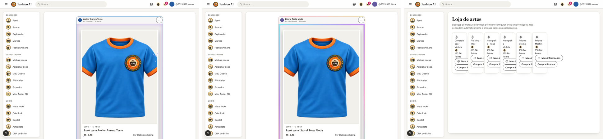
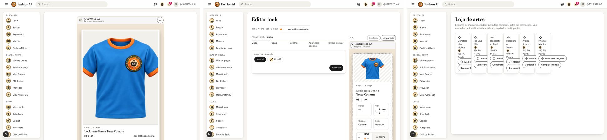

# AURA Metamorfose com contas teste — 2026-10-25

**Resultado:** as marcas teste conseguem licenciar presets Metamorfose e aplicá-los nos próprios esquemas. Os usuários
comuns teste **não conseguem** criar um esquema com esses presets: toda tentativa volta `403 AURA_ART_REQUIRED`, inclusive
com nível LOFT. Isso é o comportamento atual do backend, não uma falha do teste: o repasse da arte da marca para o
participante (promoção de selo ou cupom) continua pendente, como já dizia `docs/design/AURA_LICENCAS_ESTADO.md`.

## Ambiente

- Backend desta branch (`fai-bootstrap`) e MySQL 8.4 descartável em contêiner local, porta 3307, só em 127.0.0.1.
- Banco criado do zero pelas migrações Flyway (V1–V81), com os 20 presets Metamorfose da V65.
- Nenhuma escrita em produção. Contas, senhas e pontos existem só nesse banco local.
- E-mail em modo `log` com corpo visível (`EMAIL_LOG_BODIES=true`), para ler o código de confirmação.
- Roteiro reproduzível: `scripts/aura/metamorfose_contas_teste.py`. Ele recusa qualquer API que não seja localhost.
- Passos e respostas da API: `relatorio.json` (83 passos, nenhum resultado diferente do esperado).

## Contas teste

| Conta | Tipo | Preparação |
| --- | --- | --- |
| Atelier Aurora Teste | Marca | Cadastro com logo e comprovante fictícios, e-mail confirmado, perfil aprovado pelo admin local, 1 200 FAI Points de teste |
| Litoral Teste Moda | Marca | Idem |
| Noite Urbana Teste | Marca | Idem |
| Ana Teste Comum | Pessoal | E-mail confirmado, sem pontos (nível ESTREIA) |
| Bruno Teste Comum | Pessoal | E-mail confirmado, 1 200 FAI Points de teste (nível LOFT) |

Os pontos de teste entraram direto no razão do banco local (`TEST_FIXTURE`). Contas novas começam sem pontos e a API
não tem crédito administrativo de pontos.

## 1. Marcas criando presets

| Tentativa | Resposta |
| --- | --- |
| Marca cria um preset Metamorfose próprio (`POST /api/admin/aura-store`) | `403 ACESSO_NEGADO` |
| Admin publica seis desenhos da V65 escolhidos pelas marcas | `200` em todos |
| Marca compra licença sem saldo | `409 SALDO_INSUFICIENTE` |
| Marca compra licença com saldo (150 pontos cada, dois presets por marca) | `200` em todos |
| Minhas Artes da marca lista as Metamorfoses licenciadas | `200` |
| Marca aplica o preset licenciado no próprio esquema | `200` nas três marcas |

Presets por marca:

| Marca | Presets licenciados | Aplicado no esquema |
| --- | --- | --- |
| Atelier Aurora Teste | Prisma · Marfim, Constelação · Violeta | Constelação · Violeta |
| Litoral Teste Moda | Fio Vivo · Menta, Holografia · Rosé | Holografia · Rosé |
| Noite Urbana Teste | Prisma · Cromo, Holografia · Violeta | Holografia · Violeta |

**Marcas não criam presets no sistema atual.** Só a administração cadastra e publica ofertas; a marca compra a licença
de um preset publicado. Por isso os "presets das marcas" deste teste são os desenhos da V65 que cada marca licenciou.



## 2. Usuários comuns tentando usar o preset

| Tentativa | Ana (ESTREIA) | Bruno (LOFT) |
| --- | --- | --- |
| Ver a loja de artes logado | `200` | `200` |
| Comprar a licença do preset | `403 ACESSO_NEGADO` | `403 ACESSO_NEGADO` |
| Minhas Artes: Metamorfoses | `200`, lista vazia | `200`, lista vazia |
| Criar esquema já com o preset da marca no fundo | `403 AURA_ART_REQUIRED` | `403 AURA_ART_REQUIRED` |
| Aplicar o preset da marca num esquema existente | `403 AURA_ART_REQUIRED` | `403 AURA_ART_REQUIRED` |
| Aplicar só o modo Metamorfose, sem a arte | `403 AURA_ART_REQUIRED` | `403 AURA_ART_REQUIRED` |
| Controle: fundo de cor lisa no mesmo esquema | `200` | `200` |

Mensagens da API:

```
403 ACESSO_NEGADO      Somente marcas e celebridades aprovadas podem comprar licença de arte para promoções.
403 AURA_ART_REQUIRED  Esta Metamorfose exige uma arte adquirida na loja ou recebida como recompensa válida.
```

A posse da arte é conferida antes do nível. Por isso Ana recebe `AURA_ART_REQUIRED`, e não `AURA_LEVEL_REQUIRED`.



## Achados

1. **Falta o repasse ao participante.** Uma marca licencia o preset, mas nenhum fluxo concede essa arte a um usuário
   comum. A única fonte de posse para pessoas comuns é a recompensa `auraSignature`, emitida hoje pelas sinergias do
   FLAIR com código `SYNERGY_*`. Ela só vira arte quando existe uma oferta Metamorfose com o mesmo código, e as 20
   ofertas da V65 usam `META_*`.
2. **Beco sem saída na mensagem.** O erro manda o usuário comum "adquirir na loja", mas a loja recusa a compra dele.
3. **A loja mostra "Comprar licença" para todos.** Usuários comuns veem o botão e só descobrem a recusa ao confirmar.
4. **A loja não mostra o que já foi comprado.** A marca vê "Comprar licença" nos presets que já licenciou.
5. **Cartões da loja apertados.** A loja usa a grade de opções pequenas: nomes quebram no meio da palavra e os botões
   ficam cortados ("Mais i…", "Comprar li…").
6. **"Mais informações" diz "Licença adicionada a Minhas Artes"** mesmo antes de qualquer compra.
7. **A loja exige login.** Visitantes recebem `401` em `/api/aura-store`.
8. **Marcas novas não têm como pagar.** A licença custa 150 pontos e a Metamorfose exige o nível LOFT (900 pontos
   acumulados); uma marca recém-aprovada começa com zero.

## Como repetir

```bash
docker run -d --name fai-mysql-local --network host --env-file <arquivo com as senhas locais> \
  -e MYSQL_DATABASE=fashionai -e MYSQL_USER=fashionai mysql:8.4 --port=3307 --bind-address=127.0.0.1
# backend desta branch com MYSQL_PORT=3307, FAI_ADMIN_EMAIL/FAI_ADMIN_PASSWORD, EMAIL_PROVIDER=log e EMAIL_LOG_BODIES=true
FAI_API=http://localhost:8080 FAI_ADMIN_EMAIL=... FAI_ADMIN_PASSWORD=... FAI_TEST_PASSWORD=... MYSQL_ROOT_PASSWORD=... \
  python3 -I scripts/aura/metamorfose_contas_teste.py --backend-log <log do backend> --out relatorio.json
```

O cadastro aceita dez contas por hora por IP. Cada rodada cria cinco contas.
