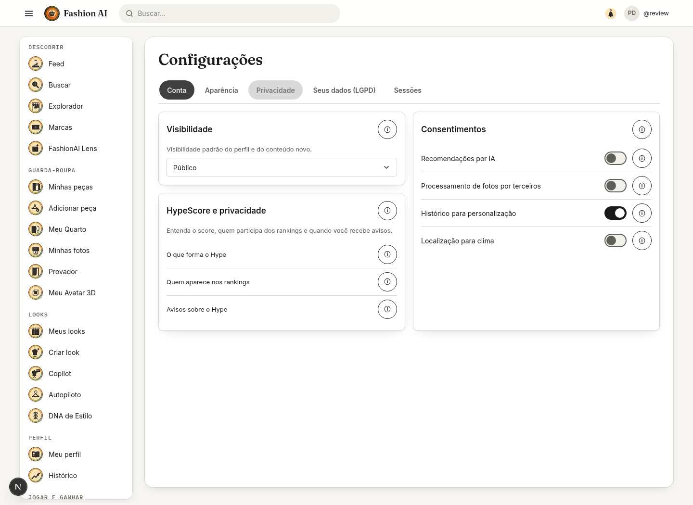
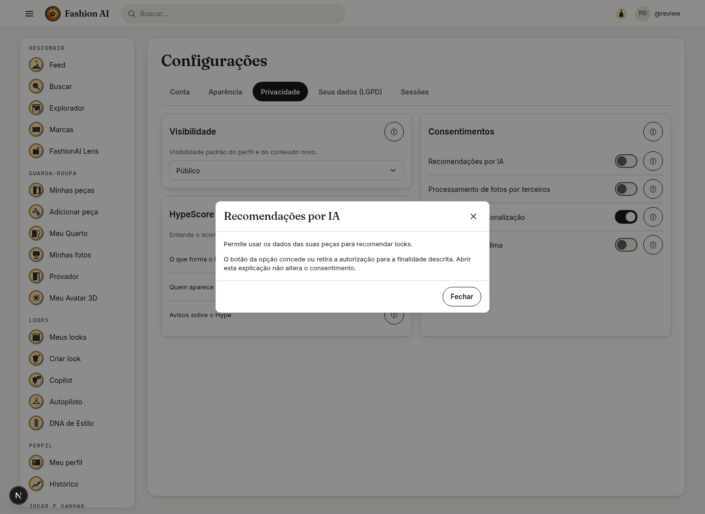
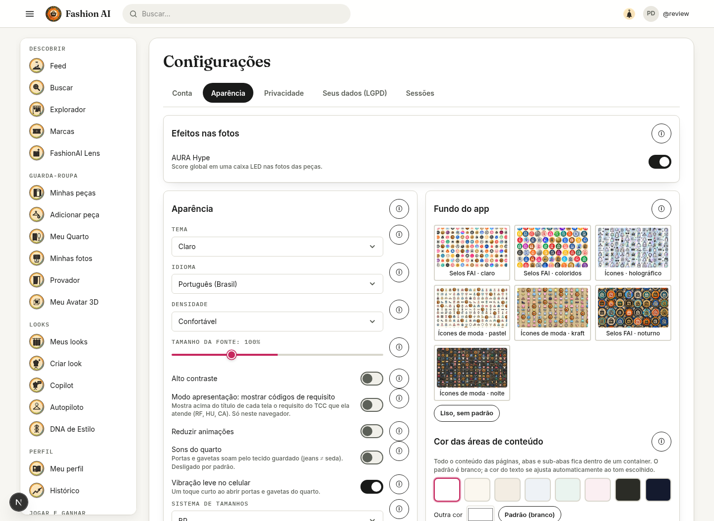

# Configurações e login em duas etapas

Configurações mantém as abas Conta, Aparência, Privacidade, Dados e Sessões. As funcionalidades têm botões de informação que abrem o Dialog padrão, com fechamento por Escape e retorno do foco. Consentimentos têm explicações individuais; abrir informação não concede autorização.

AURA Hype fica em Aparência, num bloco destacado. O switch usa a preferência visual local e sincroniza com a conta quando a API devolve o campo auraHype. Backend antigo que omite esse campo não desliga mais silenciosamente a preferência local. Falha de sincronização é indicada como aplicação apenas neste navegador, sem afirmar persistência remota.

Privacidade apresenta tópicos compactos de score, rankings e avisos; as explicações extensas ficam nos modais. O link técnico de método/pesos e o controle “Não aparecer em Criadores em alta” foram retirados da tela. Perfil privado continua excluindo os itens dos rankings públicos. Nenhuma autorização ou escolha de privacidade já armazenada foi alterada automaticamente.

Login reconhece DOIS_FATORES_NECESSARIO e details.twoFactorRequired emitidos pelo backend. O modal se chama “Verificação em duas etapas” e orienta inserir o código enviado por e-mail. O campo aceita preenchimento de código de uso único, mantém a etapa em caso de erro e oferece reenvio. Senha/identificador alterados descartam o desafio anterior. Os endpoints e controles de segurança do backend permanecem os mesmos.

Capturas abaixo usam perfil de revisão e API simulada; não representam dados de produção.

